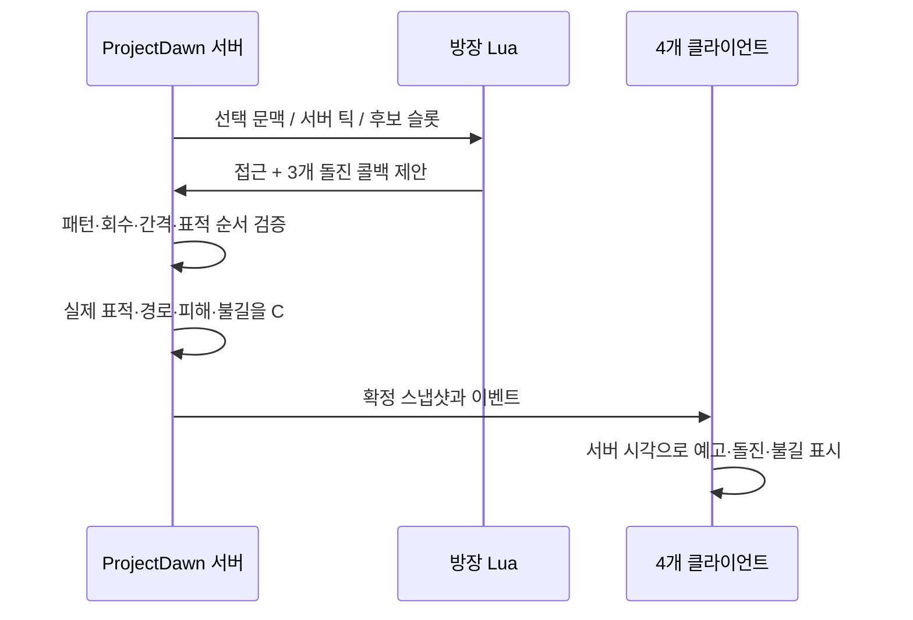

# 보스 AI · 멀티 전송 안정화 · AWS 기반 개발 인계

2026-10-18. 사용자가 요청한 추가 개발과 이후의 “지목 후 3회 돌진 + 짧고 약한 불길” 변경을 포함한다. 원작 DNF 코드가 이와 같다고 주장하는 자료가 아니라 ProjectDawn 통합 데모에 새로 구현한 전투 규칙이다.

## 보스 행동

| 단계 | 최종 규칙 |
|---|---|
| 추적 | 같은 방의 살아 있는 표적을 따라 4.2유닛/초로 접근 |
| 지목 | 회차별로 플레이어를 지정하고 머리 위 표식과 회차 표시 |
| 예고 | 방향을 고정하고 0.8초간 바닥 경로 표시. 이때는 돌진 피해 없음 |
| 돌진 | 최대 14유닛/초, 최대 거리 9, 반경 0.8. 방 경계에서 멈춤. 기본 피해 38, 방어력 적용 |
| 반복 | 총 3회. 각 지목 시작은 162틱(2.7초) 간격. 지정 후보가 사망/다른 방이면 같은 방의 가까운 생존자로 대체 |
| 약한 불길 | 지나간 경로에 반경 0.6의 불길. 조각별 2.5초 뒤 소멸 |
| 불길 피해 | 캐릭터별 1초에 한 번 기본 3, 방어력 적용. 조각이 여러 개 겹쳐도 중복 틱 없음. 경직/밀려남 없음, 점프 회피 가능 |
| 이후 | 3회 및 회복 구간 종료 후 예약된 무력화/페이즈 전환 처리. 보스 사망/전투 종료는 즉시 종료 |

돌진 경로의 작은 불길과 기존 표식 메테오의 강한 방 전체 불바다는 별도 규칙이다. 기존 메테오 직격 최대 HP 95%, 불바다 최대 HP 20%/초, 16초 유지 규칙을 약하게 만들지 않았다.

### Lua와 서버의 역할

- 패턴 ID 8, 행동 kind 4, 전투 정의 209. 방 표식 ID 7 / 정의 208은 유지한다.
- 기본 제안 예시: `0,0,2;4,36,2;4,198,3;4,360,0`.
- 서버는 정확히 3회와 162틱 간격, 허용 후보 순서를 검사한다. 호스트가 속도/피해/범위를 패킷으로 임의 지정할 수 없다.
- 스냅샷 버전 9, 규칙 ID `dawn-lua-charge-trail-v10`. 구버전과 섞어 실행하지 않는다.
- `TargetId`와 캐릭터별 다음 화상 틱을 저장한다. 지연 입력에 따른 미확정 구간 재계산/복구에서도 같은 결과가 나온다.
- 화면 보정에서 이미 확정된 돌진으로부터 파생되는 불길을 투영하되 서버 HP를 수정하지 않는다.

관련 소스: [Lua](Lua/bakal_patterns.lua), [허용 행동 검증](Packages/com.projectdawn.combat/Runtime/Content/BossPatternProgram.cs), [보스 행동](Packages/com.projectdawn.combat/Runtime/Content/RaidSimulation.BossProgram.cs), [피격/불길](Packages/com.projectdawn.combat/Runtime/Content/RaidSimulation.cs), [Unity 표시](UnityClient/Assets/Scripts/RaidDemoApp.BossAi.cs).

## 멀티 전송 안정화

TCP 송신 완료가 요청한 전체 버퍼를 보냈다는 가정 때문에 짧은 송신에서 뒤쪽 데이터가 사라질 수 있었다. 전송한 바이트만 큐에서 소비하고 남은 조각의 오프셋을 이어서 보내도록 수정했다.

- 대기 중/송신 중 데이터를 합쳐 연결당 4MiB로 제한한다. 느린 클라이언트가 계속 읽지 않으면 해당 연결을 종료한다.
- 한 송신 묶음은 최대 256KiB/64조각. 동기 완료는 루프로 처리해 재귀 콜백 누적을 막는다.
- 종료 후 새 송신을 쌓지 않고, 프레임 길이가 ushort 헤더 범위를 넘으면 중단한다.
- 수신된 TCP 조각을 재조립하는 기존 방식은 유지한다. 실제 작은 소켓 버퍼와 512KiB 전송으로 순서/누락을 확인했다.
- Unity 전송을 Stream 기반으로 바꿔 평문 개발 접속과 TLS 접속이 같은 패킷 처리 경로를 쓴다.
- 채널 목록은 C_ChannelList(53)/S_ChannelList(54)로 전달하므로 외부에 관리 HTTP 포트를 노출하지 않는다.

관련 소스: [Session](Server/ServerCore/Session.cs), [클라우드 클라이언트](Client/CloudTransport.cs), [게이트웨이](CloudGateway/Gateway.cs).

## AWS 진행 상태

.NET 10 / EF Core 10 서버, 계정별 초대 인증/TLS 게이트웨이, Linux x64 실행 ZIP, CloudFormation과 systemd 시작 스크립트를 만들었다. 세부 배포 순서, 인증서/비밀 값/DB 초기화/비용 관리는 [Cloud/README.md](Cloud/README.md)에 있다.

**AWS 자원 생성·업로드는 하지 않았다.** 계정/리전/예산과 도메인 인증서가 필요하다. 현재 Windows에서 새 런타임을 실행했고, Linux용 바이너리는 크로스 퍼블리시했다. 실제 Linux 부팅·RDS 연결·외부 4PC 접속은 아직 검증하지 않았다.

## 자동 검사

| 검사 | 통과 개수 | 범위 |
|---|---:|---|
| AiTests | 22 | 3회 지목/간격, 예고 무피해, 측면 회피, 경계, 다른 방 격리, 약한 불길 중복 방지/소멸, 스냅샷/서버 거절 |
| TransportTests | 7 | 부분 송신, 큐 제한, 실제 TCP 조각 재조립/대용량 무결성 |
| LuaTests | 50 | Lua/C# 선택 계약, 샌드박스, 조작 제안 거부, 메테오/표식 |
| ContentTests / RoomTests | 77 / 72 | 기존 스킬·장비·3×3 방·표식 기믹 |
| TimelineTests / ClockTests | 53 / 20 | 예측·확정 화면 시각과 입력 시계 |
| NetworkTests | 37 | 실제 TCP/UDP, 4인 매칭/전송/권한 경로 |
| FlowTests | 21 | 실제 SQL 로그인/장비/코디/채널/4인 입퇴장 |
| CloudTests | 10 | TLS 양방향 패킷, 잘못된 키/인증서/계정 사칭 및 대소문자 중복 접속 거부 |

인프라 템플릿은 서울 리전 cfn-lint 검사, 시작 스크립트는 구문 검사를 통과했다. 이 검사를 AWS 배포 성공이나 부하 처리량 측정으로 해석하지 않는다.

## 아직 남은 작업

1. 비방장 3분 재접속과 원래 슬롯 복구/세션 세대 변경. 끊긴 동안 피격 가능, 기한 만료 시 제거.
2. 직접 나가기의 즉시 퇴장·재입장 금지.
3. 정상 클리어 SQL 보상/중복 방지 및 재접속·만료·클리어 경합 검사.
4. AWS 실제 배포, Linux/RDS/복구 검증, 친구들의 물리 PC 4대와 다른 회선 테스트.
5. 여러 파티/장시간 부하, 중앙 로그·운영 알람, 초대 키 자동 만료/발급 관리.

재접속·보상은 이번 TCP 안정화/TLS만으로 완성되지 않는다. 최종 체크 상태는 [DEVELOPMENT-CHECKLIST.md](DEVELOPMENT-CHECKLIST.md)를 기준으로 이어간다.

## 시연 도구 수정

자동 시연은 실제 플레이어 입력만 보낸다. 돌진 옆으로 피할 위치를 현재 캐릭터 위치가 아닌 잠긴 돌진 경로의 수직 거리로 계산하도록 보완했다. 기존 각성 스킬의 무적 시간이 남아 있을 때 자동 대시로 각성을 취소하지 않도록 했다. HP 증가, 연습 무적, 서버 판정 우회는 사용하지 않았다.

- `flow-4p-20261018-142903`: 3연속 돌진/불길 자체 8개 및 방 기믹 21개 검사는 통과했지만 자동 시연 회피가 부족해 전멸했다. 전체 회귀 성공 기록으로 사용하지 않는다.
- `flow-4p-20261018-143232`: 90초 전투/4인 귀환·전투·방/돌진 검사는 통과했으나, 시연 자동 대시가 진각성을 취소해서 진각성 영상 비교 조건을 만족하지 못했다. 이 결과를 진각성 동시 재생 검증 성공으로 표시하지 않는다.
- `flow-4p-20261018-143714`: 최종 수정 빌드. 아래 검사를 모두 통과했다.

## 최종 4인 시연 — 14:37 실행

실제 Unity 클라이언트 4개와 .NET 10 서버, 기존 SQL DB로 실행했다. 한 PC에서 방향별 30ms 지연을 넣었으며, 물리 PC 4대/인터넷 환경 검증은 아니다. 일반 입력으로 약 90초 전투 후 `PartyReturn_NoRewards`로 마을에 복귀했다. 클리어 보상 테스트가 아니다.

| 최종 검사 | 결과 |
|---|---|
| 전투/시각 26개 | 모두 통과. 공통 확정 상태 181개와 콘텐츠 이벤트 396개 일치, 입력 거절/Unity 오류 0 |
| 흐름/SQL 12개 | 모두 통과. 로그인→마을→4인 매칭→레이드→귀환, 저장된 코디 복원 |
| 방/표식/HUD 21개 | 모두 통과. 2인 교대 표식, 다른 방 운반, 이전 불바다와 다음 표식 중첩 |
| 돌진/불길 8개 | 모두 통과. 완전한 3연속 돌진 3묶음, 1·2·3회 예고/표적 표시와 불길 생성·소멸 촬영 |
| 컷신/원격 연출 10개 | 모두 통과. 본인 진각성 컷신 13프레임 동안 타인 컷신 없음, 원격 스킬 계속 진행 |
| 메테오 점프 | 화면상 안전한 점프 23/23 서버 회피 확정. 충돌/충격파 활성 시각 96건 서버 틱 일치 |

네 화면은 실제 JPEG 촬영 시각을 맞춰 합성했다. 전체 89.58초 무음 영상, 별도 돌진 12초·진각성 13초 영상이다. 전체 최근접 프레임 오차 최대 246.35ms, 컷신 비교 최대 51.92ms, 돌진 정지 화면 최대 21.67ms다. 서버 틱 차이를 보정한 원격 행동 시간 오차는 약 0.004ms였으며, 이는 영상 촬영 지연이나 네트워크 지연이 0이라는 뜻이 아니다.

- 시연 모음 (`Artifacts/flow-4p-20261018-143714/video/index.html`, 로컬 검증 자료)
- 3연속 돌진 4인 영상 (`Artifacts/flow-4p-20261018-143714/video/boss-charge-four-players.mp4`, 로컬 검증 자료)
- 지목/예고 스크린샷 (`Artifacts/flow-4p-20261018-143714/video/charge-four-views.jpg`, 로컬 검증 자료) · 짧은 불길 스크린샷 (`Artifacts/flow-4p-20261018-143714/video/short-charge-fire.jpg`, 로컬 검증 자료)
- 전투 (`Artifacts/flow-4p-20261018-143714/verification.json`, 로컬 검증 자료) · 흐름/SQL (`Artifacts/flow-4p-20261018-143714/flow-verification.json`, 로컬 검증 자료) · 방/HUD (`Artifacts/flow-4p-20261018-143714/rooms/verification.json`, 로컬 검증 자료) · 돌진 (`Artifacts/flow-4p-20261018-143714/charge-verification.json`, 로컬 검증 자료) · 진각성 (`Artifacts/flow-4p-20261018-143714/video/verification.json`, 로컬 검증 자료)
- [Windows 실행](Build/Start-ProjectDawn.cmd): `Build` 폴더 전체가 필요하다. 구버전과 섞지 않는다.
- Linux 서버 패키지 (`Artifacts/cloud-release-20261018-142934/release.zip`, 로컬 검증 자료): Windows에서 크로스 퍼블리시한 파일이며 AWS/Linux 실행 검증은 아직이다.

다음 개발은 기존에 확정한 **3분 재접속·직접 퇴장 → SQL 보상/종료 경합**을 우선 이어간다. AWS 실제 배포에는 계정·리전·예산·인증서/도메인이 필요하다. 배포나 외부 4PC 검증까지 완료했다고 표시하지 않는다.
