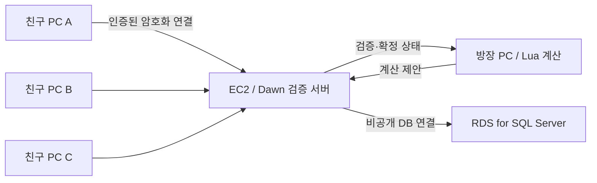

> 2026-10-18 갱신: 런타임·TLS 초대 인증·채널 패킷·AWS 템플릿의 구현이 시작됐다. 현재 사용 방법은 [Cloud/README.md](Cloud/README.md), 미완료 범위는 [개발 체크리스트](DEVELOPMENT-CHECKLIST.md)를 먼저 확인한다. 아래는 초기 설계 기록이며 AWS 자원은 아직 생성하지 않았다.

# 친구 초대 테스트와 AWS 확장 계획

2026-10-18 · 계획만 작성, AWS 리소스 생성·과금·배포는 하지 않았다.

## 유지할 구조

방장 PC가 Lua 패턴을 계산하고 ProjectDawn 서버가 C#으로 검증·확정한다. 참가자들은 서버에 연결한다. 방장에게 직접 접속하는 P2P 연결이나 공유기 포트 개방을 요구하는 구조로 바꾸지 않는다. SQL의 캐릭터·장비·코디는 중앙 서버가 읽고 쓰며, 게임 클라이언트에는 DB 자격 증명을 전달하지 않는다.

## 제안하는 순서

| 단계 | 개발 내용 | 완료 기준 |
|---|---|---|
| 1. 접속 기반 | 지원 중인 .NET LTS로 서버 갱신, 서버 주소/리스닝 주소 설정 분리, 클라이언트 버전 검사 | 로컬 전체 회귀 통과, 서로 다른 두 PC에서 같은 SQL 캐릭터 복원 |
| 2. 친구용 인증 | 현재 계정 ID만으로 로그인하는 개발 방식을 대체. 초대 계정 로그인·만료 세션·중복 캐릭터 접속 정책, 요청 빈도 제한, TLS 인증서 검증 | 다른 사람 계정 ID만 알아서는 접속 불가, 잘못된 인증서/세션 거부 |
| 3. AWS 시험 서버 | EC2 게임 서버 + 비공개 RDS SQL Server, 최소 접근 권한, 비밀 값 분리, DB 백업/복원, 서버 로그와 장애 재시작 | 서버 재시작·DB 복원 후 캐릭터/장비/코디 유지 |
| 4. 친구 4인 테스트 | 배포용 클라이언트에 서버 주소 제공, 빌드 버전 일치, 다른 인터넷 회선 네 개에서 전투 | 로그인→마을→매칭→레이드→복귀, 코디 일치, 지연·일시 단절·방장 이탈 검사 |
| 5. 운영 확장 | 비방장 3분 재접속, 영속 보상, 여러 파티 격리와 서버 용량 측정 | 파티 간 상태 혼선 없음, 보상 중복 없음, DB 지연이 전투를 막지 않도록 처리 |

현재 `FlowHost`는 루프백 TCP 28182에만 바인딩하며 로그인에는 비밀번호 검증이 없다. 따라서 현재 빌드를 그대로 공개 포트에 연결하는 것을 첫 배포 작업으로 삼지 않는다. 인증과 연결 암호화를 먼저 붙이는 것은 현 코드의 구체적인 제약에 따른 순서다.

초기 AWS 형태는 위 EC2 + RDS를 제안한다. 운영체제·인스턴스 크기·리전·운영 시간은 런타임 이전과 4인 부하 측정 뒤 정한다. RDS를 쓴다고 현재 LocalDB가 자동으로 옮겨지는 것은 아니므로 별도 시험 DB를 준비하고 스키마·필요한 테스트 데이터만 이전한다. 월 비용은 그때 실제 요금으로 산정하고 종료 일정·예산 알림도 함께 정한다.

DB는 공개 접속 없이 게임 서버에서만 접근하도록 구성한다. AWS는 RDS의 VPC/보안 그룹을 통한 접근 제한과 SSL/TLS 연결을 지원한다. [RDS 보안 문서](https://docs.aws.amazon.com/AmazonRDS/latest/UserGuide/UsingWithRDS.html), [SQL Server 암호화 연결](https://docs.aws.amazon.com/AmazonRDS/latest/UserGuide/SQLServer.Concepts.General.SSL.Using.html).

GameLift는 여러 세션의 서버 수명주기와 용량 관리가 필요할 때 비교할 후속 선택지다. 도입 시 서버 SDK의 초기화·준비 완료·세션 시작/종료 연동이 추가된다. 기존 Dawn 매칭 코드를 자동으로 대신해 주는 것으로 가정하지 않는다. [GameLift 서버 SDK 통합](https://docs.aws.amazon.com/gameliftservers/latest/developerguide/gamelift-sdk-server-api.html).

## 다음 대화에서 시작할 작업

우선 서버 런타임 갱신과 친구용 인증 설계를 구체화한다. 현재 SQL 코디 저장을 유지하면서 외부 접속용 주소 설정, TLS, 버전 협상을 구현하고 로컬 두 PC에서 확인한 뒤 AWS 시험 배포로 진행한다. 다음 구현에 필요한 정책은 초대 계정 발급 방식과 동일 캐릭터 중복 접속 처리다.
