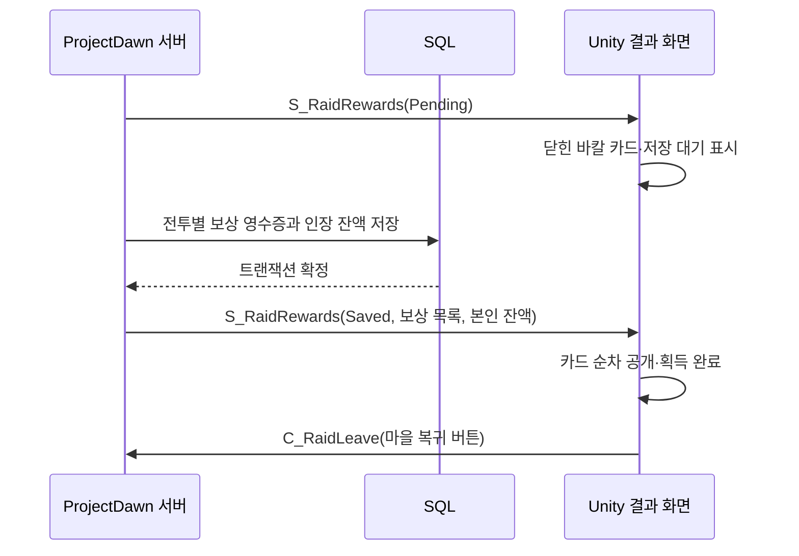

# 바칼 레이드 결과 화면 리소스와 통합 UI

## 실제로 확인한 원본

설치본 `D:/Games/DNF/ImagePacks2/sprite_contents_2022_bakalraid_ui_bakal_reward.NPK`를 읽었다. 게임 설치 폴더에는 쓰지 않았다.

REA `open_binary`에 이 파일을 지정했으나 `unsupported_target / file_format_rejected`가 반환됐다. NPK는 현재 제공자의 지원 형식이 아니어서 기존 프로젝트에 보관한 PyDnfEx NPK/IMG 디코더로 멤버와 프레임을 해석했다. **REA가 원본 결과 화면 코드를 복원했다는 뜻은 아니다.**

| 원본 멤버 | 확인한 내용 | 통합판 사용 |
|---|---|---|
| `bakal_reward/bakal_reward.img` | 용 문양 카드판, 금색 테두리, `기계 혁명 성공` 글자, 배경, 문양 | 제목·배경·카드판·본인 보상 테두리 |
| `bakal_reward/card_my.img` | 본인 카드의 용 문양과 붉은 화염 공개 프레임 | 본인 카드 공개 |
| `bakal_reward/card_etc.img` | 다른 참가자 카드의 같은 계열 공개 프레임 | 파티원 카드 공개 |
| `bakal_reward/back_loop.img` | 붉은 연기·불티 배경 | 결과 화면 배경 반복 |
| `bakal_reward/title.img` | 제목 위아래 장식 | 제목 장식 |

원본 카드가 세로 카드가 아닌 **가로로 긴 카드**임을 실제 프레임에서 확인했다. 카드 자체의 용 문양·장식·애니메이션 그림은 원본이며, 통합판의 4장 배치·공개 시간·문구는 이 프로젝트용 구현이다. 원작의 12인 결과 배치나 프레임별 원래 재생 시간까지 복구한 것은 아니다.

원본 카드 접촉 시트 (`Artifacts/bakal-reward-reference/card_my-contact.jpg`, 로컬 검증 자료), UI 부품 접촉 시트 (`Artifacts/bakal-reward-reference/bakal_reward-contact.jpg`, 로컬 검증 자료), 멤버·프레임 인벤토리 (`Artifacts/bakal-reward-reference/inventory.json`, 로컬 검증 자료).

공식 [바칼 업데이트 보상 안내](https://df.nexon.com/community/news/update/2725621)도 검색해 교차 참고했다. 인터넷에서 발견한 일반 개전 보상 화면이나 레이드 상점 화면을 바칼 레이드 결과 화면으로 잘못 사용하지 않았다. 외부 이미지 파일을 내려받아 사용하지 않았다.

## 가져온 리소스

`Tools/ImportBakalRewards.py`가 원본 IMG의 좌표·캔버스 크기를 유지해 **103개** PNG를 `UnityClient/Assets/Resources/DawnRewards`에 만든다. 색상 변환·검정색 제거 없이 원본 RGBA를 보존한다. 원본 NPK SHA-256, IMG 멤버 SHA-256, 프레임 인덱스, 출력 PNG SHA-256은 `Tools/bakal-reward-asset-provenance.json`에 기록한다.

## 서버 보상과 화면의 연결



보상은 **서버가 보낸 영수증**만 표시한다. 카드를 열거나 버튼을 눌러 클라이언트에서 재화를 더하는 코드는 없다. Pending에서는 지급 완료·수량을 먼저 표시하지 않으며 복귀 버튼도 비활성화한다. Saved를 받은 뒤 같은 전투의 늦은 Pending이 들어와도 화면을 저장 대기로 되돌리지 않는다.

`폭룡왕의 인장 100`은 이 데모의 지급 규칙이다. 원작의 실제 지급 수량·주간 제한·보상 경제와 동일하다는 의미가 아니다. 재화 표시의 작은 용 문양은 보상 카드 원본의 문양을 재사용한 것으로 원작 인장 아이템 아이콘을 복원한 것은 아니다.

후속 개발로 인장과 함께 장비 1개도 지급한다. 근원을 삼킨 무기 5종 중 서버가 선택하며 공식 장비사전의 이름과 원본 아이콘을 연결했다. SQL 영수증과 실제 소유 Item 행을 같은 트랜잭션에 저장한다. 성공 제목은 투명 캔버스가 아닌 실제 글자 영역 238×44의 비율로 그려 세로로 길어지는 문제를 수정했다. [설명과 검증](LIFECYCLE-EQUIPMENT-REWARDS-20261018.md), 실제 SQL 결과창 (`Artifacts/rewards-4p-20261018-151719/p1/sql-saved-rewards.png`, 로컬 검증 자료).

History는 이전 저장 영수증을 보여주며 확인 버튼으로만 닫는다. 본인 카드에 테두리를 표시하고, 참가자의 닉네임 및 현재 전투에 남은 캐릭터가 있으면 같은 아바타 머리 그림을 표시한다. 없는 참가자 또는 보상 제외 참가자는 획득 카드로 표시하지 않는다.

## UI 검사 전용 실행

```powershell
./Build/ProjectDawnRaid.exe --reward-ui-preview --reward-preview-dir Artifacts/reward-ui-preview --reward-preview-exit
```

이 옵션은 네트워크·SQL에 접속하지 않는 **가상 데이터 시각 검사**다. 화면 상단과 `FIXTURE.txt`에 이를 명시하며 실제 보상 지급 검증의 근거로 사용하면 안 된다. 닫힌 카드와 열린 카드 PNG를 Unity의 실제 화면 캡처로 저장한다. 실제 SQL/4인 지급 검증은 별도의 실행 기록을 따른다.
