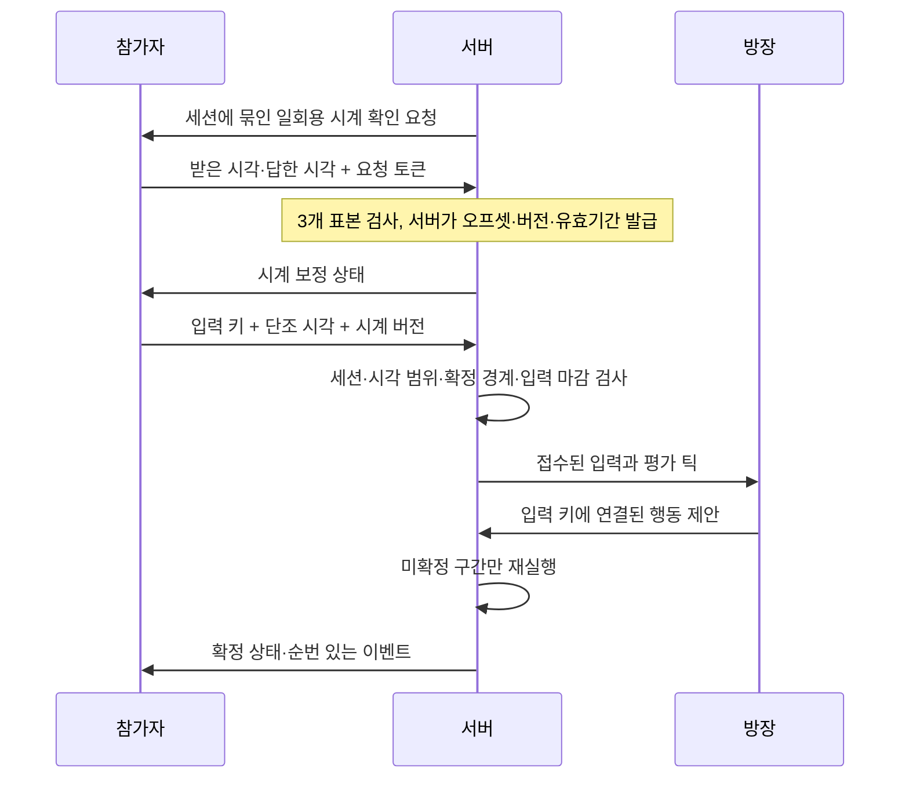

# 입력 시각 동기화와 제한된 지연 보상

2026-10-18 / 개발 사본 `E:\task\ProjectDawnIntegration`

## 이번 단계에서 달라진 점

이전 Unity 빌드는 모든 입력을 서버 도착 시각으로 평가했다. 이번에는 서버가 연결별 왕복 시간을 측정하고 시계 대응 관계를 발급한다. 허용된 범위 안에서 늦게 도착한 입력은 원래 입력 틱에 배치하며, 기존 미확정 구간 재실행으로 점프·피해·넉백과 후속 행동을 다시 검증한다. 이미 확정된 상태는 바꾸지 않는다.

방장의 Lua 패턴 계산 및 행동 제안, 서버 C# 검증·확정 구조는 유지한다. 방장에게 클라이언트 시계 승인 권한을 주지 않았다.



## 구현 계약

| 항목 | 현재 동작 |
|---|---|
| 시계 | UTC 대신 각 프로세스의 단조 시계 사용 |
| 초기 상태 | 수신 시각 기준. 3개 유효 표본 확보 후 보정 활성 |
| 서버 권한 | 오프셋·신뢰 여부·입력 허용 폭은 서버가 결정. 클라이언트 선언값으로 설정하지 않음 |
| 왕복 제한 | 160ms 초과 표본, 과도한 클라이언트 처리 시간, 시각 역행·큰 변화는 보정 승인에 사용하지 않음 |
| 과거 입력 | `min(120ms, 측정 RTT/2 + 35ms)` 범위. 별도로 기존 입력 마감과 확정 경계도 검사 |
| 미래 입력 | 표본 오차 범위 안에서는 수신 시각으로 제한. 범위를 넘으면 거부 |
| 갱신 | 5초마다 재측정, 시계 승인 유효기간 15초. 최초 오프셋은 전투 동안 고정하고 큰 변화를 발견하면 기본 판정으로 복귀 |
| 불안정·만료 | 수신 시각 기준으로 처리하고 화면에 연결 보정 상태 표시 |
| 버전 | 연결별 최근 4개 대응 관계 보관. 큐에 들어온 입력은 그때 캡처한 불변 대응 관계 사용 |
| 중복 | 기존 입력 원장의 결정을 재사용. 갱신으로 이미 접수한 입력의 틱을 다시 이동하지 않음 |
| 인과 관계 | 시계 버전 변경으로 뒤 입력이 앞 입력보다 과거로 넘어가지 않도록 제한 |
| 즉시 입력 | 점프·대시·스킬은 이동 입력의 약 45ms 전송 묶음을 기다리지 않고 전송 |
| 기존 연결 | 기능 협상 없이 접속한 기존 클라이언트는 수신 시각 경로 유지 |

숫자는 이번 통합의 제한된 검증 설정이다. 모든 인터넷 환경에 적합한 제품 기본값으로 확정한 것은 아니다. 실제 키 입력의 물리 시각을 서버가 증명할 수는 없으므로 허용된 시간 범위 내 조작 가능성까지 완전히 제거했다고 주장하지 않는다.

## 주요 파일

- `Packages/com.projectdawn.combat/Runtime/ClockMapping.cs`: 표본 검증, 서버 시계 승인, 불변 대응 관계.
- `Contracts.cs`, `EncounterEngine.cs`: 연결별 버전 보관, 수신 순간 캡처, 입력 시각/만료/과거·미래 범위 검사.
- `Protocol/Raid.proto`, `Protocol/Protocol.proto`: 기능 협상과 시계 확인/응답/상태 메시지.
- `Server/Server/Session/ClientSession_Raid.cs`: 인증된 현재 세션에서만 시계 응답 처리.
- `Client/RaidNetworkClient.cs`: 단조 입력 시각, 요청 응답, 서버 발급 버전 사용.
- `UnityClient/Assets/Scripts/DawnRaidTransport.cs`: 즉시 전송, 입력 판정 기록, 화면 보정 상태.
- `ClockTests`, `NetworkTests`: 지연·위조·만료·메테오 재판정과 실제 소켓 검사.
- `Tools/DelayTcp.py`: 루프백 전용 양방향 지연 검증 도구.

## 재현

```powershell
cd E:\task\ProjectDawnIntegration
./Validate.ps1
./Build-Unity.ps1
./Play-Unity4.ps1 -Auto -Seconds 85 -NetworkDelayMs 30
python ./Verify-Unity4.py ./Artifacts/<실행폴더>
```

`NetworkDelayMs 30`은 각 방향에 30ms씩 추가하므로 기본 왕복 지연에 약 60ms가 더해진다. 실제 물리 LAN·공유기·인터넷을 측정한 값은 아니다. 프록시는 루프백에만 바인딩하며 게임의 패킷·권한 규칙을 우회하지 않는다.

## 완료한 검증

- 시계 검사 **20개**: 표본·오프셋 고정·만료·극단 시각·오래된 버전·중복·수신 후 큐 지연, 확정 경계 보호.
- **45ms 늦은 점프**로 잠정 피해·넉백을 취소하고 회피를 한 번 확정.
- **실제 콘텐츠의 100ms 늦은 점프 + 방장 행동 제안**으로 메테오 충격파의 잠정 피해를 취소하고 회피 이벤트 확정.
- 실제 TCP 네트워크 검사 **37개**: 네 연결의 시계 발급과 20ms 지연 입력의 이전 틱 유지, 위조 미래 시각 거부, 기본 판정 호환성 포함.
- 전체 회귀 통과: .NET 8/3.1 코어 각각 26개, Lua/메테오 20개, 콘텐츠 28개, 기존 서버 회귀. Unity 빌드와 기존 모션/원본 리소스 검사 통과.
- 실제 Unity 프로세스 네 개, **85초**, 방향별 30ms 추가 지연. 최종 측정 RTT **61.0–62.2ms**. 시계 보정을 사용해 접수된 입력 총 **7005개**, 초기 기본 판정 **4개**.
- 자동 검증 **21개 모두 통과**. 공통 확정 스냅샷 171개·콘텐츠 이벤트 접두열 338개 일치. Unity 오류·입력 거절 0.
- 네 클라이언트 모두 21개 SkillId, 메테오 점프 회피 확인. 메테오 4묶음 모두 네 발·87틱 간격이며 착지와 충격파는 같은 틱.
- 측정 종료 시 전투 진행 중. 클리어·보상 검증이 아니다.

검증 JSON (`Artifacts/unity-4p-20261018-030452/verification.json`, 로컬 검증 자료) · 전체 검사 로그 (`Logs/clock-full-validation.log`, 로컬 검증 자료)

（화면 자료: 지연을 추가한 실제 Unity 네 화면 — Notion 참조）

앞선 `unity-4p-20261018-030233`의 100초 실행은 최종 기록 저장 전 창이 종료되어 완료 근거에 사용하지 않았다. 종료 원인은 확정하지 않았으며 위 85초 실행의 저장된 결과로 검증했다.

## 후속 범위

- 이후 보스 예고·낙하 표시를 추정 서버 현재 틱에 맞추고 입력 ACK를 개인 예측 재생에 연결했다. 최신 구현과 실제 4인 지연 검증 결과는 [표시 시간 통합 문서](PRESENTATION-TIMELINE-INTEGRATION.md)를 참조한다. 이 문서 위의 수치는 이전 입력 시계 단계 기록이다.
- 운영 로그인/DB·마을 화면 전체 연결, 물리 LAN 검증, 3분 재접속·영속 보상은 남아 있다.
- 지연이 허용 폭을 넘으면 과거 판정을 무제한 수정하지 않는다. 확정된 피해·사망은 되돌리지 않는다.
