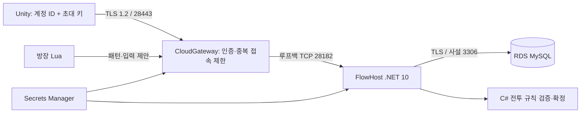

# AWS 친구 테스트 배포 준비 — MySQL 전환 반영

**최신 접속 방식은 게임 회원가입/로그인이다.** 계정·캐릭터 설계 및 검증 (`../MEMBER-ACCOUNTS-20261018.md`, 로컬 검증 자료), [단일 VM 회원 서버 배포안](freevm/README.md)을 따른다. 아래 초대 키·RDS·Secrets Manager 방식은 이전 별도 배포안이다. 회원 서버에서는 초대 키를 배포하지 않는다.

**2026-10-18 무료 플랜 확인 후 진행 경로:** [무료 플랜 확인 및 최소 서버 준비](AWS-FREE-PLAYTEST-20261018.md)를 먼저 따른다. 계정은 Free plan / 잔액 $100으로 확인했다. 아래 RDS·Secrets Manager 포함 템플릿은 별도 배포안이며 이번 무료 친구 테스트에 그대로 실행하지 않는다. 친구용 클라이언트 패키지는 `Build-PlaytestClient.ps1`로 별도 생성한다.

2026-10-18 후속 변경: 기본 DB는 MySQL이다. 전환/검증 기록 (`../MYSQL-INTEGRATION-20261018.md`, 로컬 검증 자료). 이전 SQL Server 릴리스는 새 MySQL 배포에 사용하지 않는다. AWS 자원은 아직 생성하지 않았다.

2026-10-18. 이 폴더는 배포 코드다. AWS 계정에 스택·EC2·RDS를 생성하거나 파일·비밀 값을 업로드하지 않았다. 현재 검증은 Windows의 .NET 10 서버 및 TLS 소켓, Unity 4프로세스와 Linux x64 크로스 퍼블리시까지다. 실제 Amazon Linux 실행, RDS 연결/복구, 외부 회선 테스트는 배포 후 확인해야 한다.

## 연결 구조



- 기존 TCP 패킷을 TLS 안에서 전달한다. UDP/공유기 포트포워딩은 이 경로에 필요하지 않다.
- 공개 포트는 28443 하나다. 28182와 채널 관리 HTTP 8090은 루프백에 남는다. 채널 목록은 새 `C_ChannelList/S_ChannelList` 게임 패킷으로 요청한다.
- 계정별 256비트 난수 초대 키를 배포한다. 서버에는 SHA-256 해시만 저장하고 고정 시간 비교로 검증한다. 초대 키는 현재 친구 테스트용 인증이며, 정식 계정/비밀번호 복구 서비스는 아니다.
- 게이트웨이 인증 계정과 `C_Login.UniqueId`가 일치해야 한다. 동일 계정 동시 접속은 새 연결을 거절한다. SQL의 일반적인 대소문자 비구분 정책에 맞춰 대소문자만 다른 초대 계정 중복도 허용하지 않는다. 키는 클라이언트 PlayerPrefs, 코드, 로그에 저장하지 않는다.
- 인증 제한 8초, 연결 슬롯 32개, 연결당 600 패킷/초, 부분 패킷 완성 제한 10초, 수신 없는 연결은 10분 뒤 정리한다. 이런 제한은 부하 용량 검증 결과가 아니다.
- 클라이언트는 OS 인증서 체인 및 서버 이름을 검증한다. 인증서 검증을 무조건 통과시키는 콜백은 없다. 원격 평문 접속과 평문 초대 키 전송은 거부한다.

## 빌드

통합 루트에서 PowerShell 7:

```powershell
./Cloud/Build-Cloud.ps1
```

`-Dotnet`으로 .NET 10 SDK 경로를 바꿀 수 있다. 현재 작업 전용 SDK는 `dotnet`다. 시스템 SDK/환경변수는 바꾸지 않았다.

산출물은 `Artifacts/cloud-release-시간/release.zip`과 `manifest.json`이다. 서버·게이트웨이는 Linux x64 self-contained로 퍼블리시된다. 클라이언트 스프라이트, 사용자 SQL 데이터, 인증 키/PFX는 패키지에 넣지 않는다. 원래 로컬 3.1 빌드는 호환 분기로 남아 있으며, AWS 빌드는 `-p:DawnCloud=true`로 .NET 10 / EF Core 10.0.13을 사용한다.

## 아직 필요한 배포 값

AWS 프로필/계정, 리전, 월 예산, 알림 이메일, S3 릴리스 버킷, 친구의 공인 IP/CIDR, 게임 도메인 및 그 이름에 유효한 PFX 인증서가 필요하다. 비밀 키/DB 암호/초대 키는 채팅이나 Git에 넣지 않는다. 현재 서울 리전 스키마 검사만 했으며 리전·예산이 확정된 것은 아니다.

1. S3 비공개 버킷에 `release.zip`을 올린다. 기본 예시는 SSE-S3다. 자체 KMS 키를 쓴다면 해당 키에 한정한 복호화 권한도 별도로 추가한다.
2. `aws-playtest.json`으로 **변경 세트부터 생성하고 비용·자원·보안 그룹을 검토**한다. `ArtifactSha256`은 manifest의 값이다. `AllowedClientCidr` 기본값은 127.0.0.1/32이므로 실제 친구 접속 전 값 변경이 필요하다.
3. 생성되는 것은 VPC, 인터넷 연결 서버 서브넷, 인터넷 경로 없는 DB 서브넷 2개, EC2, 고정 IP, 사설 RDS MySQL, 비밀 값 2개, SSM IAM 역할, 월 비용 알림이다. DB 삭제 방지와 7일 백업, 교체/삭제 시 스냅샷 정책을 넣었다. SSH·SQL·관리 HTTP는 인터넷 인바운드 규칙이 없다.
4. `AppSecretArn`은 처음에는 `configured:false`다. 서비스는 설정 전에는 실패 후 재시도하며 계정 이름만 받는 서버를 공개하지 않는다.
5. 운영자 권한으로 **새 테스트 DB만** 초기화한다. 관리자 DB 연결 문자열은 해당 초기화 프로세스 환경에만 전달하고 `PROJECT_DAWN_DB_PROVIDER=MySql`과 `PROJECT_DAWN_CONFIG_PATH`를 릴리스 설정 파일로 지정한 후 `server/FlowHost --initialize-empty-database`를 실행한다. MySQL 경로는 포함된 초기 DDL을 적용하고 스키마를 읽어 검증한 뒤 종료한다. 기존 DB를 삭제하거나 마이그레이션하지 않으며, 운영 중 DB 업그레이드 도구로 사용하지 않는다.
6. 별도의 게임 전용 SQL 로그인/DB 사용자를 만들고 프로젝트 DB의 읽기·쓰기 권한만 준다. 런타임 앱 비밀에는 관리자 계정을 넣지 않는다. EC2 역할은 DB 관리자 비밀을 읽을 수 없다.
7. 게임 도메인을 고정 IP로 연결하고 OS가 신뢰하는 체인의 해당 도메인 PFX를 준비한다. RDS 인증서 번들은 EC2 초기화에서 설치한다. DB 연결은 RDS의 실제 엔드포인트를 사용하고 `SslMode=VerifyFull`과 RDS CA 번들 경로를 지정한다.
8. AppSecret을 아래 **형태**로 채운다. 실제 값은 Secrets Manager에서 관리한다.

```json
{
  "configured": true,
  "dbProvider": "MySql",
  "connectionString": "Server=<RDS endpoint>;Port=3306;Database=projectdawn;User Id=<game login>;Password=<secret>;SslMode=VerifyFull;SslCa=/etc/pki/ca-trust/source/anchors/amazon-rds.pem",
  "tlsPfxBase64": "<PFX file encoded as base64>",
  "tlsPassword": "<PFX password>",
  "invites": { "friend_1": "<64-character SHA256 hex>" }
}
```

9. SSM 관리 세션에서 `systemctl restart dawn-server dawn-gateway`를 실행한다. `journalctl -u dawn-server -u dawn-gateway`로 확인한다. 초기화 스크립트는 비밀 JSON/연결 문자열을 출력하지 않는다. 로컬 저널은 200MB/7일 제한이다. 중앙 CloudWatch 수집/알람 및 백업 복원 훈련은 후속 작업이다.
10. 친구는 `Build/Start-ProjectDawn.cmd`로 로그인 UI를 열고 계정 ID, `tls://game.example.com`, 포트 `28443`, 자기 초대 키로 접속한다. 자동 실행 때는 키 자체를 명령행에 넣는 대신 `--invite-file <개인 파일 경로>`를 사용한다.

## 초대 키 발급

```powershell
./Cloud/New-PlaytestInvite.ps1 -Accounts friend_1,friend_2,friend_3,friend_4
```

기본 출력은 `%LOCALAPPDATA%/ProjectDawn/Invites`이며 현재 Windows 사용자에게만 디렉터리 접근 권한을 부여한다. 각 `.invite` 파일은 당사자에게 전달할 원문 키, `invites.hashes.json`은 서버용 해시 목록이다. 기존 계정을 자동으로 덮어쓰지 않는다. 키 폐기/교체는 해시 목록을 변경하고 게이트웨이를 재시작하는 수동 운영 방식이다. 자동 만료·발급 UI는 아직 없다.

## 비용과 종료

`BudgetUsd`/`BudgetEmail`은 반드시 전달해야 한다. 예산 알림은 **과금 차단 상한이 아니다**. EC2+RDS+고정 IPv4+스토리지/스냅샷+Secrets Manager 비용을 리전별로 산정한 뒤 생성한다. 아직 월 비용 견적이나 실제 배포 금액을 확정하지 않았다. DB 삭제 방지, 보존된 비밀과 스냅샷 때문에 스택 삭제만으로 모든 과금 항목이 없어지지 않을 수 있다. 시험 종료 시 DB 보존 여부와 삭제 방지 해제, 스냅샷·비밀·S3 파일·고정 IP 정리를 각각 확인한다.

## 검증 근거와 후속 범위

- `CloudTests`: 실제 TLS 소켓, 계정 바인딩/중복 접속, 잘못된 키/인증서 거부 10개 검사.
- `cfn-lint`: 서울 리전 CloudFormation 스키마 검사 통과. AWS API의 실제 create/update 성공을 뜻하지 않는다.
- Linux x64 self-contained 퍼블리시 완료. Linux 실행/인프라 초기화는 아직 실행하지 않았다.
- 3분 재접속, 만료 제거, 직접 퇴장, 정상 클리어 SQL 보상, 만료와 보상 경합은 별도 미완료다. 친구에게 공개하기 전에 우선 마무리할 항목이다.

공식 참고: [.NET 지원 정책](https://dotnet.microsoft.com/en-us/platform/support/policy/dotnet-core), [RDS CloudFormation](https://docs.aws.amazon.com/AWSCloudFormation/latest/TemplateReference/aws-resource-rds-dbinstance.html), [RDS SQL Server TLS](https://docs.aws.amazon.com/AmazonRDS/latest/UserGuide/SQLServer.Concepts.General.SSL.Using.html), [Amazon Linux AWS CLI](https://docs.aws.amazon.com/linux/al2023/ug/awscli2.html).

MySQL 전환 후 RDS 엔진 버전·인스턴스 클래스·리전 지원 여부와 예산은 실제 배포 시 다시 확인한다. 로컬 TLS Required는 외부 배포용 VerifyFull 검증을 대체하지 않는다.
