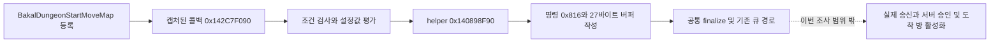

# DNF 방 이동 조사와 ProjectDawn 3×3 설계 근거

2026-10-18 · 읽기 전용 정적 조사

**원본에서 바칼 이동 관련 콜백이 요청을 작성하는 경로까지 새로 연결했다.** 그러나 방별 상태의 서버 저장 방식, 승인 응답, 3×3 배치, 표식 메테오의 원본 스크립트는 복원하지 못했다. ProjectDawn의 3×3 방과 방장 계산·서버 검증은 사용자의 요구를 구현하는 독립 설계다.

## 조사 도구와 범위

- REA 스킬을 읽고 REA 6.5.0 `binary_session`과 `get_evidence_bundle(detail=summary)`를 호출했다. 현재 retained Evidence는 0개이며, Ghidra/IDA 미설정, Hopper Windows 미지원이었다. [현재 REA 상태](Research/dnf-rooms/rea-status.json)
- 따라서 기존 보고서의 동일 파일 분석을 재사용하고 Python PE 메타데이터 파서와 Microsoft `dumpbin`으로 좁은 코드 범위를 추가 검사했다. **아래 새 결과는 REA 디컴파일 Evidence가 아닌 `LOCAL-*` 정적 증거다.** 엔진 설치나 설정 변경은 하지 않았다.
- 대상: `D:\Games\DNF\DNF.exe`, SHA-256 `b94a50910215864c5f3eaf7b078d768102dfbc53e7b6a2f51f9511ce18cf4a0f`. 이번 조사에서도 파일 전체 해시를 대조했다. 주소는 해당 빌드의 정적 VA다.
- 게임 실행·주입·프로세스 메모리 접근·라이브 패킷 수집·송신·원본 변경은 하지 않았다.

## 새로 확인한 바칼 이동 요청

| 단계 | 정적 관찰 | 근거 |
|---|---|---|
| 이름 → 객체 | `Behavior::BakalDungeonStartMoveMap`의 RTTI, COL, vtable `0x14A87DD60` 연결 | `LOCAL-ROOM-RTTI-20261018`, [room-rtti.json](Research/dnf-rooms/room-rtti.json) |
| 등록 → 콜백 | `0x142C5FD28`에서 `0x142C7F090` 주소를 캡처하고 `0x142C20080`으로 전달. 등록 함수는 vtable을 설치하고 콜백 포인터를 객체 `+8`에 저장 | [호출 지점](Research/dnf-rooms/142c5f070.asm.txt), [등록 함수](Research/dnf-rooms/142c20080.asm.txt) |
| 콜백 조건 | 두 helper의 반환 객체가 같은지 검사하고, 추가 객체의 존재 여부를 확인한 후 진행 | [콜백 시작](Research/dnf-rooms/142c7f090.asm.txt) |
| 인수 구성 | 설정 바이트에 따라 두 helper 중 하나를 선택하고 반환값의 32비트 필드 두 개와 평가한 설정 네 개를 `0x140898F90`에 전달 | [연속 코드](Research/dnf-rooms/142c7f100-continuation.asm.txt) |
| 요청 작성 | 공통 요청 객체 취득 → builder 명령값 `0x816` → 길이 `0x1B`(27바이트) 버퍼 추가 → finalize `0x142001500` | `LOCAL-BAKAL-MOVE-20261018`, [helper](Research/dnf-rooms/140898f90.asm.txt), [구조화된 근거](Research/dnf-rooms/verified-bakal-move.json) |



이로써 **바칼 관련 이동 행동이 로컬 화면 변경만으로 끝나지 않고 공통 요청 작성 경로를 호출한다**고 말할 수 있다. 다만 이름의 `StartMoveMap`이 레이드 입장, 특정 패턴 이동, 사용자 요청의 개인 방 이동 중 어느 것인지 확정하지 못했다. 두 32비트 값을 좌표·방 번호로 이름 붙일 근거도 부족하다. `0x816`은 내부 builder에 전달한 명령 인수이며 최종 암호화된 회선 opcode라고 단정하지 않는다. 조건부 조기 반환이 있어 콜백 호출마다 송신에 성공한다는 뜻도 아니다.

`Behavior::MapChangeSystem`도 등록 콜백 `0x142C978D0`에 연결했다. 설정을 평가하고 조건에 따라 세 helper로 분기한다. 이를 바칼 개인 방 이동의 수신 처리로 연결하지는 못했다. [등록](Research/dnf-rooms/142c68f30.asm.txt), [본문](Research/dnf-rooms/142c978d0.asm.txt)

## 이전 조사와 합쳐서 말할 수 있는 범위

이전 보고서에서는 `SendDoBehavior`, `SendUpdateVar`, `DungeonSymbolSync`의 필드 작성과 공통 전달 경로, `RaidSendMessage`의 별도 큐, `OnChangeRaidState`의 메시지 디스패치→상태 변경→내부 이벤트를 확인했다. 이 구조는 행동·변수·레이드 상태를 다른 곳에 전달할 수 있다는 근거다. **그 콜백들을 곧바로 Lua 호출 또는 서버 검증으로 명명하면 안 된다.** 관찰된 RTTI는 `ActionBehaviorTasFunction`/`ActionScript`이며, 원본의 Lua 여부와 권위 분담은 이 경로만으로 입증되지 않는다.

기존 자료: 넷플레이 정적 보고서 (`../DnfRaidDemo/Portfolio/2026-10-16/evidence/original-20261015/netplay/raid-netplay-report.md`, 로컬 검증 자료), 마을 전환 조사 (`../DnfRaidDemo/Portfolio/2026-10-16/evidence/town-20261016/transition/findings.md`, 로컬 검증 자료). 기존 PE 리소스 Evidence ID는 `ev_eda3d9e55739a28ef6f4a1ec2998b38821d8373156fe2c090261012bdb041e9f`이며 파일 정체성·리소스 조사 근거다. 해당 ID를 방 이동 동작의 근거로 사용하지 않았다.

| 질문 | 상태 |
|---|---|
| 바칼 이동 관련 이름이 실제 요청 작성 코드에 연결되는가? | 확인: 위 조건부 정적 경로 |
| 개인별로 다른 방에 있을 수 있는 원본 프로토콜인가? | 미확인: 수신 handler, 파티/개인 대상, 적용 시점 추적 필요 |
| 원본 방이 정확히 3×3인가? | 이번 조사에서 미확인. 구현의 3×3 요구는 사용자 제공 사양 |
| 방장 PC가 계산하고 서버가 검증하는가? | 원본에서는 미확인. ProjectDawn에서는 명시적으로 채택한 구조 |
| 표식 메테오/화염이 빈 방에서도 유지되는가? | 원본 스크립트 및 실제 실행 미확인. 아래는 ProjectDawn 설계 요구 |
| lockstep/rollback/관심 영역별 송신인가? | 원본 구현 미확인 |

## ProjectDawn에 적용할 독립 설계

```text
┌────┬────┬────┐
│ 0  │ 1  │ 2  │
├────┼────┼────┤
│ 3  │보스4│ 5 │
├────┼────┼────┤
│ 6  │ 7  │ 8  │
└────┴────┴────┘
```

위 번호는 예시이며 실제 구현 상수와 구분한다. 상하좌우로 인접한 방만 연결하고, 네 플레이어는 같은 레이드 인스턴스 안에서 각자의 방 상태를 갖는다. 이동마다 새 매칭을 만들지 않는다.

1. 서버는 플레이어별 `RoomId`, 위치, 생존 상태와 방별 위험 지대를 보관한다. 클라이언트는 출구 방향을 입력하고 서버는 출구 위치·인접성·이동 간격을 검사한다.
2. 방장 Lua가 패턴과 대상 후보를 계산하고 C# 서버가 난수 기준·대상 자격·타이밍을 검증한다. 서버가 표식 대상과 낙하 tick을 확정한다.
3. 표식은 플레이어를 따라가지만 낙하 순간 서버에 기록된 방에 메테오와 화염을 생성한다. 방을 나가도 이미 생성된 화염의 방과 종료 시각은 바뀌지 않는다.
4. 화염 피해는 같은 방·유효 범위 안의 플레이어에게 정해진 tick마다 적용한다. 다른 방의 플레이어는 맞지 않는다. 빈 방에서도 서버 시간이 흘러 화염이 만료된다.
5. 클라이언트는 자신의 방만 그리되 미니맵과 1P→4P 고정 파티 HUD에는 다른 방의 동료 위치·HP·표식을 표시한다. 재입장 시 새 화염을 시작하지 않고 서버의 남은 수명으로 그린다.
6. 점프/회피 재판정 때 위치뿐 아니라 해당 tick의 방 소속도 함께 복원해야 한다. 뒤늦은 이동 입력으로 이미 확정된 피해나 메테오 설치 방을 바꾸지 않는다.

이 설계에서 동기화하는 핵심은 화면 전환 애니메이션 자체보다 **누가 어느 방에 있고, 어떤 위험 지대가 언제 활성화·종료되는지**다. 화면 페이드와 로딩 연출은 그 확정 상태를 따라간다.

## 재현과 다음 조사 지점

[읽기 전용 분석 스크립트](Research/dnf-rooms/inspect_rooms.py)는 원본 해시를 검사한 뒤 기존 PE 섹션·예외 메타데이터를 재사용한다. 바이트 패턴 참조 목록은 후보이며, 위 두 등록 경로와 바칼 helper는 저장한 어셈블리 명령을 대조했다. `.pdata`의 첫 범위가 함수 전체가 아닌 경우가 있어 바칼 콜백의 연속 블록을 따로 기록했다.

추가 원본 조사에는 `0x816`의 대응 수신 처리, 이동 인수의 데이터 출처, `MapChangeSystem` helper의 상태 필드, 바칼 자산/스크립트의 맵 연결표가 필요하다. 이것들이 확인되기 전까지 현재 보고서를 원본 네트워크 프로토콜 복원 완료로 취급하지 않는다.
