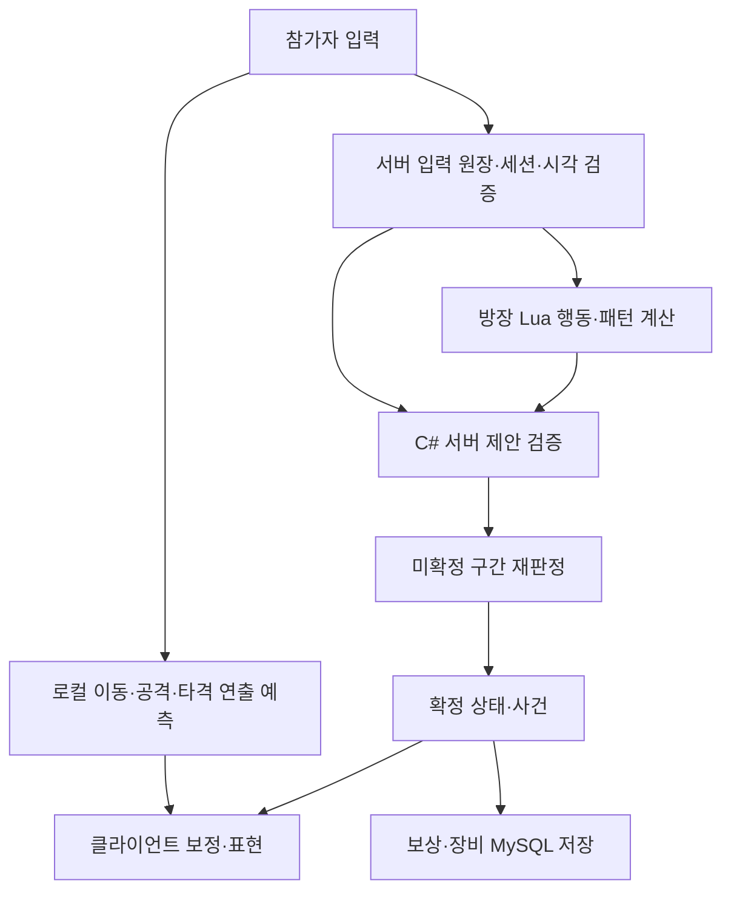

# 구조와 코드 읽기

## 권한 경계

방장이 임의 HP·명중을 최종 결정하지 않습니다. 서버는 원래 입력과 방장 제안의 관계, 전투·참가자·연결 세대, 시각·쿨다운·범위·중복을 검사합니다. 피해·사망·보상은 서버 확정 결과를 따릅니다.

늦은 입력은 허용된 미확정 구간에서 피해뿐 아니라 넉백·경직·후속 행동도 재계산합니다. 재계산 중 Lua 콜백·사운드·DB 부작용을 다시 실행하지 않습니다. 확정 경계 이후 결과는 되돌리지 않습니다.

## 읽는 순서

1. [Contracts](../Packages/com.projectdawn.combat/Runtime/Contracts.cs): 식별자·입력·제안·마감 계약.
2. [EncounterEngine](../Packages/com.projectdawn.combat/Runtime/EncounterEngine.cs): 입력 원장·검증·재판정·확정.
3. [CombatState](../Packages/com.projectdawn.combat/Runtime/CombatState.cs): 순수 전투 상태·체크포인트.
4. [PredictionLedger](../Packages/com.projectdawn.combat/Runtime/PredictionLedger.cs): 예측과 확정 이벤트의 일대일 연결.
5. [Lua](../Lua/bakal_patterns.lua)와 [Lua 검사](../LuaTests/Program.cs): 패턴·대상·행동 프로그램과 C# 검증.
6. [RaidCombatSession](../Server/Server/Game/Room/RaidCombatSession.cs): 기존 서버 세션·방과 코어 연결.
7. [Unity](../UnityClient/Assets/Scripts): 전투 시간과 별개인 카메라·컷신·히트스톱·HUD.

## 구성

| 경로 | 역할 |
|---|---|
| Packages/com.projectdawn.combat | Unity와 서버가 공유하는 C# 코어 |
| Build/CombatCore | 같은 소스를 .NET Standard 2.1로 빌드하는 프로젝트 |
| Protocol / Client | Protobuf 계약과 참가자·방장 네트워크 처리 |
| Server / FlowHost | 기존 Dawn 서버 기반의 실제 게임 흐름 |
| CloudGateway | 회원 인증·TLS 접속 |
| Lua | 방장 패턴 프로그램 |
| UnityClient | 실제 화면·입력·연출 코드, 작성한 씬과 설정 |
| *Tests | 콘솔 회귀 검사 프로젝트 |
| Cloud / Tools | 배포·운영·검사·리소스 연결 도구 |

## 정책과 미포함 확장

방장 이탈은 전투 중단·마을 복귀, 비방장은 3분 재접속이며 그동안 피격 가능합니다. 새로운 참가자의 중간 충원·방장 자동 교체·인원별 보스 자동 난이도 보정은 현재 정책에 포함하지 않습니다.

현재 공개 TLS 경로와 기존 Dawn의 TCP/UDP 이력은 구분합니다. 과거 Town 부하 수치를 현재 레이드 서버의 수용 인원으로 주장하지 않습니다.
