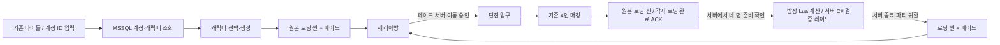

# ProjectDawn 로그인·마을·레이드 통합

2026-10-18 / `E:\task\ProjectDawnIntegration`

## 실제 연결한 흐름



기존 ProjectDawn의 Title(Login), Town, LoadingScene 씬과 의존 리소스를 작업 사본으로 가져왔다. 마을의 배경·NPC·불꽃·비, 로딩 지도, 배경 음악, 파티 팝업과 HUD를 사용한다. 새 계정 입력·캐릭터 선택·장비 저장 버튼은 기존 서버 패킷에 연결한 통합 UI다. 원래 타이틀의 Enter로 마을을 여는 임시 동작은 실제 계정·캐릭터 선택으로 대체했다.

씬 전환은 어두워짐 → 실제 로딩 씬 → 목적지 비동기 로딩 → 준비 완료 전송 → 밝아짐 순서다. 로딩 씬은 최소 1.2초 표시한다. 화면이 준비되기 전 서버에 SceneReady를 보내지 않으며, 네 명이 준비되기 전 전투를 시작하지 않는다. 세리아방/던전 입구도 서버 이동 승인을 기다리며 페이드한다.

레이드 스킬 21종, 기존 HUD 가운데 스킬 배치, 히트스톱·흔들림·원본 효과·메테오 네 발·서버 시간 표시를 유지한다. 파티 귀환 버튼은 방장만 사용할 수 있고 서버가 현재 전투 ID와 방장 권한을 확인한다. 이 귀환은 클리어 보상을 주지 않는다. 종료 패킷을 받으면 같은 인증 연결로 마을 로딩을 완료한다.

## SQL 장비와 코디

기존 `(localdb)\MSSQLLocalDB`의 `GameDB` 연결과 Account/Player/Item 테이블을 사용한다. DB 비밀번호나 연결 문자열은 게임 클라이언트에 넣지 않는다. 기존 테이블 삭제는 없다. 후속 코디 SQL 작업에서 Player.Appearance 열을 추가했다.

- 기존 Dawn 장비 템플릿과 함께, 신규 통합 캐릭터에 훈련 무기 5종을 제공한다. 각 캐릭터의 20칸 인벤토리 중 7칸을 사용한다.
- 추가 템플릿 ID는 91001–91005. 원본 DNF에서 추출한 아이콘을 사용하되 **훈련 장비 이름과 능력치는 프로젝트용 데이터**다. 원본 아이템 수치를 복원했다고 주장하지 않는다.
- 장착은 자기 소유 아이템인지 확인하고 SQL 트랜잭션을 성공시킨 후 메모리·UI를 갱신한다. 레이드·매칭·씬 이동 중에는 변경할 수 없다.
- 서버가 전투 시작 시 장착 장비를 읽어 공격 배율과 방어 수치를 고정한다. 공격 배율은 `1 + min(무기 공격력,100)/100`, 받는 피해 배율은 `100/(100+min(방어력,100))`이다. 방장과 참가자는 동일한 서버 스냅샷으로 재생한다.
- 인벤토리의 **아바타·무기 코디**에서 외형을 선택한다. 능력치 장비와 무기 외형은 별개다.
- 아바타 18종·무기 외형 9종을 추가했다. 최종 무기 외형 선택지는 41개이며, 머리 14·상의 15·하의 13·모자 11·신발 8·목가슴 6 등이다. 프렌지와 블러드 소드의 별도 무기 표시도 유지한다.
- 마을과 던전 모두 같은 DrawAvatar 렌더러와 서버가 승인한 Look 문자열을 사용한다. 서버가 목록에 없는 외형 코드를 거절하며 전투 중 코디는 고정한다. 마을 복귀 시에도 서버의 동일 외형을 유지한다.
- 코디와 장비 소유·착용을 SQL에 저장한다. 후속 구현은 [코디 SQL 저장](SQL-APPEARANCE-INTEGRATION.md)에 정리했다. 로컬 설정은 초기 이전·서버 승인값 캐시 용도로만 사용한다.
- 각성 스킬 컷신은 사용한 본인 화면에만 표시한다. 다른 참가자의 공격 동작·전투 효과는 유지한다.

장비 출처: [아이콘 추출 설명](EquipmentImport/README-KO.md).
아바타 출처: [추가 외형·포즈 검사](AvatarImport/README-KO.md). 새 57개 레이어의 10,203포즈를 검사했다.

## 실행

현재 PC에서 [Start-LocalGame.ps1](Start-LocalGame.ps1)을 실행한다. 기존 SQL 설정을 읽어 로컬 게임 서버와 게임 창을 연다. 로그인 화면에서 계정 ID를 입력하고 기존 캐릭터를 선택하거나 새 캐릭터를 만든다. 마을에서 I로 장비/코디를 열고, 던전 입구로 이동해 네 클라이언트에서 매칭을 신청한다.

서버 설정은 `PROJECT_DAWN_DB_CONNECTION_STRING` 환경 변수를 우선 사용한다. 없으면 Start-FlowServer.ps1의 기존 로컬 설정 파일 경로를 읽는다. 별도 서버 PC에서는 해당 경로 또는 환경 변수를 설정해야 한다. `flow-server.config.json`에는 리소스 경로만 있으며 자격 증명은 없다.

```powershell
./Build-Unity.ps1
./Start-LocalGame.ps1
# 네 개의 실제 화면 + 방향별 30ms 지연 + 일반 입력 자동 조작
./Play-Flow4.ps1 -ReturnAfter 85 -DelayMs 30
python ./Verify-Flow4.py ./Artifacts/<실행폴더>
```

FlowHost는 기본적으로 루프백 TCP 28182에서 실행한다. 기존 서버의 계정 ID 기반 로그인 방식을 연결한 개발 빌드이며, 비밀번호 인증 서비스를 새로 구현한 것은 아니다. 원본 서버나 DB의 운영 계정은 변경하지 않았고, 검증에는 명시적인 PD_Flow_ 접두사의 별도 계정을 사용한다.

## 검증과 범위

- 실제 SQL 연결을 사용하는 소켓 검사 14개 통과: 로그인, 다른 계정 캐릭터 선택 거부, 타인 장비 장착 거부, 저장된 장착 상태 복구, 필수 장비 검사, 네 명 준비 장벽, 잘못된 전환 ID 거부, 장비/외형의 서버 스냅샷 일치, 전투 중 변경 차단, 방장 귀환 권한과 네 명 복귀.
- 공유 콘텐츠 검사 32개 통과: 추가 장비의 실제 공격·방어 수치와 복사/스냅샷 격리 포함.
- 화면 시간 검사 25개 통과. 충격파 발생 뒤 첫 화면까지 1–2틱 차이가 있을 때, 회피 검증 기록이 무적 종료 후의 상태를 잘못 읽는 문제를 수정했다. 화면 자체와 서버 판정 규칙은 그대로 두고 발생 틱의 예측 상태를 기록한다. 해당 상황의 회귀 검사를 추가했다.
- 네트워크 시간·기존 콘텐츠 전체 회귀 검사는 Logs/flow-regression.log에 기록했다.
- 실제 Unity 네 프로세스의 최종 실행: `Artifacts/flow-4p-20261018-033936`. 방향별 30ms 지연을 추가하고 85초 전투 후 네 명 모두 마을 복귀. 전투 검사 26개와 흐름 검사 10개 모두 통과했다.

기존 원본 프로젝트·게임 설치 파일·공유기·방화벽은 변경하지 않았다. Git에 게시하지 않았다. 3분 재접속과 영속 클리어 보상은 여전히 후속 범위다.

## 다음 대화에서 이어갈 위치

- 통합 진입·씬 이동·마을 표시·장비창: `UnityClient/Assets/Scripts/RaidDemoApp.Flow.cs`
- 코디 렌더링·본인 컷신: `UnityClient/Assets/Scripts/RaidDemoApp.Berserker.cs`
- 서버의 이동·외형 승인: `Server/Server/Session/ClientSession_Flow.cs`
- 실제 SQL 장비 처리: `Server/Server/Game/Object/IntegrationEquipment.cs`
- 레이드 장비/코디 고정과 귀환: `Server/Server/Game/Room/GameRoom_Raid.cs`
- 화면 시각과 입력 예측: `Client/RaidPresentationTimeline.cs`
- 원본 씬 가져오기: `Tools/ImportDawnFlow.py`와 `Tools/flow-asset-provenance.json`
- 실제 소켓 검사: `FlowTests/Program.cs`. 실제 네 화면 실행과 결과 검사는 `Play-Flow4.ps1`, `Verify-Flow4.py`.

코디 SQL 영속화는 후속 작업으로 완료했다. 다음 범위는 비방장 3분 재접속, 영속 보상, 친구용 인증 및 물리 LAN/AWS 시험 배포다. 방장 계산·서버 검증 방향을 유지하며, 이번 범위의 테스트 계정은 `PD_Flow_1018032620_1`부터 `_4`까지다. 새 계정을 늘리지 않고 이 네 계정으로 재검증할 수 있다.


## 최종 화면과 측정 결과

| 항목 | 결과 |
|---|---|
| Unity 빌드 | 성공, 오류 0·경고 0 (서버의 기존 .NET Core 3.1 지원 종료 경고는 별도) |
| 실제 SQL 로그인·로딩·마을·4인 매칭·레이드·마을 복귀 | 4/4 완료, Unity 오류 0 |
| 마을/레이드/귀환 아바타 | 서로 다른 4종 코디 모두 동일하게 유지 |
| 장비 저장 | 네 계정 모두 7개 아이템, 방어구 100·무기 91002 착용 유지 |
| 컷신 | 본인 각성 3건 표시, 다른 참가자 화면 총 9건 차단 |
| 확정 상태/사건 | 공통 스냅샷 169개·콘텐츠 사건 295개 일치 |
| 화면에서 점프로 회피한 충격파 | 63/63 서버 회피 기록 일치, 무적 중 충돌 1건은 별도 분류 |
| 메테오·충격파 | 128개 활성 시점 비교, 발생 틱 차이 0, 이번 실행의 첫 표시 틱 지연 0 |
| 보스·플레이어 콘텐츠 | 스킬 ID 21종·보스 패턴 7종 확인, 방장 Lua만 계산, 서버 확정 콜백 수신 |

전체 흐름 검증 JSON (`Artifacts/flow-4p-20261018-033936/flow-verification.json`, 로컬 검증 자료) · 전투 검증 JSON (`Artifacts/flow-4p-20261018-033936/verification.json`, 로컬 검증 자료) · SQL 직접 조회 결과 (`Artifacts/flow-4p-20261018-033555/sql-verification.json`, 로컬 검증 자료)

（화면 자료: 실제 로딩·마을·레이드·복귀 화면 — Notion 참조）

（화면 자료: 네 개의 독립 클라이언트에서 촬영한 레이드 — Notion 참조）

네 캐릭터의 마을 진입/귀환 화면 대조 (`Artifacts/flow-4p-20261018-033936/avatar-round-trip.png`, 로컬 검증 자료) · [추가 코디 애니메이션](AvatarImport/four-looks-animation.gif)

위 화면은 실제 실행 캡처를 배열한 것이다. 검증은 같은 PC의 네 프로세스와 지연 프록시에서 수행했으며, 다른 물리 PC의 LAN 검증을 대신하지 않는다. 중간 실행 033555에서 발견한 회피 기록의 시점 혼동은 수정했고, 이를 숨기기 위해 이전 실패 결과 파일을 덮어쓰지 않았다.
