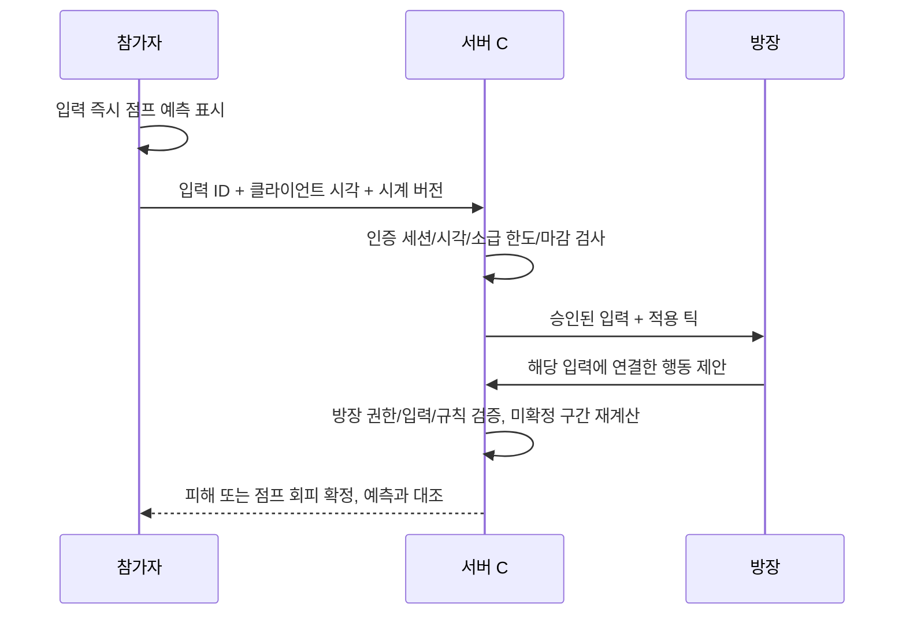

# 고지연 점프 보정 — 2026-10-18

## 목표와 권위

실제 Unity 4인에서 화면의 점프와 서버 확정 회피를 대조한다. 방장 Lua가 패턴을 계산하고 행동을 제안하며, 서버 C#이 입력·제안·명중·피해를 검증하고 확정하는 구조를 유지한다. AWS 배포 작업은 이번 범위에 없다.

## 원인과 변경

기존 시계 측정 상한은 왕복 160ms였다. 프록시가 방향마다 80ms를 더하면 실제 응답은 처리 시간까지 포함해 상한을 초과한다. 이 경우 입력은 서버 수신 시각으로 처리되어 화면에서 점프한 시각보다 늦어졌다. 또한 참가자 입력은 서버에 도착한 뒤 방장의 제안을 받기 위해 추가 왕복이 필요하므로 시계 상한만 늘리는 것으로는 충분하지 않다.

| 항목 | 이전 | 변경 |
|---|---:|---:|
| 시계 응답 RTT 상한 | 160ms | 280ms |
| 입력 도착 유예 | 120ms | 160ms |
| 입력 마감 이후 방장 제안 유예 | 120ms | 300ms |
| 틱 끝부터 결과 확정까지 | 260ms | 480ms |
| 개별 입력 소급 허용 | min(입력 유예, 측정 RTT/2 + 35ms) | 동일 공식 |
| 시계 임대/갱신 | 15초/5초 | 동일 |
| 화면 예측 상한 | 60틱 | 동일 |

결과 확정은 기존보다 220ms 더 늦어진다. 본인 이동·점프·공격 및 개인 타격 연출은 기존 즉시 예측을 유지하며 HP와 공통 결과는 서버 확정을 따른다. 280ms는 시계 측정의 상한으로, 모든 280ms RTT 경로에서 무조건 회피를 인정한다는 의미가 아니다. 실제 입력 소급, 입력 마감, 방장 제안 마감은 별도로 모두 통과해야 한다.

제안 예산은 입력 도착 이후 방장까지의 추가 왕복과 서버/클라이언트 dispatch 여유를 포함한다. 최초 수정의 220ms 제안 유예/400ms 확정에서는 실제 4인 100±10ms 시험 초기에 승인 입력의 방장 제안 1건이 `TooLate`로 거절됐다. 입력 소급 한도는 늘리지 않고 이 추가 경로를 300ms로 보강했다. 제안 접수 마감(틱 끝+460ms)과 최종 확정(틱 끝+480ms)은 구분한다.

방장은 기존 미확정 preview 경로로 앞으로 실행할 Lua 패턴을 제안한다. 확정 상태를 기다렸다가 패턴을 생성하도록 바꾸지 않았으며 기존 30틱 사전 예약과 서버 검증을 유지한다.

콘텐츠 계약은 `dawn-jump-latency-v13`으로 갱신했다. 서버와 클라이언트를 함께 교체해야 한다. 과거 MS SQL/MySQL 문서의 v12 및 80ms 실패 기록은 당시 결과로 보존한다.



이미 확정된 피해·사망은 다시 열지 않는다. 임의의 클라이언트 시계 오프셋을 신뢰하지 않으며 서버의 일회용 challenge 3개로 측정한다. 재전송, 시계 급변, 만료, 미래 입력, 지나친 소급 검사도 유지한다.

갱신 표본의 분산만 커졌고 모든 표본이 기존 오프셋의 오차 범위 안이면, 기존 신뢰 임대를 **원래 만료 시각까지만** 유지하고 1초 뒤 다시 측정한다. 이때 오프셋·버전·소급 한도·만료를 바꾸지 않는다. 기존 임대가 없거나 만료됐거나 시계 급변이면 수신 시각으로 전환한다. 잡음만으로 신뢰를 연장하지 않는다.

## 코드와 단위 검증

- `Packages/com.projectdawn.combat/Runtime/ClockMapping.cs`: RTT 상한과 이유.
- `Packages/com.projectdawn.combat/Runtime/Content/RaidContentState.cs`: 세 구간의 예산과 계약 버전.
- `ClockTests/Program.cs`: 시계 34개 검사. 왕복 180~195ms 변동, challenge 유지, 상한 초과 차단, 입력 소급 제한, 참가자→서버→방장→서버 410ms 뒤 실제 메테오 재판정 및 확정 후 변경 거절. 정확한 제안 마감 경계에서의 거절, 잡음이 있는 갱신에서 기존 임대만 유지하고 만료 후에는 신뢰하지 않는지 추가 검증.
- `TimelineTests/Program.cs`: 화면 64개 검사. 최대 38틱 오래된 스냅샷에서도 메테오 활성 틱·점프 회피·중복 연출 억제 대조.
- 공통 전투 26개, 콘텐츠 86개, 실제 네트워크 37개 검사 통과. 로그는 `Logs/highlatency-*.log`.
- `Tools/DelayTcp.py`, `Play-Flow4.ps1`: 방향별 FIFO 지연에 선택적인 seeded jitter 추가. 프록시 점유 검사와 시작 실패 검사를 유지한다. TCP 바이트 순서를 뒤섞지 않는다.
- 서버 진단: 입력/제안 거절 사유와 시각·틱·연결 입력을 기록한다(방별 첫 32건 상한). 시계 fallback도 기록해 이후 현장 지연 문제를 구분할 수 있다.

## 실제 4인 검증

각 실행의 `processes.json`에 지연 조건, `proxy.log`에 실제 시작 인수를 남기고 `verification.json`과 `flow-verification.json`으로 확인한다. 기존 검증 기준을 낮추지 않았다.

### 최종 480ms 빌드

| 실행 | 전투 / SQL 흐름 검사 | 화면상 안전 점프 → 서버 회피 | 공통 상태 / 이벤트 |
|---|---|---|---|
| 편도 100±10ms, 90초 (`155741`) | 26 / 12 통과 | 18 / 18 | 181 / 397 일치 |
| 편도 80ms, 90초 (`160008`) | 전투 25/26, 독립 흐름 11/11; 전체 보고서는 실패 보존 | 13 / 13 | 180 / 364 일치 |

최종 전투 결과 (`Artifacts/flow-4p-20261018-155741/verification.json`, 로컬 검증 자료), 최종 SQL/흐름 결과 (`Artifacts/flow-4p-20261018-155741/flow-verification.json`, 로컬 검증 자료). 마지막 측정 RTT는 클라이언트별 203.1~209.3ms. 입력 7,083건이 측정 시각으로 승인되었고 수신 시각 fallback 0, 입력/제안 거절 0, Unity 오류 0. 메테오/충격파 활성 대조 96건은 계산 틱 차이 0, 관측 틱 지연 0, 중복 연출 0이었다. 자동 조작하는 독립 Unity 4프로세스이며 일반 전투 HP/피해를 사용한다.

첫 메테오 주변 네 클라이언트 화면 (`Artifacts/flow-4p-20261018-155741/four-client-evidence.html`, 로컬 검증 자료). 원본 캡처 틱은 203~205로, 완전히 같은 렌더 프레임을 촬영했다고 가정하지 않는다. 판정 일치 여부는 위 이벤트 대조 결과를 사용한다.

최종 80ms 재검증도 시계 fallback·거절·Unity 오류 0, 화면상 점프 회피 13/13, 메테오/충격파 64건의 활성 틱 차이 0이었다(원본 결과 (`Artifacts/flow-4p-20261018-160008/verification.json`, 로컬 검증 자료)). 단, 전체 검증기의 `four_sequential_meteor_impacts` 한 항목은 실패했다. 첫 두 메테오는 각각 4회 정상 낙하했고 세 번째(4099틱)는 공격 콜백 4회가 실행됐지만 보스 방의 살아 있는 표적이 없어 낙하가 생성되지 않았다. 4139틱 캡처에는 0~2번 캐릭터가 보스 방에서 HP 0, 유일한 생존자 3번은 1번 방에 HP 약 1.74로 기록돼 있다. `RaidSimulation.BossProgram.cs`는 같은 방의 생존 표적이 있을 때만 메테오를 생성한다. 이는 점프/시계 불일치가 아니지만 검증 기준을 낮춰 전체 성공으로 바꾸지 않았다. 무표적 콜백을 명시적 서버 이벤트로 감사하고 4연속 낙하 검사와 구분하는 후속 항목으로 남긴다.

### 중간 검증과 발견한 문제

아래 두 실행은 400ms 확정 예산의 중간 검증이다. 최종 480ms 빌드 결과는 별도로 기록한다.

| 실행 | 전투 / SQL 흐름 검사 | 화면상 안전 점프 → 서버 회피 | 공통 상태 / 이벤트 |
|---|---|---|---|
| 편도 80ms, 90초 | 26 / 12 통과 | 23 / 23 | 182 / 403 일치 |
| 편도 100±10ms, 진단 로그 추가 재시험, 90초 | 26 / 12 통과 | 23 / 23 | 181 / 413 일치 |

80ms 실행: 전투 결과 (`Artifacts/flow-4p-20261018-154702/verification.json`, 로컬 검증 자료), 로그인·장비·코디·귀환 결과 (`Artifacts/flow-4p-20261018-154702/flow-verification.json`, 로컬 검증 자료). 네 클라이언트 모두 측정 시계를 사용했고, 메테오/충격파 화면 활성 96건의 계산 틱 차이와 관측 틱 지연은 0이었다. 입력/제안 거절·Unity 오류·중복 착지 연출 0. 21개 스킬이 모두 서버 확정 이벤트로 관측됐다.

중간 스트레스 실행 `154917`(편도 100±10ms)은 화면상 안전 점프 24/24, 상태/이벤트 일치는 통과했지만 거절 1건 때문에 전체 실패로 보존했다. 당시 로그에는 거절 상세가 없어 종류를 특정하지 못했다. 이 결과를 전체 통과로 계산하지 않으며 이후 진단 로그와 갱신 잡음 처리를 보강했다.

진단 로그 추가 후 재시험 `155145`는 거절·fallback 없이 통과했다(결과 (`Artifacts/flow-4p-20261018-155145/verification.json`, 로컬 검증 자료)). 해당 실행은 갱신 잡음 보강 전 서버이므로 앞선 거절의 원인이 해결됐다는 증거로 단정하지 않는다. 갱신 잡음 보강은 별도의 단위 회귀 검사와 최종 빌드 실행으로 검증한다.

이어진 `155431`에서는 서버 로그로 `RAID_PROPOSAL_REJECT`, `TooLate`, 제어 입력에 대한 `definition=100`, `tick=117`을 확인했다. 이를 근거로 제안 예산을 보강했다. 실패 결과와 서버 로그를 보존한다. 이후 진단에는 펌프 시각이 아닌 엔진이 기록한 제안 수신 시각(`ReceivedUs`)도 포함한다.

재현 명령(기존 7개 장비/서로 다른 코디 시험 계정 사용):

```powershell
./Play-Flow4.ps1 -Port 28202 -DelayMs 80 -SavedLooks -Record -ReturnAfter 90 -AccountPrefix PD_Flow_1018032620
./Play-Flow4.ps1 -Port 28242 -DelayMs 100 -JitterMs 10 -SavedLooks -Record -ReturnAfter 90 -AccountPrefix PD_Flow_1018032620
python Verify-Flow4.py <출력 경로> --sql
```

다음 실행 전 해당 실행 서버와 프록시를 종료해야 한다. 포트/명령행을 확인하여 이번 실행의 프로세스만 종료한다. 이 테스트는 로컬 지연 주입이며 외부 인터넷 4PC 시험과 구분한다.
