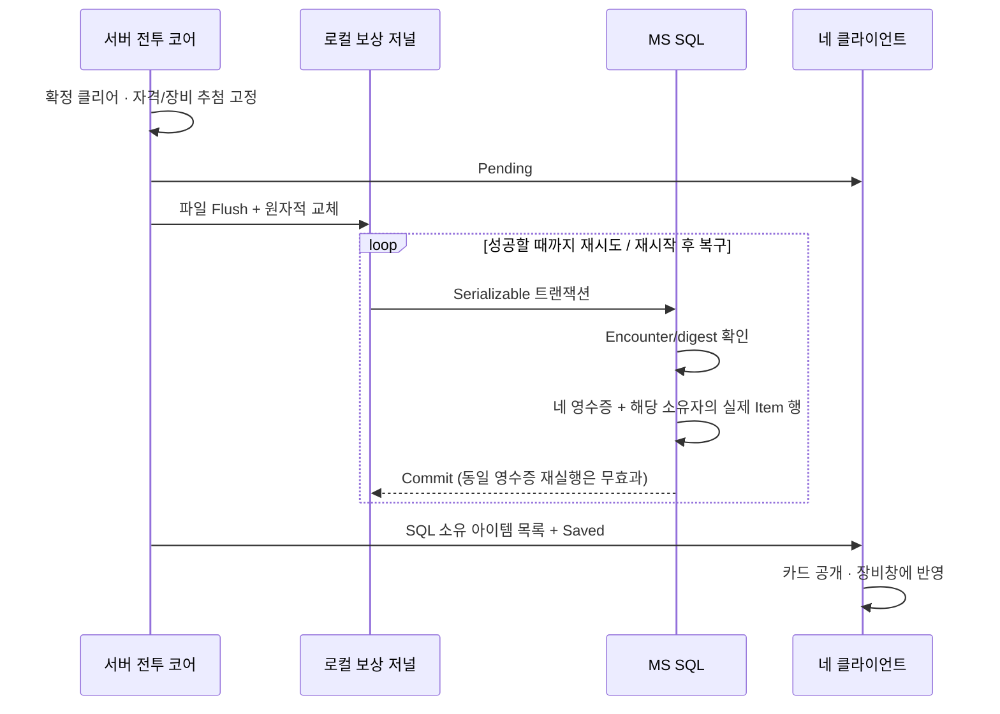

# 재접속·장비 능력치·바칼 보상창 통합

2026-10-18. 작업 경로 `E:\task\ProjectDawnIntegration`. 방장 Lua 계산 → 서버 C# 검증·확정 구조를 유지한다. AWS 자원 생성은 하지 않았으며, 사용자 가입 후 별도로 논의한다.

## 실제 변경

| 기능 | 서버 처리 | 화면 처리 |
|---|---|---|
| 비방장 연결 중단 | 마지막 연결 중단부터 180초. 캐릭터는 남아서 피격·사망 가능 | 재접속 대기 표시 |
| 원래 참가자의 재접속 | 같은 계정·캐릭터 확인, 기존 객체/슬롯/HP/방 유지, 세션 epoch 갱신, 이벤트 기준점 전달 | 기존 로딩 화면을 거쳐 진행 중 전투 복원 |
| 3분 만료 / 직접 나가기 | 만료는 필드 제거, 직접 나가기는 즉시 제거·재입장 불가. 나머지 전투/보스 HP 유지 | 해당 참가자만 마을 복귀 또는 다음 로그인 시 마을 |
| 방장 이탈 | 전투 중단·파티 마을 복귀. 15초 입력/시계 응답 무활동도 연결 중단 처리 | 기존 전환/로딩 사용. 방장 자동 교체 없음 |
| 정상 클리어 | 연결 중 + 3분 대기 중 참가자의 자격 동결. 사망 여부 무관. 직접 퇴장/만료 제외 | SQL 저장 대기 → 카드 공개 → 개별 귀환 또는 15초 후 귀환 |
| 보상 | 인장 100 + 무기 1개. 서버가 5종 중 선택한 결과를 영수증에 고정 | 원본 바칼 카드/배경/성공 제목, 이름·수량·장비 아이콘 |
| 장비 착용 | SQL 소유권 검사/저장 후 응답. 매칭 중·전투 중 변경 금지 | 원본 UI 부품을 사용한 장비창, 현재 능력치 표시 |

보상 지급은 이 데모의 경제 규칙이다. 원작 바칼의 드롭 확률·획득량·경제 시스템을 복원한 것으로 표현하지 않는다.

## 중복 지급과 재시작

`RaidRewardEncounter`와 `RaidRewardGrant`는 추가 테이블이다. 장비는 기존 `Item` 테이블에 저장한다. 레거시 영수증의 digest를 깨지 않도록 장비 필드 기본값은 직렬화에서 생략한다. 오프라인 참가자는 다음 정상 로그인에서 SQL 아이템과 보상 기록을 받는다. 저널 기록 전 디스크 오류는 성공으로 표시하지 않고 재시도한다. 전투 자체의 서버 재시작 복원은 이번 범위가 아니다.

## 물리 공격력과 속도

다음은 **ProjectDawn의 물리 퍼센트 공격 모델**이며, 원작 버서커의 실제 공식·밸런스를 추출한 수치가 아니다.

- 물리 공격력 = 기본 100 + 착용 무기 공격력. 타격 피해 = 물리 공격력 × 스킬 계수/100 × 프렌지/폭주 배율. 기존 무력화 배율도 유지한다.
- 일반 피격 피해 = 공격 피해 × `100/(100+방어력)`.
- 방 메테오 직격 95%·불바다 20% 최대 HP 기믹은 기존 설계대로 방어력을 무시한다.
- 이동 속도 = 기본 보행/달리기 속도 × 장비 이동 배율. 점프 중 수평 이동에도 적용한다. 회피 대시의 고정 거리·점프 중력은 변경하지 않는다.
- 공격 속도는 시전 때 고정한다. 모션, 이펙트, 타격 구간, 돌진 동작 시간, 일반 평타 반복 간격에 같은 배율을 적용한다. 스킬의 MP·버프 지속시간·일반 스킬 쿨타임은 그대로다.
- 각성 스킬은 컷신과 효과의 합의된 동시 재생 시간을 유지하도록 배율 1의 연출 일정이다.
- 네 클라이언트가 받는 스냅샷에 최종 능력치·시전 배율·타격 배율을 포함한다. 로컬 예측과 원격 연출도 그 값을 읽으며 피해/HP 확정은 서버만 수행한다.

| 보상 무기 | 공격력 추가 | 이동 속도 | 공격 속도 |
|---|---:|---:|---:|
| 근원을 삼킨 도 | 48 | +5% | +15% |
| 근원을 삼킨 대검 | 72 | -3% | -8% |
| 근원을 삼킨 소검 | 55 | +3% | +8% |
| 근원을 삼킨 둔기 | 80 | -5% | -12% |
| 근원을 삼킨 광검 | 50 | +10% | +22% |

기존 갑옷/신발에도 방어력과 속도 옵션을 부여했다. 수치는 서버 `Data/ItemData.json`에서 읽는다. 클라이언트가 보낸 공격력·속도 값으로 덮어쓰는 패킷은 없다. 장비 외형과 아바타 코디는 별도이며, 코디의 마을·던전 일치는 유지된다.

## 원본 자료와 웹 보완

- [원본 장비명 조사](Research/equipment-names/README-KO.md): 설치된 귀검사 무기 IMG 다섯 개의 428개 아이콘을 추출했다. 원본 이름/아이템 ID 매핑은 복원하지 못했다.
- [공식 웹 장비사전 대조](Research/equipment-web/README-KO.md): 공식 응답의 동일 레코드에서 이름과 이미지 URL을 확인한 다섯 보상 무기와 기존 장비 세 개를 사용한다. 총 8쌍의 원본 28×28 아이콘을 적용했다. 공식 웹 식별자와 프로젝트 템플릿 ID는 서로 다르다. 공개 이름 목록의 최종 수집 범위/개수는 해당 문서와 카탈로그에 기록한다.
- [보상 UI 근거](BAKAL-REWARD-UI-REFERENCE.md): 실제 원본 바칼 카드·배경·제목 부품을 사용한다. 제목은 투명한 700px 캔버스를 늘리지 않고 글자 영역 238×44의 비율을 보존한다.
- [인벤토리·아바타·스킬창 근거](ORIGINAL-WINDOWS-REFERENCE.md): 원본 리소스와 공식 화면을 참고해 기존 기능을 연결한다. 원작 UI 동작 스크립트/ANI를 복원했다고 주장하지 않는다.

## 검증 범위

- Content: 실제 이동 거리·물리 피해·방어·공격속도별 타격 시점·최저/최고 속도에서 다단히트 보존·스냅샷 복원.
- Timeline: 공격속도를 적용한 원격 모션/이펙트 시각과 서버 스냅샷 불변성.
- Lifecycle: 실제 TCP/SQL의 재인증·재접속·이탈·자격 동결·중복 장비/인장 방지·SQL 롤백·오프라인 재로그인·독립 프로세스 저널 복구. 3분 만료 테스트는 서버 기한을 앞당긴 시험 fixture이며 실제 정책은 180초다.
- 실제 Unity 재접속 (`Artifacts/flow-4p-20261018-150103/reconnect-verification.json`, 로컬 검증 자료): 한 PC의 4프로세스, 방향별 30ms. 비방장 프로세스 강제 종료 후 새 프로세스로 재접속. 공통 확정 스냅샷 101개 일치, 네 명 귀환/외형 유지, 입력 거절 없음.
- UI 미리보기 사진은 가상 데이터임을 화면에 표시한다. 별도 `RewardPlaytestHost`는 SQL/매칭/공격/보상 코드가 실제 경로지만, 15초 뒤 보스 HP를 500으로 낮춰 클리어 시간을 줄이는 시험 전용 실행 파일이다. 일반 배포 서버에는 이 기능이 없다.

물리 PC 4대·외부 인터넷·장시간 여러 파티·서비스 용량 시험은 미완료다. AWS 실제 배포는 사용자와 추후 논의한다.

최종 자동 검사: Content 86, Timeline 55, Ai 22, Room 72, Clock 20, Lua 50, Core 26, Network 37, Lifecycle 46개 통과. 상세 출력은 `Logs/equipment-*.log`에 보관한다.

공식 아이콘 8종을 포함한 최종 Unity 빌드와 .NET 10 FlowHost 빌드 성공. 이 서버에서 실제 SQL 로그인·채널 이동·타인 장비 거절·장비 능력치 고정·4인 로딩/귀환 Flow 21개를 재검사해 통과했다(`Logs/equipment-final-flow-tests.log`). 공개 웹 장비사전은 7개 카테고리 모두 마지막 페이지까지 수집 완료: 37,312개 고유 웹 항목, 34,731개 고유 이름. 전체 이미지 다운로드 수를 뜻하지 않으며 게임에 적용한 웹 이미지는 8개다.

- 일반 90초 4인 전투 영상 (`Artifacts/flow-4p-20261018-151216/video/index.html`, 로컬 검증 자료): 한 PC의 네 프로세스, 방향별 30ms 지연, HP 조작/무적 없음. 전투 26·흐름 10·방 21·돌진 8·컷신 영상 10개 검사 통과. 확정 상태 182개·이벤트 401개 일치. 89.58초 무음 영상.
- 실제 SQL 보상 검사 (`Artifacts/rewards-4p-20261018-151719/reward-verification.json`, 로컬 검증 자료): 방향별 80ms. 시험 서버가 15초 뒤 보스 HP를 낮춘 뒤 정상 공격으로 클리어. 네 명의 소유권·서로 다른 Item ID·템플릿·인장 100·동일 영수증·Pending→Saved·가방 7→8·마을/외형 유지 등 12개 통과. 실제 결과창 (`Artifacts/rewards-4p-20261018-151719/p1/sql-saved-rewards.png`, 로컬 검증 자료).
- 보상 검증기 최초 실행에서는 PowerShell hashtable의 `item` 키를 `.item`으로 읽어 고유 ID 검사가 잘못 실패했다. 문자열 인덱서 `['item']`로 수정해 동일 SQL 행을 재검사했다. 최초 출력은 `reward-verification-initial.json`에 보존했다. 게임 지급 로직이나 DB 행을 이 때문에 수정하지 않았다.
- 창 미리보기: 장비 (`Artifacts/equipment-ui-final/inventory.png`, 로컬 검증 자료), 아바타 (`Artifacts/equipment-ui-final/avatar.png`, 로컬 검증 자료), 스킬 (`Artifacts/equipment-ui-final/skills.png`, 로컬 검증 자료). 가상 데이터임을 화면에 표시한 실제 Unity 렌더다.

## 다음 대화에서 이어갈 위치

- 핵심: `Server/Server/Game/Room/GameRoom_RaidLifecycle.cs`, `Server/Server/DB/RaidRewardStore.cs`, `Packages/com.projectdawn.combat/Runtime/Content/RaidSimulation.cs`.
- UI: `UnityClient/Assets/Scripts/RaidDemoApp.Rewards.cs`, `RaidDemoApp.OriginalWindows.cs`.
- 계약: snapshot **11**, ruleset **dawn-equipment-rewards-v12**. 이전 클라이언트와 섞어 배포하지 않는다.
- 실행: `Build/ProjectDawnRaid.exe`. 서버 실행/SQL 설정은 기존 `Start-FlowServer.ps1` 경로를 유지한다. 비밀 값은 문서/저장소에 복사하지 않는다.
- 남은 항목은 `DEVELOPMENT-CHECKLIST.md` 참조.
