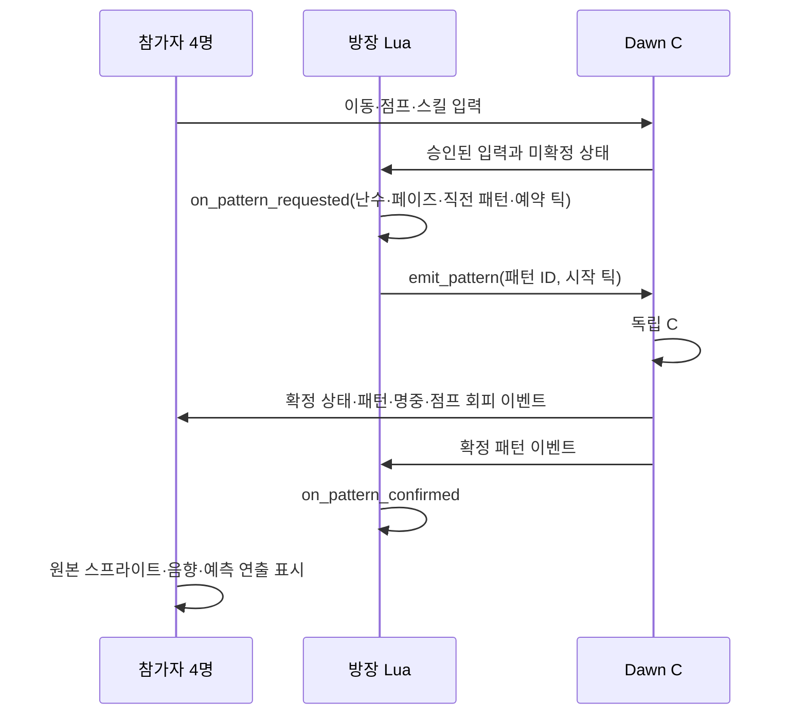

# 방장 Lua · 서버 C# 검증 · 메테오 · Dawn HUD 통합

> 후속 완료: [입력 시계 동기화·지연 보상](CLOCK-INPUT-INTEGRATION.md). 아래는 메테오/UI 통합 단계 기록이다.

2026-10-18 / 작업 사본: `E:\task\ProjectDawnIntegration`

## 실제 연결한 구조



방장만 Lua 패턴 선택 콜백을 실행한다. 서버는 Lua가 보낸 HP나 명중 결과를 신뢰하지 않고 공유 C# 전투를 다시 계산한다. Lua의 허용 범위는 현재 등록된 패턴의 선택과 예약 틱 제안이다. 실제 영역 생성·피해·네 번의 낙하 일정은 C# 패턴 구현이 담당한다. **임의 Lua로 새 판정 규칙까지 작성하는 단계는 아니다.**

Lua는 `CoreModules.None`과 명시적 콜백만 제공하며 파일·네트워크·Unity 객체를 노출하지 않는다. 초기화와 콜백의 명령 수를 제한하고, 실패 시 C# 호스트 AI로 조용히 대체하지 않는다. 서버에는 Lua 실행기가 없다. 첫 번째 및 매 네 번째 선택은 메테오, 나머지는 페이즈별 조건부 추첨이다. 클라이언트/서버 콘텐츠 협상과 체크포인트는 V3다.

## 요청한 메테오

| 항목 | 반영한 동작 |
|---|---|
| 개수/리듬 | 한 개씩 총 4회, 착지 간격 1.45초(60Hz 기준 87틱) |
| 낙하 | 우측 위에서 착지점으로 대각선 이동, 원본 속도의 2배, 약 1.214초 |
| 크기 | 메테오 표시 배율을 이전의 3배로 확대 |
| 직격 범위 | 가로·깊이를 각각 3배로 확대: 반너비 3.3, 반깊이 1.2. 면적은 9배 |
| 직격 회피 | 지면 좌표 기준, 이동으로 회피. 점프만으로 직격을 피할 수 없음 |
| 충격파 | 낙하 중 전장 전체 경고 표시, 착지와 **동일 틱**에 전장 전체(반너비 9, 반깊이 3) 발동. 착지에 맞춰 점프 회피 |
| 대상 | 패턴 시작 시 살아 있는 참가자를 ID 순서로 잠금. 4명 미만이면 순환해 4발 유지 |
| 페이즈/무력화 | 네 발과 충격파가 끝난 뒤 대기 중 전환 처리. 전투 종료는 우선 |
| 피해 | 직격 25, 충격파 16. 서버 확정 및 대상별 중복 피해 방지 |

충격파의 ‘화면 전체’는 HUD를 제외한 **캐릭터가 이동 가능한 전장 전체**를 뜻한다. 직격의 예고 영역과 충격파의 전장 전체 영역을 낙하 중 함께 표시한다. 착지 후 추가 대기는 없으며, 착지마다 원본 폭발음과 공통 화면 흔들림을 한 번씩 재생한다. 한 발의 폭발 잔상은 다음 발의 낙하와 겹칠 수 있지만 동시에 두 발이 낙하하지 않는다.

원본 Dawn `Meteor.cs`의 높이·피해·지면 좌표 판정과 원본 애니메이션 리소스를 가져왔다. 확대·가속·연속 네 발·점프 충격파는 이번에 요청받아 추가한 동작이다.

## UI와 기존 연출

원본 Dawn HUD 프리팹과 HP/MP 구체 애니메이션을 가져와 적용했다. 기존 스킬 14칸을 두 구체 가운데 2행으로 축소 배치하고, 기존 가방/캐릭터 버튼은 화면 안으로 이동했다. 전체 21개 SkillId와 스킬 창, 프렌지·블러드 소드 레이어, 각성·음향·개인 히트스톱·화면 흔들림 연결은 유지한다.

메테오 외피·내부 불꽃·폭발·지면 폭발의 원본 4개 클립, 74프레임을 원래 스프라이트 분할 정보와 피벗으로 읽는다. `Tools/dawn-asset-provenance.json`에 원본 경로와 GUID를 기록했고, 빌드 전 모든 프레임을 확인한다. 원본 프로젝트는 수정하지 않았다.

## 검증과 재현

```powershell
cd E:\task\ProjectDawnIntegration
./Validate.ps1
./Build-Unity.ps1
./Play-Unity4.ps1 -Auto -Seconds 100
python ./Verify-Unity4.py ./Artifacts/<실행폴더>
```

`Build` 폴더 전체가 실행 배포 단위다. 실제 4인 플레이는 같은 폴더의 `Play-Unity4.ps1`로 서버와 네 창을 함께 실행할 수 있다. `-Auto`를 빼면 직접 조작한다.

검증 드라이버는 이동·점프·대시·스킬의 정상 입력만 보낸다. 실플레이 검증에서는 무적·HP 수정·강제 패턴 선택을 사용하지 않는다. 단위 검사의 강제 패턴/무적 설정은 일정·전환 경계 검사용으로만 사용한다.

## 최종 검증 결과

증거 폴더: 실제 4인 실행 기록 (`Artifacts/unity-4p-20261018-025455`, 로컬 검증 자료)

- 실제 Unity 클라이언트 네 개, 100초 실행. 자동 판정 **20개 모두 통과**.
- 네 클라이언트의 공통 확정 스냅샷 **201개**, 콘텐츠 이벤트 접두열 **371개** 일치.
- 메테오 완주 4회 모두 네 발이며, 모든 착지 간격이 87틱. 첫 묶음 착지 틱: 169 → 256 → 343 → 430.
- 모든 메테오 착지와 전장 전체 충격파가 같은 서버 틱에 확정됨.
- 방장 한 명만 Lua 요청 콜백 실행. 확정 콜백 수신, 네 클라이언트 모두 21개 SkillId와 메테오 점프 회피 확인.
- Unity 오류 및 입력 접수 거절 0. 이 기록의 전투 종료 상태: `측정 종료 시 진행 중`. 클리어/보상 검증과 구분한다.
- Lua/메테오 계약 **20개**, 콘텐츠 **28개** 검사 통과. 앞선 전체 회귀 실행에서 코어 .NET 8/3.1 각각 26개, 실제 네트워크 34개 및 서버 회귀 통과.
- Unity 빌드 성공, 기존 모션/프렌지/찌르기 검사와 원본 HUD·메테오 74프레임·효과음 리소스 검사 통과.

기계 판정 결과 (`Artifacts/unity-4p-20261018-025455/verification.json`, 로컬 검증 자료)

（화면 자료: 네 개 Unity 화면 — 낙하 중 전체 경고 — Notion 참조）

## 남은 범위

- 이 검증은 한 PC의 실제 네 Unity 프로세스와 루프백 TCP 매칭이다. 테스트 계정 준비 경로를 사용하며 운영 DB 로그인·외부 LAN 검증을 대신하지 않는다.
- Dawn 전체 로그인/마을 화면을 합친 것은 아니다. 원본 HUD와 전투 리소스를 연결했다.
- 입력 시계 동기화와 제한된 지연 보상은 후속 단계에서 연결했다. 최신 범위와 남은 표시 시간 보정 작업은 위 후속 문서를 참조한다.
- 3분 재접속·영속 보상 등 앞서 합의한 후속 범위는 그대로 남아 있다.
- Lua 패턴 ID/선택 규칙 추가 시 C# 검증 계약도 함께 변경해야 한다.
