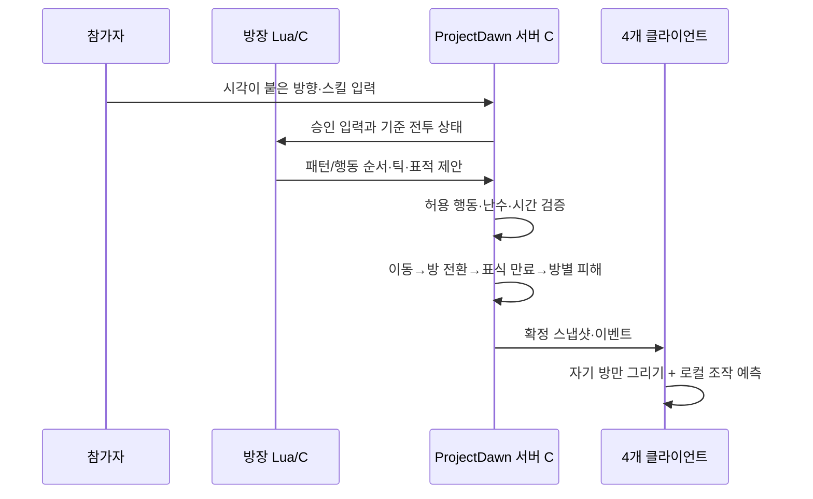

# Lua 콘텐츠 · 3×3 방 · 보스 HUD 통합

2026-10-18. ProjectDawn 통합판의 자체 구현이다. 원본 DNF에서 확인한 범위는 [별도 조사 보고서](DNF-ROOM-EVIDENCE.md)에 구분했다.

## 플레이 흐름

```text
1 ─ 2 ─ 3
│   │   │
4 ─ 5 ─ 6     5번: 바칼 전투 / 나머지: 메테오 유도 공간
│   │   │
7 ─ 8 ─ 9
```

화면 번호는 1~9, 내부 RoomId는 0~8이다. 출발점은 중앙 5번 방이다. 각 방 가장자리의 화살표에 맞춰 방향키로 걸으면 인접 방으로 이동한다. 파티 전체를 강제로 옮기지 않는다. 네 사람은 서로 다른 방에 머물 수 있고 오른쪽 미니맵에서 위치와 화재 방을 볼 수 있다. 이동 시 짧은 화면 전환을 적용하며 HP 회복이나 무적은 부여하지 않는다.

표식 대상 두 명을 서버 난수 기준으로 선택한다. 같은 차수의 중복과 직전 차수의 대상 재선정을 막는다. 4명 생존 시 두 조가 교대로 맡는다. 생존자가 부족하면 새 대상을 먼저 선택하고 부족한 자리만 이전 대상에서 보충하며, 한 명만 살아 있으면 한 명만 표시한다. Lua가 지정한 대상 슬롯을 C#이 검증하고, 해당 슬롯이 사망 상태면 다음 생존 슬롯을 순서대로 찾는다. 표식 후 사망해도 메테오는 마지막 위치의 방에 떨어진다.

| 단계 | 동작 | 확정 책임 |
|---|---|---|
| 표식 | Lua 행동 3이 선택한 서로 다른 두 플레이어에 7초 표시 | 서버가 난수·순서·대상 검증 |
| 운반 | 대상자가 상하좌우 문으로 다른 방에 이동 | 서버가 위치·입력·전투 상태·연결 관계 검사 |
| 낙하 위치 잠금 | 표식 만료 틱의 RoomId와 위치 고정 | 서버 과거 상태 재판정에도 같은 순서 적용 |
| 메테오 | 잠긴 방에 약 1.21초 낙하, 최대 HP의 95% 직격 피해 | C# 범위·타이밍·피해 |
| 불바다 | 착탄부터 16초 유지, 1초 간격 최대 HP의 20% 피해 | 같은 방만 판정, 방어력 무관 |
| 소멸 | 서버 틱에 따라 자동 제거 | 방이 비어 있어도 진행 |

불바다는 방 전체 지면을 덮는다. 이번 불바다는 점프만으로 회피하는 충격파와 다르게 지속 피해 지역으로 취급한다. 기존 보스 메테오의 지상 충격파는 계속 점프로 피할 수 있다. 보스 패턴의 ‘화면 전체’ 범위는 보스가 있는 방 전체이며 다른 방까지 피해가 넘어가지 않는다.

## 동기화와 권위



방 이동은 새 매칭이나 새 TCP 연결을 만들지 않는다. 한 전투 스냅샷에 네 플레이어의 RoomId, 진행 중 행동 프로그램, 표식, 방별 불바다 시작/종료/다음 피해 틱을 함께 보관한다. 첫 구현은 모든 방 상태를 네 클라이언트에 보내고 화면만 현재 방으로 걸러 낸다. 방별 수신자 최적화는 아직 하지 않는다.

클라이언트는 목적 RoomId나 HP를 명령으로 보내지 않는다. 기존 방향 입력을 보내면 서버가 문 근처인지, 인접한 방인지, 공격·피격·점프 중인지와 이동 간격을 검사해 전환한다. 늦은 입력으로 미확정 구간을 다시 계산할 때도 체크포인트의 과거 RoomId와 화재 상태가 함께 복구된다. 이미 확정된 HP를 화면 예측으로 덮어쓰지 않는다.

## Lua에서 바꿀 수 있는 것

`Lua/bakal_patterns.lua`의 `emit_pattern` 뒤에 `emit_action(kind, relativeTick, targetSlot)`을 호출한다.

| kind | 행동 | 현재 서버 허용 계약 |
|---|---|---|
| 0 | 대상 근처로 접근 | 첫 틱, 초당 2.8 단위, 준비 종료까지 |
| 1 | 기존 일반 패턴 실행 | 준비 24~60틱 후 |
| 2 | 메테오 + 지상 충격파 | 준비 후 87틱 간격, 총 4번 |
| 3 | 다른 방으로 옮길 메테오 표식 | 별도 표식 콜백, 서버 난수에 맞는 슬롯 |

기본 준비 시간은 36틱이다. 프로그램은 최대 7행·512자로 제한한다. Lua가 피해량이나 범위를 임의로 지정할 수 없으며, 누락·과다 행동·잘못된 표적·간격을 서버가 거부한다. 일반 패턴 0~5의 세부 판정은 기존 C# 프리미티브이며, 이번 변경이 모든 C# 콘텐츠를 자유 형식 Lua로 옮겼다는 뜻은 아니다.

## HUD와 채널

- 기존 Dawn `BossHpBar` 프리팹과 의존 리소스 134개를 가져왔다. [출처 목록](Tools/boss-hud-asset-provenance.json).
- 게이지 채움은 기존 추출본 `monster_hp.img`의 빨간 스트립 2번·흰 스트립 7번을 사용한다. 임시 ALERT 무늬를 제거했다.
- 보스 HP는 서버 확정 수치대로 바로 줄어든다. 손실 구간은 흰색으로 0.38초 남고 초당 전체 바의 32% 속도로 따라 줄어든다. 연속 피해는 잔상 대기 시간을 갱신한다.
- 흰 잔상은 보스에만 적용한다. 파티 표시는 항상 1P→2P→3P→4P 순서이고 본인도 포함한다. 현재 코디의 머리 초상, 인증된 캐릭터 이름, HP와 현재 방 번호를 표시한다.
- 원본에 있던 채널 이동 패킷을 재연결했다. 마을 채널 두 개를 열고 목록 조회·현재 채널 거절·이동 후 캐릭터/위치/코디 유지까지 검사한다. 현재 채널 목록 API와 FlowHost는 로컬 테스트용 루프백 서비스이며 외부 접속 지원 완료로 표현하지 않는다.
- 익스트림 오버킬은 혈검/마무리 이펙트의 가로만 1.5배, 실제 판정도 가로 반경 3.4→5.1로 확장했다. 세로 반경 3.4와 캐릭터/컷신 크기는 유지한다. 경계·깊이·실제 10회 타격·체크포인트 재현을 검사했다.
- 기존 스킬, 스킬바, 개인 히트스톱과 본인만 표시되는 진각성 컷신을 유지한다.

## 검증

RoomTests 72, LuaTests 50(대상 선택 조합 1,024건 포함), ContentTests 77, TimelineTests 25, ClockTests 20, 코어 26개 시나리오(.NET 8과 3.1 각각), 실제 세션 FlowTests 20개를 통과했다. 입력/제안 전송 회귀 NetworkTests 37개도 통과했다.

방 테스트는 24개 유효 방향 연결, 경계/대각선 차단, 실제 문 이동, 전투 중 전환 제한, 표식 운반과 잠금, 사망 대상, 방별 피해 분리, 재진입·빈 방 소멸, 페이즈 전환 후 화재 유지, 표식/화재 중 체크포인트 복원을 포함한다. 낙하 피해와 화재 시작이 한 틱 어긋난 문제를 발견해 수정하고 같은 틱임을 검사했다.

4인 검증은 한 PC의 독립 Unity 프로세스 네 개와 방향별 30ms 지연 프록시를 사용한다. 실제 PC 네 대 또는 외부 인터넷 시험과 구분한다. 촬영 자료와 최종 확인 결과는 아래에 추가한다.

## 주요 코드

- [Lua 작성](Lua/bakal_patterns.lua), [Lua 실행 제한](Client/LuaPatternPlanner.cs), [C# 행동 검증](Packages/com.projectdawn.combat/Runtime/Content/BossPatternProgram.cs)
- [보스 행동 실행](Packages/com.projectdawn.combat/Runtime/Content/RaidSimulation.BossProgram.cs), [방 이동과 화재](Packages/com.projectdawn.combat/Runtime/Content/RaidSimulation.Rooms.cs)
- [방 화면](UnityClient/Assets/Scripts/RaidDemoApp.Rooms.cs), [원본 보스 HUD](UnityClient/Assets/Scripts/DawnHudView.cs), [파티 HUD](UnityClient/Assets/Scripts/RaidDemoApp.DawnHud.cs)
- [방 검증](RoomTests/Program.cs), [남은 개발 목록](DEVELOPMENT-CHECKLIST.md)


2인 표식 변경에 맞춰 스냅샷 버전은 8, 전투 규칙 ID는 `dawn-lua-room-cadence-v8`이다. 서버와 클라이언트를 함께 새 빌드로 교체해야 한다. 시연 자동 조작은 두 표식 대상을 대각선 모서리 방 1·9 / 3·7로 번갈아 분산하고 중앙으로 복귀한다. 목적지에 가까워지는 최단 방 경로 중 화재가 없는 쪽과 가까운 문을 우선한다. 운반 중에는 일반 달리기 입력을 사용하고 긴 스킬은 회피로 취소한다. 목적 방의 이전 화재가 남아 있으면 문 밖에서 소멸을 기다린 뒤 진입한다. 첫 차수는 직격을 옆으로 피한 뒤 불바다를 잠깐 보여 준다. 모두 일반 입력이며 무적·체력 회복이나 위치 강제 변경은 없다. 실제 수동 플레이는 네 방향 문을 자유롭게 이용한다.

미확정 입력이 늦게 도착해 패턴 선택 당시 생존자가 달라지는 경우도 검사했다. 같은 패턴·시작 틱이라도 선택 기준이 바뀌면 방장이 수정된 제안을 다시 보내며, 서버는 이전 제안을 거절하고 현재 기준에 맞는 제안만 한 번 실행한다.

## 표식과 불바다 중첩

첫 표식은 전투 5초, 이후 10초마다 보스 일반 공격·경직·페이즈와 독립적으로 두 명에게 들어온다. 7초 운반 뒤 위치를 잠그고 약 1.21초 후 착탄한다. 화재는 16초 남기 때문에 다음 표식과 이전 화재가 겹치고, 다음 착탄 후에는 두 세대의 화재가 약 6초 겹친다. 네 명이 살아 있으면 직전 두 명을 제외한다.

`on_room_mark_requested` → Lua 패턴 7 / 행동 3 두 개 → 서버 정의 208 검증 → 시작 틱 확정 흐름이다. 일반 보스 프로그램에서는 표식 행동을 제거해 중복 발동을 막았다. 다음 표식 시각·난수·생존 마스크·직전 대상도 체크포인트에 보관한다.

직격은 최대 HP 95%, 화재는 1초마다 최대 HP 20%로 방어력을 무시한다. 기존 피격 무적 0.55초는 유지하므로 같은 틱에 겹친 화재가 여러 배로 피해를 주지는 않는다. 풀 HP라도 직격 후 화재에 머무르면 사망한다. 화재 잔여 시간은 미니맵에서 확인한다.

## 최종 4인 시연 — 2026-10-18 13:47

실행 폴더: flow-4p-20261018-134739 (`Artifacts/flow-4p-20261018-134739`, 로컬 검증 자료). 한 PC에서 독립 Unity 4개, 방향별 30ms 지연, 전투 약 90초 후 방장 요청으로 마을 복귀했다. 정상 보스 클리어/보상 시험과 구분한다.

- 전투/시각 26개, 흐름·SQL 12개, 방·HUD 21개 검사 통과. 별도 실제 세션 FlowTests 20개도 통과.
- 공통 확정 스냅샷 182개, 콘텐츠 이벤트 404개 일치. 메테오/충격파 표시 활성 시점 128건의 틱 오차 0, 화면상 안전한 점프 33/33 확정 회피.
- 표식 9차수, 네 명 생존 중 직전 두 명과 겹치지 않는 교대 8회 확인. 네 모서리 착탄, 빈 방 화재 지속, 다음 표식과 이전 화재 중첩, 두 세대 화재 동시 유지 확인.
- 4명 모두 생존 상태로 복귀했다. 마지막 HP는 53.0 / 86.1 / 64.3 / 86.1이다. 시연은 일반 입력만 보내며 체력 회복·강제 무적·위치 변경을 하지 않았다.
- 실제 화면 3,520장 촬영. 방 비교 스크린샷 촬영 시각 차이는 약 6ms. 영상은 UTC가 가까운 실제 프레임을 맞춘 무음 자료다.
- 자동 시연 중 발견한 각성 회피 취소, 문 왕복 경로, 남은 화재 방 조기 진입을 수정했다. 수동 게임의 피해/쿨타임/이동 규칙을 완화하지 않았다.

영상 보기 (`Artifacts/flow-4p-20261018-134739/video/index.html`, 로컬 검증 자료) · 표식·화재 중첩 화면 (`Artifacts/flow-4p-20261018-134739/rooms/overlap-map.png`, 로컬 검증 자료) · 방별 화면 비교 (`Artifacts/flow-4p-20261018-134739/rooms/rooms-comparison.png`, 로컬 검증 자료) · 보스 흰 잔상 (`Artifacts/flow-4p-20261018-134739/rooms/boss-hp-trail.png`, 로컬 검증 자료)

전투 검증 (`Artifacts/flow-4p-20261018-134739/verification.json`, 로컬 검증 자료) · 방 검증 (`Artifacts/flow-4p-20261018-134739/rooms/verification.json`, 로컬 검증 자료) · 흐름/SQL 검증 (`Artifacts/flow-4p-20261018-134739/flow-verification.json`, 로컬 검증 자료) · 빌드 해시 (`Artifacts/flow-4p-20261018-134739/build-hashes.json`, 로컬 검증 자료)

영상은 전체 89.58초, 방 기믹 요약 32초, 진각성 비교 13초다. 진각성 비교 7개 검사도 통과했다. 1P 본인 컷신 14프레임 동안 타인 컷신은 없고 원격 행동 시간이 계속 증가했다. 같은 방의 2P 화면에서는 스킬 효과를 계속 표시하며, 다른 방의 3·4P 화면은 방 필터에 따라 효과를 표시하지 않는다. 컷신 비교 촬영 오차 최대 56.5ms, 전체 리샘플링 오차 최대 227.8ms로 기록했다. 물리 PC 4대/인터넷 시험을 대신하지 않는다.

## 후속 수정: 파티원 진각성 재생 시각 — 13:54

본인은 입력 예측으로 현재 시각까지 진행했지만 원격 캐릭터는 확정 스냅샷의 과거 ActionElapsed를 그대로 표시하고 있었다. 서버 확정 대기 구간이 모션·몸체 변신·이펙트 시작에 그대로 더해져 약 0.25~0.37초 늦었다.

현재 표시는 `min(행동 길이, 확정 행동 경과 + (표시 틱 - 확정 틱) / 60)`으로 계산한다. 서버가 승인한 기존 행동만 현재 시각으로 투영한다. 체력·위치·쿨타임·피해·판정은 전진시키지 않는다. 정지/취소/새 행동 스냅샷을 받으면 그 상태를 따르고 오래된 상태의 투영은 최대 60틱으로 제한한다.

원격 스킬 영역의 표시 시간도 같은 기준으로 진행한다. 돌진 스킬의 효과 원점은 원래 확정 시각의 위치와 행동 경과로 복원한다. 추가 표시 시간은 PlayerState의 표시용 속성에만 있고 스냅샷 필드에는 포함되지 않는다. Dawn은 이미 서버 시각까지 투영했으므로 기존 일반 클라이언트용 추가 50ms 보간을 중복 적용하지 않는다. 본인 전용 컷신과 개인 히트스톱은 유지한다.

| 같은 진각성 비교 구간 | 수정 전 13:47 | 수정 후 13:54 |
|---|---:|---:|
| 가까운 촬영 프레임의 본인−타인 행동 시간 차이 | +250~+367ms | −67~+50ms |
| 서버 틱 차이를 제거한 행동 시각 최대 오차 | 333.3ms | 0.0041ms |
| 같은 방 이펙트−몸체 재생 시각 최대 차이 | 미계측 | 0.054ms (14표본) |

아주 작은 보정 후 수치는 기록된 재생 시간 값의 오차이며, 모니터/입력/네트워크의 실제 지연이 0이라는 의미는 아니다. 최초 스킬 확정 패킷이 도착하기 전에는 원격 행동을 알 수 없다. 수신하면 이미 진행 중인 올바른 프레임부터 재생한다. 다른 방에서는 기존 방 필터가 해당 효과를 숨긴다.

TimelineTests 53개는 0/16/18/22/60틱 지연, 반복 렌더, 취소·사망·새 행동, 오래된 상태 상한, 원본 스냅샷 불변, 원격 영역 소멸을 검사한다. Clock 20/Content 77/Network 37과 Unity 빌드 검사를 통과했다. 같은 PC의 독립 4클라이언트 및 방향별 30ms 지연 시연에서 전투 26/흐름·SQL 12/방·HUD 21 검사를 통과했다. 182개 공통 확정 상태와 381개 이벤트가 일치했다.

최신 전체 영상/진각성 비교 (`Artifacts/flow-4p-20261018-135426/video/index.html`, 로컬 검증 자료) · 시각 검증 (`Artifacts/flow-4p-20261018-135426/video/verification.json`, 로컬 검증 자료) · 빌드 해시 (`Artifacts/flow-4p-20261018-135426/build-hashes.json`, 로컬 검증 자료)

주요 변경: [현재 시각 표시](Client/RaidPresentationTimeline.cs), [동작 시각 검사](TimelineTests/Program.cs), [이펙트 원점](UnityClient/Assets/Scripts/RaidDemoApp.SkillPresentation.cs), [화면/이펙트 계측](UnityClient/Assets/Scripts/RaidDemoApp.FourRecording.cs).

최종 영상 검증 10개도 모두 통과했다. 진각성 본인 컷신 14프레임, 같은 방 원격 이펙트 14표본을 비교했다. 전체 영상 89.58초/비교 영상 13초이며, 비교 프레임 촬영 시각 차이는 최대 47.8ms다. 보정 전후 수치 (`Artifacts/flow-4p-20261018-135426/action-timing-comparison.json`, 로컬 검증 자료).
