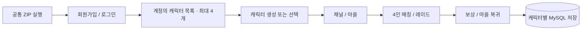
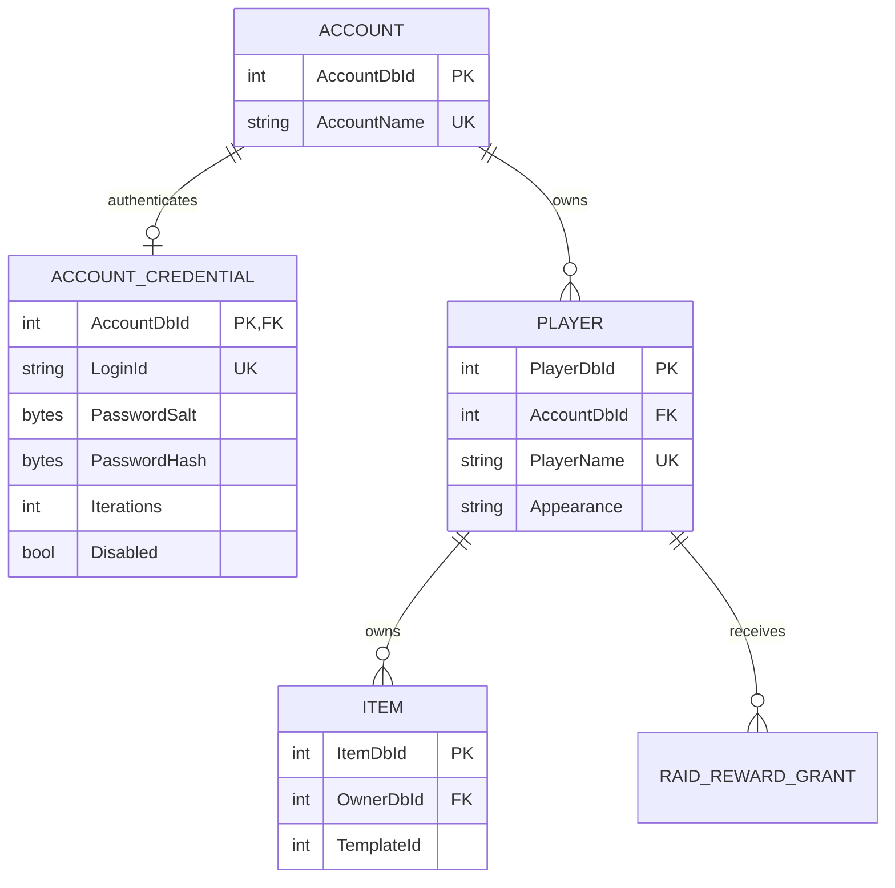

# 게임 회원가입과 계정별 캐릭터 저장

## 최신: 최소8자와 운영 도구

게이트웨이·네트워크 클라이언트·Unity UI를8~128자로 통일했다. 기존 비밀번호와 PBKDF2-SHA256600,000회 정책은 유지한다. 실제 AWS7자 거절·8자 가입/로그인 포함9검사 통과(`Logs/password8-aws-tests.log`). [아이디 조회·캐릭터 확인·비밀번호 재설정·계정 잠금/해제](Cloud/ACCOUNT-MANAGEMENT-KO.md). 비밀번호 원문 조회는 제공하지 않으며 실제 사용자 계정은 변경하지 않았다. 이하12자/미구현 관리자 내용은 과거 기록이다.

## AWS 후속 검증 완료

실제 공인 TLS 회원/캐릭터22검사, Unity 전투26/흐름10검사, DB9테이블 별도 복원 일치, 재시작 후 기존회원14검사 및 인증서 갱신 시험 통과. 첫 AWS 실행은 HostProposalOmissions 실패, 같은 소스 재실행은 통과하여 최초 실패 원인 해결로 단정하지 않는다. 외부 친구4PC와 AWS 정상 난도 보상 클리어는 후속 시험이다. [실제 배포 기록](Cloud/AWS-DEPLOYED-20261018.md). 아래 배포 전 표현은 당시 기록이다.

2026-10-18. 개인 초대 키를 배포하는 방식에서 **공통 클라이언트 + 게임 아이디/비밀번호** 방식으로 전환했다. AWS 계정은 운영자만 사용한다. 방장 Lua 계산 → 서버 C# 검증·확정의 전투 권위는 변경하지 않았다.

## 사용자 흐름

클라이언트의 `playtest.server.json`에는 공개 서버 주소와 포트만 들어간다. 비밀번호·AWS 키·DB 접속 정보는 포함하지 않는다. 서버 주소가 미정인 준비본은 접속 버튼을 비활성화한다. 아이디만 PlayerPrefs에 기억하며 비밀번호는 저장하지 않는다.

## 데이터 관계

기존 account/player/item/reward 구조를 재사용했다. 신규 `accountcredential`과 가입 수 제한용 `authregistrationgate`만 추가한다. 기존 계정 이름을 회원가입으로 선점하여 기존 캐릭터를 가져갈 수 없다. 기존 개발 계정의 회원 자격 전환은 자동으로 수행하지 않는다.

## 인증과 서버 경계

- MySQL 8.4에 PBKDF2-HMAC-SHA256 600,000회, 계정마다 무작위 32바이트 salt, 32바이트 해시 저장. 원문 비밀번호 저장/로그 출력 없음.
- TLS 게이트웨이가 비밀번호를 검증한 뒤 loopback 게임 서버 연결을 연다. `C_Login.UniqueId`는 인증된 아이디와 일치해야 한다.
- 회원 모드에서는 예전 초대 키로 로그인할 수 없다. 다른 계정 캐릭터 입장과 같은 계정 동시 접속을 거절한다.
- 등록은 account와 credential을 한 DB 트랜잭션으로 생성한다. 캐릭터와 시작 장비도 한 트랜잭션으로 생성한다. DB 오류는 생성 실패로 응답한다.
- 기본 전체 64계정. 가입 제한용 DB 행 잠금으로 동시 가입의 한도 초과를 막는다.
- 인증: 전체 분당 60회, IP당 분당 20회, ID당 분당 6회. 가입: IP당 시간당 4회. 해시 작업 최대 2개, 전체 연결 최대 32개. 서버 재시작 시 요청 제한은 초기화되지만 전체 계정 한도는 DB에 남는다.
- DB/게임 원본 포트/관리 HTTP는 외부 공개하지 않는다. 게임 서버에는 `PROJECT_DAWN_REQUIRE_REGISTERED_ACCOUNTS=true`를 설정하여 미등록 계정 자동 생성을 막는다. 이 설정만으로 비밀번호를 검증하는 것은 아니며 TLS 게이트웨이 경계가 반드시 필요하다.
- 이메일 수집, 자동 비밀번호 찾기, 비밀번호 변경 UI, 운영자 계정 관리 UI는 이번 범위에 없다.

비밀번호 저장 근거: [OWASP Password Storage](https://cheatsheetseries.owasp.org/cheatsheets/Password_Storage_Cheat_Sheet.html). 인증 전송/오류/요청 제한 근거: [OWASP Authentication](https://cheatsheetseries.owasp.org/cheatsheets/Authentication_Cheat_Sheet.html).

## 적용 및 검증

로컬 MySQL 백업을 먼저 수행했다. `Server/Server/Migrations/MySql/002_member_auth.sql`은 추가 테이블 생성용이며 기존 데이터 삭제를 포함하지 않는다. 백업 복원 시험은 이번 작업에서는 수행하지 않았다.

| 검증 | 결과 / 증거 |
|---|---|
| 실제 MySQL + TLS + 실제 FlowHost 회원 통합 | 44개 통과, `Logs/member-integration.log` |
| 4계정 동시 접속 | 각각 본인 캐릭터 생성·장비 로드·마을 입장 |
| 계정별 캐릭터 영속성 | 새 연결에서 기존 4개 목록 복원 |
| 권한 | 외부 캐릭터 선택, 중복 접속, 잘못된 비밀번호, 기존 계정 선점 차단 |
| 가입 제한 | 중복 ID, 약한 비밀번호, 전체 계정 한도, IP별 가입 제한 검증 |
| TLS/게이트웨이 회귀 | 17개 통과, `Logs/member-cloud-tests.log` |
| 실제 AWS 및 외부 인터넷 회선 | 아직 배포 전, 미검증 |

테스트는 임의 비밀번호로 생성한 테스트 계정만 사용했다. 로컬 테스트 계정은 DB에 남겼으며 사용자 계정을 삭제하지 않았다. 테스트 인증서는 테스트 프로세스의 신뢰 저장소에만 지정했고 Windows/Unity의 인증서 검증은 우회하지 않았다. 소켓 통합 검증과 실제 Unity 화면 검증은 구분한다.

## 다음 배포

1. 무료 플랜을 유지하며 EC2 단일 VM과 MySQL을 준비한다. 유료 전환/기존 RDS 템플릿 실행 금지.
2. 기본 게임 스키마 후 `002_member_auth.sql`을 적용한다. 실행용 DB 계정은 DML 권한만 갖는다.
3. 게임 서버와 인증 게이트웨이에 서로 다른 최소 권한 DB 계정을 지정한다. 회원 게이트웨이는 account/credential/gate만 접근한다.
4. 공인 IP TLS 인증서 발급·갱신 후 Unity에서도 인증서 검증을 확인한다.
5. `Cloud/Build-PlaytestClient.ps1 -Server tls://공인IP`로 공통 ZIP을 만든다.
6. 실제 4인 외부 회선에서 가입→캐릭터→레이드→보상→재로그인을 확인한 뒤 친구 테스트 완료로 기록한다.
