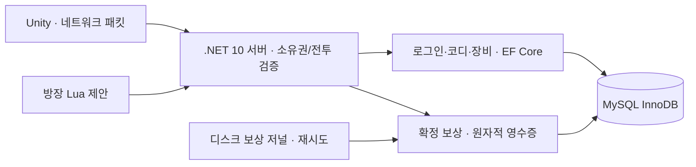

# ProjectDawn MySQL 전환 · 2026-10-18

사용자 요청은 채용 공고에 맞춘 기술 과시보다 **프로젝트의 기본 DB를 MySQL로 설정**하는 것이다. C# 전투 서버·Unity·방장 Lua 계산/서버 C# 검증 구조를 유지하고 영속 계층을 변경했다. 기존 MS SQL 인스턴스와 데이터는 삭제하거나 덮어쓰지 않았다. 원작 던파의 내부 DB 구조를 복원한 작업은 아니다.

## 현재 구성

| 항목 | 적용 |
|---|---|
| 서버 | MySQL Community 8.4.11 LTS, 작업 전용 ZIP 설치 |
| 연결 | 로컬 `127.0.0.1:3307`, DB `projectdawn`; 게임 클라이언트는 DB에 직접 연결하지 않음 |
| 저장 | InnoDB, utf8mb4/utf8mb4_0900_ai_ci, UTC, commit flush=1, binlog sync=1, binlog 7일 |
| 관측 | 200ms 이상 slow query log. 파일은 비밀 디렉터리 안에 보관하며 자동 회전/보존 정리는 후속 작업 |
| 런타임 | .NET 10 / EF Core 10.0.13 / Oracle MySql.EntityFrameworkCore 10.0.9 |
| 계정 | root는 초기화/이관/백업 전용. 게임 계정은 해당 DB의 SELECT/INSERT/UPDATE/DELETE만 허용 |
| 비밀 | 프로젝트 밖 `E:/task/ProjectDawnTools/mysql/private`, 현재 Windows 사용자·SYSTEM만 접근하는 ACL |
| TLS | 로컬 개발은 Required로 암호화. 외부 배포는 VerifyFull + 호스트/CA 검증 필요 |
| 시작 | `Start-LocalGame.ps1` → 기본 MySQL 서버 경로. `Start-FlowServer.ps1 -Provider SqlServer`는 이전 DB 경로 |

MySQL은 Windows 서비스나 시스템 PATH에 설치하지 않았다. 로컬 시작 스크립트가 필요할 때 프로세스를 실행한다. 원격 DB 포트를 개방하거나 AWS 자원을 생성하지 않았다. 기존 .NET 3.1 서버는 MS SQL 호환용이고 MySQL 실행에는 .NET 10을 사용한다. MySQL 커넥터가 요구하는 서버용 Protobuf 런타임을 3.35.0으로 올렸고 Unity의 프로토콜/스냅샷은 변경하지 않았다.

## 이관

`MySqlTools migrate`는 7개 원본 테이블을 읽기 트랜잭션으로 가져오고, 빈 MySQL 대상에 ID를 보존하여 한 트랜잭션으로 입력한다. 기존 대상에 한 행이라도 있으면 덮어쓰기를 거부한다. 행 수와 정규화한 내용 SHA-256을 비교한 후에만 커밋한다. SQL Server의 100ns 시간 정밀도는 MySQL datetime(6)에 맞춰 마이크로초 미만 자릿수를 잘랐다. 보상 digest 값 자체는 변경하지 않는다.

| 원본 테이블 | 복사 행 수 |
|---|---:|
| Account | 846 |
| Player | 846 |
| Item | 401 |
| MatchHistory | 5 |
| MatchHistoryMember | 20 |
| RaidRewardEncounter | 13 |
| RaidRewardGrant | 52 |

이관 검사 (`Artifacts/mysql-migration/copy-verification.json`, 로컬 검증 자료). 이후 검증 계정/아이템이 추가되므로 현재 행 수는 이 값보다 많다. 기존 MS SQL의 가방 슬롯 중복 2그룹은 원본 그대로 보존했다. 임의 삭제/재배치하지 않았으며 인벤토리 전체에 슬롯 유일성 제약을 적용한 것으로 주장하지 않는다.

## 쿼리·동시성

- MySQL 보상은 Encounter PK 삽입/중복 키 잠금 → digest 확인 → 같은 완료 영수증은 무효과 반환 → 캐릭터 소유권 잠금 → 보상 행/실제 장비 행을 함께 커밋한다.
- 여러 전투가 같은 캐릭터에 동시에 지급할 때는 캐릭터 ID 순으로 잠가 교착 가능성을 줄인다. MySQL 1213/1205는 전체 트랜잭션을 최대 3회 재시도한다. 연결 단절로 커밋 여부가 불명확하면 기존 영수증 저널이 동일 ID/digest로 재시도한다.
- 보상 `(Encounter, PlayerDbId)` PK, `(Encounter, Slot)` 유일성, 보상 Item ID 유일성, FK·금액/슬롯 CHECK를 적용했다.
- 인벤토리 `(OwnerDbId, Slot)`, 보상 이력 `(PlayerDbId, Encounter, Amount)` 인덱스를 두고 EXPLAIN으로 인덱스 사용을 확인했다. 작은 로컬 데이터의 계획 확인이며 대규모 처리량 측정은 아니다.
- 코디 저장은 소유 계정/캐릭터 조건 + 트랜잭션 + 읽기 확인을 유지한다.
- 서버 재시작으로 PartyId가 다시 1부터 시작해 과거 매칭 이력을 갱신하는 문제를 발견했다. MySQL 매칭 이력에는 실행별 ServerRunId와 PartyId를 묶어 새 실행의 기록을 구별한다. 이전 이관 행의 실행 ID는 NULL로 보존한다.

수정 전 80ms 시험에서 영향을 받은 이관 매칭 기록은 MS SQL 원본을 기준으로 복원했다. 신규 MySQL 실행 기록은 수정하지 않았고, 기존 5개 이력의 해시 일치를 확인했다(복원 기록 (`Artifacts/mysql-migration/legacy-history-restored.json`, 로컬 검증 자료)). 수정 후 서로 다른 실행 ID 2개/신규 이력 3개가 별도로 저장된 것도 확인했다.



## 검증과 남은 범위

- 권한·TLS·InnoDB·인덱스 계획 (`Artifacts/mysql-migration/runtime-verification.json`, 로컬 검증 자료): 8개 검사 통과.
- 동시 지급 (`Artifacts/mysql-migration/concurrency-verification.json`, 로컬 검증 자료): 최초 동일 영수증 16회 동시 요청, 별도 전투 8개 동시 지급, 전체 재실행에서 토큰/장비 중복 없음. 신규 테스트 캐릭터들의 가방 슬롯도 중복 없음. 7개 검사 통과.
- `Logs/mysql-lifecycle-tests.log`: 실제 MySQL/TCP 재접속·퇴장·오프라인 보상·소유권 실패 롤백·독립 프로세스 저널 복구 등 46개 검사 통과.
- 방향별 80ms Unity 실행 `Artifacts/flow-4p-20261018-153135`: 네 명 귀환·장비/코디 유지·확정 상태/이벤트 일치·Unity 오류 0. 다만 전체 스킬 노출, 시계 기준, 예측 점프 일치, 타인 컷신 억제 관측량 검사는 전부 통과하지 못했다. DB 전환 성공을 고지연 전투 전체 통과로 표현하지 않는다.
- 최종 방향별 30ms Unity 4인 (`Artifacts/flow-4p-20261018-153542/flow-verification.json`, 로컬 검증 자료): 실제 90초 플레이, 전투 26·흐름/SQL 12개 통과. 확정 상태 182개·이벤트 426개 일치. 입력 거절/Unity 오류 없음. 이관한 네 캐릭터의 SQL 코디·장비와 귀환 후 외형 일치. 연습 무적/HP 변경 없음.
- 중간 실행 `153332`는 이전 80ms 프록시의 포트 점유 때문에 실제 30ms 시험이 아니었다. 오류 로그/실패 결과를 보존하고, 프록시 포트 점유 및 시작 실패 검사를 추가한 뒤 `153542`에서 재검증했다. 80ms씩 왕복하면 기존 시계 검증 상한 160ms를 처리 지연까지 포함해 넘으므로 수신 시각 판정으로 전환된다. 상한을 무작정 늘려 검사를 통과시키지 않았다.
- `Logs/mysql-flow-tests.log`: 실제 MySQL 서버에서 SQL 로그인/채널 이동/타인 장비 거부/네 명 로딩/능력치 고정/귀환 21개 통과.
- 백업 복구 (`Artifacts/mysql-migration/backup-verification.json`, 로컬 검증 자료): 서버 쓰기를 중지한 뒤 mysqldump로 백업, 별도 `dawn_restore_20261018_153800` DB에 복구해 7테이블 행 수/내용 해시 일치. 백업·시험 DB는 보존.
- 실제 MySQL 4인 보상 화면/저장 검사 (`Artifacts/rewards-4p-20261018-153948/reward-verification.json`, 로컬 검증 자료): 방향별 30ms, 네 명의 소유 Item ID/템플릿/인장/영수증 일치, Pending→Saved, 가방 7→8, 마을 귀환 및 코디 유지 등 12개 통과. 결과창 (`Artifacts/rewards-4p-20261018-153948/p1/sql-saved-rewards.png`, 로컬 검증 자료). 보스 HP를 15초 뒤 낮추는 별도 시험 서버이며 정상 난도 클리어 증거는 아니다. 백업 복구 검증 이후 생성한 테스트 보상이다.
- 물리 PC 4대, 인터넷, 대규모 부하, 실사용 데이터 다량 이관, AWS/RDS 실제 실행은 미검증.

## 재현·백업·복귀

```powershell
# 최초 새 환경에서만. 기존 private/local.json 또는 data가 있으면 초기화 거부.
./Tools/Setup-MySqlLocal.ps1
# 빈 대상에만 이관. 운영 중 원본 쓰기는 중지한 상태에서 실행.
./Tools/Migrate-SqlServerToMySql.ps1
# 기본 게임 실행
./Start-LocalGame.ps1
# 일관된 논리 백업 + 별도 DB 복구 + 7개 테이블 해시 대조
# 검증 시에는 서버 쓰기를 중지해야 한다.
./Tools/Backup-MySqlLocal.ps1 -VerifyRestore
# 명시적인 이전 MS SQL 경로 (MySQL의 이후 변경분은 자동 역이관되지 않음)
./Start-FlowServer.ps1 -Provider SqlServer -CloudRuntime
```

백업과 복구 시험 DB는 보존한다. 비밀번호는 CLI 인수로 전달하지 않고 권한 제한된 임시 옵션 파일로 전달한 뒤 제거한다. 자동 예약 백업/보존 정리/시점 복구(PITR) 훈련은 아직 구성하지 않았다. binlog를 켠 것만으로 PITR 검증 완료라고 주장하지 않는다.

AWS 템플릿의 대상은 MySQL/3306으로 바꿨고 실행기는 MySql + VerifyFull을 요구한다. 실제 RDS 버전·인스턴스·예산·인증서는 사용자와 추후 확정한다. 이번 로컬 ZIP 설치가 AWS 배포를 의미하지 않는다.

최종 .NET 10 서버 빌드와 이전 .NET 3.1 호환 빌드 성공. CloudFormation 정적 검사와 Python 실행기 구문 검사 통과. MySQL 커넥터를 포함한 Linux x64 self-contained 패키지를 `Artifacts/cloud-release-20261018-153829/release.zip`으로 만들었다. 이는 크로스 퍼블리시 결과이며 Linux/RDS 실제 실행이나 외부 접속을 검증했다는 뜻은 아니다.

## 공식 기술 근거

- [MySQL Community LTS 다운로드](https://dev.mysql.com/downloads/mysql/8.4.html)
- [Windows ZIP 설치](https://dev.mysql.com/doc/refman/8.4/en/windows-install-archive.html)
- [데이터 디렉터리 초기화](https://dev.mysql.com/doc/refman/8.4/en/data-directory-initialization.html)
- [Oracle EF Core 패키지](https://www.nuget.org/packages/MySql.EntityFrameworkCore/10.0.9)

채용 조사 중 찾은 PC 던파 서버 공고는 MySQL뿐 아니라 C++ 코드도 요구했다. 현재 구현은 C#이며 이를 C++ 포트폴리오로 표시하지 않는다. 사용자의 후속 설명에 따라 이번 작업의 목표는 채용 공고 전체 충족이 아니라 MySQL 전환이다.
