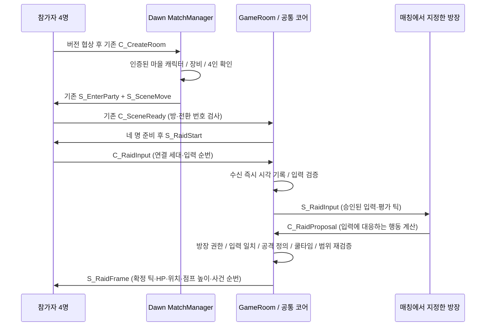

# 4인 매칭·전투 네트워크 연결 기록

2026-10-18. 작업 위치: `E:\task\ProjectDawnIntegration`.

**기존 Dawn의 실제 매칭·방 이동·패킷 처리 코드에 공통 전투 코어를 연결했다.** 별도 모의 매칭 서버를 만든 것이 아니다. 자동 클라이언트가 실제 루프백 TCP 소켓으로 요청하며, UDP 우회 검사도 실제 UDP 소켓을 사용한다. 계정/캐릭터/장비 초기 상태만 테스트에서 준비한다. 실제 DB 로그인 성공과 Unity 게임 화면 4개의 플레이는 아직 검증하지 않았다.

## 실행 경로와 권위

방장은 승인된 입력을 받아 **행동 종류·시작 틱·원인 입력을 계산해 제안**한다. 피해 수치는 패킷으로 받지 않는다. 서버가 공유 C# 규칙으로 명중/피해를 재계산하고 확정한다. 지금의 방장 클라이언트는 이 최소 행동 경로를 구현했으며 전체 전투 예측 시뮬레이션이나 Lua 보스 스케줄러가 완성된 것은 아니다.

## 구현 위치

| 파일 | 역할 |
|---|---|
| `Protocol/Protocol.proto`, `Protocol/Raid.proto` | 기존 ID 0~36 유지, 새 ID 37~45 추가. 타입을 서버·클라이언트가 같은 어셈블리로 사용 |
| `Client/RaidNetworkClient.cs` | 시작 계약 수신, 자기 입력 생성, 방장의 중복 없는 제안, 확정 사건 순번 확인·중복 연출 콜백 방지 |
| `Server/Server/Session/ClientSession_Raid.cs` | 실제 세션→불변 바인딩 연결, 패킷 수신 즉시 코어에 접수, 연결당 수신량 제한 |
| `Server/Server/Game/Room/GameRoom_Raid.cs` | 4인 준비 장벽, 코어 소유·갱신, 확정 상태와 사건 전송, 중단 처리 |
| `Server/Server/Game/Match/MatchManager.cs` | 기존 장비/4인 매칭 유지, 새 버전은 `BakalCombatV1` 큐로 분리 |
| `Server/Server/Game/Room/RoomTransferService.cs` | 기존 이동 절차에서 코어 방 설정, 전투 중단/로딩 취소 후 마을 복귀 |
| `Packages/com.projectdawn.combat/Runtime/IntegrationRules.cs` | 이름이 명시된 검증용 공격 두 종류와 임시 시간 설정 |
| `NetworkTests/Program.cs` | 실제 소켓을 사용한 통합 검증과 테스트용 계정/장비 준비 |

서버의 기존 `ServerCore.PacketSession`이 TCP 프레임을 읽고 `PacketManager`가 실제 `ClientSession`으로 처리한다. 테스트에서 핸들러를 가짜 결과로 대체하거나 `CustomHandler`로 전투를 가로채지 않는다. 테스트에서만 내부 세션 생성기를 사용할 수 있도록 `InternalsVisibleTo`를 지정했다. 서버 실행 파일에는 인증 우회 명령이나 테스트 계정 로그인 경로를 추가하지 않았다.

## 보호 경계

| 경계 | 현재 동작 |
|---|---|
| 구버전 호환 | 새 버전 협상 없이 기존 전투 유지. 매칭 중 버전 변경 금지, 신/구 큐 혼합 금지 |
| 방 입장 | 서버 매칭 명단의 실제 Player/Session 참조만 허용. 네 명 전원 준비 전 시작 금지 |
| 입력 신원 | 전투 ID·플레이어·연결 세대·순번 검증. 다른 참가자의 식별자를 보내도 세션 권한이 바뀌지 않음 |
| 방장 권한 | 매칭 첫 구성원을 서버가 지정. `IsMaster`를 패킷으로 보내는 것만으로 변경 불가 |
| 제안 | 실제 승인 입력과 같은 행동이어야 피해 발생. 누락 시 서버가 공격을 대신 생성하지 않음 |
| 누락 감시 | 검증판은 방장 제안 누락이 전투 누적 3회면 중단·복귀. 추후 RTT 측정에 맞춰 정책/수치 조정 필요 |
| 기존 경로 우회 | 코어 방에서는 기존 AI·이동·점프·스킬·충돌·장비 경로 차단. UDP 이동도 별도 상태를 기록하기 전에 차단 |
| 확정 HP | 미리보기 상태를 기존 객체 HP로 복사하지 않음. 확정 스냅샷만 기존 객체/모니터링에 반영 |
| 사건 | TCP 순서 보장 + 최종 사건 순번. 클라이언트는 중복 사건 콜백 생략, 순번 누락은 오류로 처리 |
| 수신량/크기 | 연결당 초당 240개, 새 요청 512바이트 제한. 코어 자체 큐/원장/재판정 상한도 유지 |
| 결과 크기 | 60,000바이트 초과 프레임은 잘라서 전송하지 않고 전투 중단 |
| 방장 연결 해제 | 진행 전투 중단. 로딩 단계 연결 해제도 전투 시작 취소. 기존 이동 번호를 이용해 마을로 복귀 |
| 틱 실행 | 서버 타이머 20ms, 방 단위 동시 Update 진입 차단. 네트워크 수신 시각은 방 큐 대기로 바뀌지 않음 |

## 시각 정책 — 아직 측정 전

검증판: 틱 20ms, 입력 여유 L=120ms, 방장 제안 여유 P=120ms, 확정 대기 W=260ms. 이는 **제품 수치 확정이 아닌 통합 실험 설정**이다.

실제 연결의 `SessionBinding.ClockTrusted`는 현재 false이고 `S_RaidStart.receive_time_only=true`를 명시한다. 클라이언트가 임의의 미래/과거 시각을 보내도 서버 수신 틱으로 평가한다. 시계 동기화·오차 추정기가 구현되기 전까지 사용자가 보낸 시각을 신뢰하지 않기 위한 단계다.

따라서 앞서 합의한 **“화면에서 피한 점프가 지연 후 도착해도 허용 구간 안에서 인정”** 정책의 네트워크 적용은 아직 완료되지 않았다. 코어의 늦은 입력 재판정은 기존 단위 시나리오로 검증됐으며, 실제 입력 시각을 안전하게 매핑하는 연결 작업이 다음에 필요하다.

## 검증 및 재현

통합 루트에서 `./Validate.ps1` 실행:

1. 공통 코어 26개 시나리오를 .NET 8 / .NET Core 3.1에서 각각 실행.
2. 서버 사본 빌드.
3. `NetworkTests`의 실제 4인 TCP 매칭/전투 및 UDP 검증.
4. 기존 서버 회귀 검사(설정, 로그인 실패 재시도, 잘못된 패킷/수신 오류 연결 정리).

`./Validate.ps1 -Unity`는 공통 코어의 Unity Editor/Mono 검사도 추가한다. Unity 게임 씬 검증을 뜻하지 않는다.

네트워크 검사 대상:

- 3명 대기/4명 매칭, 전원 같은 방, 준비 3명일 때 시작 금지, 잘못된 이동 번호 거절.
- 네 명 공격 100 피해, 4인 3단 공격 12회 추가 피해, 네 클라이언트의 확정 사건열 일치.
- 중복 입력·내용 변조·다른 참가자·오래된 연결 세대·비방장 제안 거절.
- 방장도 원래 입력 없이 피해를 생성하지 못함. 정의되지 않은 보스 공격 금지.
- 서버 확정 후 늦은 제안 거절, 임의 클라이언트 시각은 서버 수신 틱으로 평가.
- TCP/UDP 기존 이동·충돌 우회 금지, 정상 점프/이동 및 입력 임대 만료 시 정지.
- 중복 결과 수신 시 연출 콜백 재발행 없음.
- 비방장 연결 해제 시 캐릭터·보스 HP 유지, 방장 해제 시 중단과 실제 마을 입장.
- 인증/장비 요건, 구버전 큐 분리, 큐 대기 중 버전 변경 방지, 외부 참가자 방 진입 차단.
- 로딩 도중 방장 해제와 취소된 방의 오래된 입장 완료 신호 차단.
- 누락된 방장 제안 3회에 대한 전투 중단, 피해/보상 임의 생성 없음.

최신 통과 개수와 상세 증거는 네트워크 로그 (`Logs/network-validation.log`, 로컬 검증 자료)의 `[DAWN_NETWORK_VALIDATED]`를 기준으로 한다. 테스트는 프로세스 내부에서 실제 서버 세션을 실행하며 루프백 임시 포트를 사용한다. DB 기록은 기존 테스트 환경 변수로 끄고 원래 DB/공유기/배포 서버에 접속하지 않는다. 게임 로그인 성공, 방화벽 통과, 두 PC 간 LAN 성능을 검증했다고 해석하면 안 된다.

## 다음 작업과 출시 전 한계

1. 기존 Dawn Unity 클라이언트 작업 사본에 `RaidNetworkClient`와 새 프로토콜을 연결하고, 원래 입력·오브젝트 표시·예측 연출을 새 경로로 전환. 현재 클라이언트는 재사용 가능한 순수 C# 네트워크 처리기와 자동 소켓 실행기다.
2. 시계 교환·왕복 시간/오차 추정·제한된 과거 입력 매핑 구현 및 실제 지연/혼잡 조건 검증. TCP 혼잡으로 연쇄 지연이 발생할 수 있으므로 현재 시간 설정을 제품 기준으로 고정하지 않는다.
3. 정수 X축 기반 최소 모델을 기존 2.5D 전투/전체 스킬로 확장. 현재 규칙은 단타·3단 공격 두 종류이며 보스 AI 제안은 의도적으로 열지 않았다. Lua 패턴/RNG/페이즈 검증 후 허용한다.
4. 3분 재접속·만료 제거·자발적 퇴장·사망/재접속 상태 및 보상 영속화. 현재 비방장 단절은 캐릭터 유지까지만 연결됐고 자동 재접속/3분 제거는 구현하지 않았다. 기존 합의 정책은 유지되며 아직 이행되지 않은 범위다.
5. 전체 스킬/메테오/리소스/히트스톱·쉐이크와 네 개의 실제 게임 화면 검증. 현재 클리어는 `ValidationClear_NoRewards`로 끝나는 검증 모드이며 보상을 지급하지 않는다.

이 단계의 완료는 **4인 네트워크 연결 경로의 검증 완료**이며, 전체 4인 게임 통합 빌드 완료를 뜻하지 않는다.
