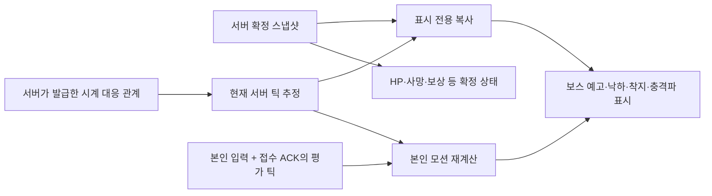

# 서버 시간에 맞춘 보스 예고·메테오 표시

2026-10-18 / `E:\task\ProjectDawnIntegration`

## 변경한 동작

이전 화면은 확정 대기 260ms와 수신 지연만큼 과거의 보스 영역을 표시했다. 본인 입력은 현재 시각으로 서버에 전송되므로, 표시된 충돌 시점과 실제 판정 시점이 어긋날 수 있었다.

이번에는 서버가 확정한 공격 영역·일정을 읽고, 시계 동기화로 추정한 **현재 서버 틱까지 표시 상태만 진행**한다. 예고 영역, 메테오 위치, 착지 폭발, 지상 충격파는 같은 틱을 사용한다. 원본 확정 상태는 변경하지 않는다.



방장이 Lua로 패턴을 계산하고 서버가 C#으로 검증하는 구조는 그대로다. 표시 계층은 새 패턴을 승인하지 않으며 피해·사망·Lua 확정 콜백을 발급하지 않는다.

## 표시와 판정의 연결

| 항목 | 구현 |
|---|---|
| 보스 영역 | 확정 스냅샷의 Age를 공유 코어와 같은 고정 틱으로 진행. 활성 구간의 이동 속도와 소멸 시점도 반영 |
| 메테오 | 동일한 영역 Age로 대각선 낙하·착지 스프라이트·전장 전체 충격파 표시 |
| 착지음·흔들림 | 이미 승인된 메테오 영역이 표시상 활성화되는 순간 재생. 영역 ID로 중복 방지 |
| 확정 이벤트 | 뒤늦게 도착한 착지 이벤트가 폭발음을 다시 재생하지 않음. 다른 확정 이벤트는 원래 확정 틱으로 중복 판별 |
| 본인 점프 | 보낸 입력 시각을 기준으로 예측하고 ACK의 평가 틱으로 수정. 거절된 입력은 재계산에서 제외 |
| 입력 유지 | 서버와 같은 6틱 유지 규칙을 적용하고, 확정 스냅샷 이전의 마지막 유지 입력만 보존 |
| 표시 틱 | 본인 점프 높이와 적 공격 표시를 같은 틱에 놓음. 미래 입력이 한 틱 먼저 점프 높이를 올리지 않음 |
| 위치 보정 | 본인 캐릭터에는 기존의 추가 위치·높이 보간 지연을 적용하지 않음. 다른 캐릭터 보간은 유지 |
| HP | 본인 모션 예측과 분리해 서버 확정 HP만 표시 |
| 연결 정체 | 스냅샷보다 최대 60틱만 진행. 무한 외삽과 늦은 착지 효과 재생 제한 |

자동 검증 입력도 실제로 화면에 사용하는 영역의 남은 경고 시간을 보고 점프한다. 이전 검증 드라이버의 ‘확정 대기 시간을 미리 더해 점프’하는 보정은 제거했다.

## 검증 방법

`TimelineTests`에서 16·18·22틱 늦은 스냅샷과 30·60FPS 표시 조건을 비교한다. 반복 그리기에서 폭발음이 중복되지 않는지, 7개 보스 패턴의 영역 시간이 서버 상태와 같은지, ACK 변경/거절, 스냅샷 불변성, 경고를 보고 한 점프의 회피 결과를 확인한다.

실제 Unity 검증은 `presentation-audit.txt`에 영역 ID·예측 활성 틱·실제 그린 틱·본인 점프 높이를 기록한다. 이를 서버가 나중에 확정한 `ContentMeteorImpact`, `ContentMeteorShockwave`, 해당 참가자의 `ContentMeteorJumpAvoid`와 연결한다. 최종 HP/전체 상태 일치만으로 화면 타이밍을 검증했다고 주장하지 않는다.

```powershell
cd E:\task\ProjectDawnIntegration
./Validate.ps1
./Build-Unity.ps1
./Play-Unity4.ps1 -Auto -Seconds 85 -NetworkDelayMs 30
python ./Verify-Unity4.py ./Artifacts/<실행폴더>
```

## 최종 검증 결과

최종 빌드로 실제 Unity 클라이언트 네 개를 85초 실행했다. 루프백 통신에 방향별 30ms를 추가했고 최종 측정 RTT는 61.7–62.8ms였다. 자동 입력은 화면에 표시하는 경고의 남은 시간을 보고 일반 점프 입력을 보냈으며, 서버 판정이나 HP를 강제로 변경하지 않았다.

| 검사 | 결과 |
|---|---|
| 표시 시간 단위 검사 | 24개 통과: 30/60FPS, 지연 스냅샷, ACK 수정/거절, 점프 한 틱 경계, 확정 HP 보호, 7개 패턴 |
| 실제 4인 자동 검사 | 26개 모두 통과 |
| 메테오·충격파 활성 시점 | 참가자마다 32건, 총 128건 비교. 표시 계산 틱과 서버 확정 틱 차이 0 |
| 그리기 시점 | 추정 서버 틱 기준 0–1틱 지연(60Hz에서 약 0–16.7ms). 물리 화면·네트워크 전체의 절대 시간 오차 측정값은 아님 |
| 화면상 점프 회피 → 서버 회피 | 59/59 일치. 동시에 대시 무적이 적용된 5건은 점프 전용 비교에서 분리 |
| 착지 효과 중복 | 0건 |
| 공통 확정 상태 | 스냅샷 171개·콘텐츠 사건 접두열 303개 일치 |
| 기존 콘텐츠 | 21개 스킬, 7개 보스 패턴, 방장 Lua 콜백 유지. 메테오 네 발·87틱 간격·착지 동시 충격파 확인 |
| Unity 오류 / 입력·제안 접수 거절 | 0 / 0 |

전체 회귀 검사에서 .NET 8/3.1 전투 코어 각각 26개, 시계 20개, Lua 20개, 콘텐츠 28개, 네트워크 37개와 기존 서버 검사가 통과했다. 마지막 점프 한 틱 경계 수정 후에는 표시 시간 검사 24개, Unity 재빌드, 위 실제 4인 검사를 다시 완료했다. 측정 종료 시 전투 진행 중이며 클리어·보상 검증은 아니다.

- [실행 빌드](Build/ProjectDawnRaid.exe) — 다른 PC로 옮길 때는 Build 폴더 전체가 필요하다.
- 최종 검증 JSON (`Artifacts/unity-4p-20261018-031541/verification.json`, 로컬 검증 자료)
- 표시 시간 검사 로그 (`Logs/timeline-tests-final.log`, 로컬 검증 자료)
- 전체 회귀 검사 로그 (`Logs/timeline-full-validation.log`, 로컬 검증 자료)
- 최종 빌드 로그 (`Logs/timeline-final-build.log`, 로컬 검증 자료)

각 참가자의 `presentation-audit.txt`와 `confirmed-audit.txt`는 같은 실행 폴더의 `p1`–`p4` 아래에 보관했다.

（화면 자료: 실제 네 클라이언트의 검증 화면 — Notion 참조）

## 적용 범위와 한계

- 서버가 확정한 패턴 일정만 표시하므로 첫 경고 데이터가 도착할 때는 일정이 이미 일부 진행됐을 수 있다. 수신 시 경고를 처음부터 다시 재생하지 않고 현재 시간으로 맞춘다. 다음 패턴을 임의로 예측·승인하지 않는다.
- 미확정 상태에서 생긴 패턴 취소·페이즈 전환은 확정 스냅샷을 받을 때 반영한다. 취소 전 재생한 소리를 되돌리지는 않는다. 확정 피해·사망과 표시 효과는 분리한다.
- 점프 버튼을 충돌 순간에 눌렀다는 이유만으로 무조건 회피하지 않는다. 해당 판정 틱에 기존 점프 회피 높이 0.35 이상이어야 한다. 화면에서도 같은 상승 시간이 필요하다.
- 시계가 불안정하면 수신 프레임의 서버 시각을 기준으로 표시하며 정확도가 낮아질 수 있다. 입력은 기존 수신 시각 대체 규칙을 따른다. 허용 지연·확정 경계 밖의 입력을 소급 승인하지 않는다.
- 물리 LAN·인터넷 전 구간의 동시성을 보장한 것은 아니다. 이번 검증은 같은 PC의 네 Unity 프로세스와 루프백 지연 도구를 사용한다.
- 운영 로그인·마을 화면 전체 연결, 3분 재접속·영속 보상은 후속 작업이다.
