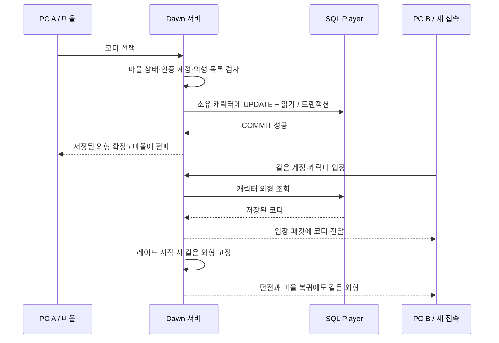

# 캐릭터 코디 SQL 저장

2026-10-18 · `E:\task\ProjectDawnIntegration`

마을에서 선택한 아바타·무기 외형을 서버의 `Player.Appearance`에 저장한다. 같은 서버·계정·캐릭터로 접속하면 PC의 로컬 설정과 관계없이 SQL 값을 사용한다. 실제 다른 물리 PC를 조작한 검증과는 구분하며, 새 연결·새 클라이언트·서버 재시작으로 영속성을 검증했다.



## 저장·실패 처리

- `Appearance`는 nullable `nvarchar(512)`이다. NULL은 아직 저장한 코디가 없다는 뜻이다.
- 기존 캐릭터는 SQL 값이 없는 첫 입장 때만 해당 캐릭터의 예전 로컬 코디를 가져온다. 로컬 기록도 없으면 기본 외형을 저장한다.
- `initializeOnly` 요청은 SQL의 `Appearance IS NULL` 조건으로만 쓴다. 다른 PC의 오래된 최초 가져오기 요청이 늦게 도착해도 이미 저장된 코디를 덮어쓰지 않는다.
- 일반 코디 변경은 소유 계정·캐릭터 조건의 UPDATE로 처리한다. 클라이언트가 다른 캐릭터 ID를 지정하는 필드는 없다. 명시적인 변경은 마지막으로 성공한 저장값을 사용한다.
- SQL 저장·커밋 이후에 서버 메모리와 마을 외형을 갱신한다. 실패하면 기존 외형과 오류 응답을 보내며 클라이언트 미리보기도 되돌린다.
- 저장 대기 중에는 코디 재선택·마을 이동·매칭을 막는다. 매칭·레이드·씬 전환 중 변경 차단은 유지한다.
- 입장 때 SQL 외형을 로컬 캐시보다 우선하고 자동으로 다시 저장하지 않는다. 로컬 캐시는 서버 승인 뒤에만 갱신한다.
- 방장 Lua 계산·서버 C# 검증 및 본인 전용 컷신 규칙은 유지한다.

## DB 반영과 실행

현재 연결된 개발 DB에 `Migrate-Appearance.ps1`을 적용했다. 기존 Player 810개를 유지한 채 열을 추가했고, 같은 마이그레이션을 두 번 실행해 재실행 가능성을 확인했다. 기존 캐릭터 행을 일괄 수정하거나 테이블을 삭제하지 않았다. 검증 중 쓰기는 별도 `PD_Flow_1018032620_1..4` 캐릭터에 한정했다.

다른 서버 DB에 이 빌드를 설치할 때는 서버를 교체하기 전에 다음을 실행한다. 연결 문자열은 서버 환경 변수 또는 기존 서버 설정에서 읽으며 게임 빌드에 포함하지 않는다.

```powershell
./Migrate-Appearance.ps1
./Build-Unity.ps1
./Start-LocalGame.ps1
```

SQL 파일: `Server/Server/Migrations/20261018040000_AddPlayerAppearance.sql`. 기존 DB에는 이 추가 전용 스크립트를 사용한다. EF 모델·마이그레이션·스냅샷도 함께 반영했으며, 자동 DB 초기화/전체 마이그레이션을 실행하도록 바꾸지는 않았다.

## 검증

- SQL 저장 검사 5개: 다른 계정의 캐릭터 변경 거부, 실제 SQL 쓰기 실패 시 롤백, NULL 값 최초 이전, 오래된 이전 요청 차단, 새 DB 연결에서 값 복원.
- 실제 소켓 검사 17개: 새 클라이언트 네 개에서 로컬 캐시 없이 코디 복원, 오래된 코디로 덮어쓰기 차단, 4인 레이드 스냅샷과 마을 복귀까지 외형 일치 및 기존 장비·매칭·귀환 검사.
- 서버를 종료하고 새 프로세스로 재시작한 뒤, 새 클라이언트 네 개가 코디 저장 요청 없이 SQL 값을 복원했다.
- Unity 실제 네 클라이언트에서 방향별 30ms 지연·85초 전투를 실행했다. 전투 검사 26개와 SQL/흐름 검사 12개를 모두 통과했다. 로그인 시 코디 재전송 0건, SQL 조회값/로그인/레이드/복귀 외형 4/4 일치. Unity 오류 0, 점프 회피 60/60 일치, 공통 확정 스냅샷 172개와 콘텐츠 사건 326개 일치.
- 최종 Unity 빌드 성공: 오류 0·경고 0. 서버의 기존 .NET Core 3.1 지원 종료 경고는 남아 있으며 AWS 준비 단계에서 런타임 갱신 예정이다.

로그: `Logs/appearance-migration.log`, `Logs/appearance-store-tests.log`, `Logs/appearance-network-tests.log`, `Logs/appearance-restart-tests.log`.

## 다음 작업

친구들의 외부 네트워크 접속과 AWS 시험 배포 계획은 [AWS 확장 계획](AWS-FRIENDS-PLAYTEST-PLAN.md)에 정리했다. 현재 실행 서버는 루프백 기본값이며 인터넷에 공개하지 않았다.


## 실제 실행 증거

SQL과 네 캐릭터 대조 결과 (`Artifacts/flow-4p-20261018-034713/sql-appearance-verification.json`, 로컬 검증 자료) · 전체 흐름 검사 (`Artifacts/flow-4p-20261018-034713/flow-verification.json`, 로컬 검증 자료) · 전투 검사 (`Artifacts/flow-4p-20261018-034713/verification.json`, 로컬 검증 자료)

（화면 자료: SQL 코디를 불러온 실제 마을·레이드·복귀 — Notion 참조）

네 캐릭터 마을/복귀 대조 화면 (`Artifacts/flow-4p-20261018-034713/avatar-round-trip.png`, 로컬 검증 자료)

재현 명령:

```powershell
./Play-Flow4.ps1 -ReturnAfter 85 -AccountPrefix PD_Flow_1018032620 -SavedLooks
python Verify-Flow4.py Artifacts/<실행폴더> --sql
./Verify-SqlAppearance.ps1 -RunDirectory Artifacts/<실행폴더>
```

`-SavedLooks`는 자동 코디 변경을 생략하고 SQL 값만 불러온다. 위 테스트는 동일 PC의 독립 프로세스 네 개로 수행했다. 실제 다른 물리 PC·외부 인터넷/AWS 접속은 다음 단계다.
