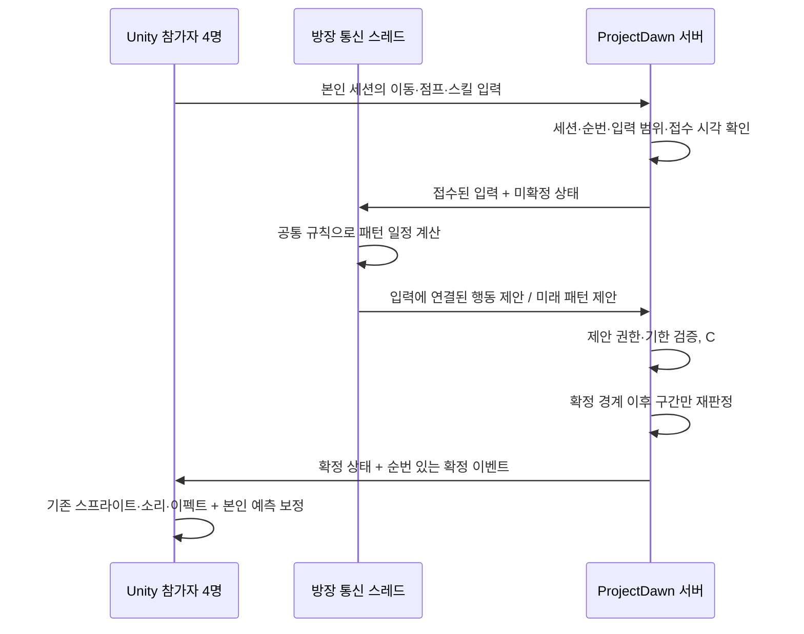

# Unity 실제 화면 · 4인 서버 검증 통합

> 후속 V3: [Lua·메테오·Dawn HUD 통합](LUA-METEOR-UI-INTEGRATION.md). 아래는 V2 단계의 검증 기록이다.

작성일: 2026-10-18. 작업 루트: `E:\task\ProjectDawnIntegration`.

## 구현한 연결

기존 DnfRaidDemo의 Unity 화면과 아트·음향·스킬 창을 사용하면서, 전투를 ProjectDawn의 실제 TCP 매칭/방/전송 경로에 연결했다. 원본 두 프로젝트는 수정하지 않았다. 이 문서는 기존 NETWORK-INTEGRATION.md의 V1 최소 전투 검증 이후 추가된 **V2 콘텐츠 연결**을 설명한다.



방장이 임의 HP/피해를 보내 확정할 수 없다. 방장은 입력을 행동 제안으로 연결하고 동일 규칙으로 미래 패턴을 계산한다. 서버는 입력 원본과 연결을 검사하고 **전체 C# 전투 규칙을 다시 실행**한다. 경량 범위 검사만 하는 구조는 아니다. 공유 RNG와 예약 틱에 맞지 않는 보스 패턴은 실행되지 않는다.

| 영역 | 이번 연결 |
|---|---|
| 4인 매칭 | V2 협상 → 기존 MatchManager → 4인 파티 → 전송 토큰/SceneReady → 네 명 준비 후 전투 |
| 전투 | 기존 21개 SkillId, 2.5D 범위, MP·쿨타임·피격·점프·달리기·대시 평타를 공유 코어로 분리 |
| 스프라이트 | Idle/이동/점프/공격, 프렌지 이도류, 블러드 소드 몸/검 레이어, 기존 각성 연출 유지 |
| 보스 | 데모의 기존 6개 패턴, 2페이즈, 무력화; 방장 미래 제안과 서버 재실행 연결 |
| 화면 | 4개 캐릭터와 4인 HP HUD, 본인 슬롯 표시, K 스킬 창, 기존 슬롯/인벤토리 표시 |
| 타격감 | 본인 모션·타격 피드백 예측, 확정 HP 표시, 개인 히트스톱과 화면 흔들림 |
| 공통 연출 | 확정 스냅샷의 각성·페이즈·무력화 이벤트로 각 클라이언트 연출 |
| 종료 | 방장 제안 누락/이탈 등 기존 서버 중단 정책 유지, 마을 전송 토큰 처리 |

기존 Dawn의 HitStopManager는 `Time.timeScale`을 바꾸므로 그대로 호출하지 않았다. 합의된 설계에 맞게 **자기 캐릭터의 표시 자세만 잠시 유지**하고 화면 좌표에 흔들림을 적용했다. 전투 틱·네트워크·다른 캐릭터는 멈추지 않는다. 원본 카메라 Transform을 흔드는 대신 데모의 GUI 렌더러 좌표를 흔든다.

## 실행 / 재현

Windows, Unity 2022.3.16f1, .NET SDK 8 및 서버용 .NET Core 3.1 런타임을 사용했다.

```powershell
cd E:\task\ProjectDawnIntegration
./Build-Unity.ps1
./Play-Unity4.ps1                  # 직접 조작하는 게임 창 4개, 로컬 서버는 15분 뒤 종료
./Play-Unity4.ps1 -Auto -Seconds 85 # 정상 입력을 보내는 검증 드라이버, 자동 저장·종료
python ./Verify-Unity4.py ./Artifacts/<실행폴더>
./Validate.ps1                    # 코어/콘텐츠/실제 네트워크/서버 회귀 검사
```

실행 파일은 `Build/ProjectDawnRaid.exe`. **Build 폴더 전체**가 필요하다. 서버 없이 실행하면 메뉴가 열린다. 4인 서버 모드는 로컬 서버 실행이 필요하다. 이 재현 스크립트는 `127.0.0.1:28180`만 사용하며 방화벽/공유기 설정을 바꾸지 않는다.

조작: 방향키 이동, 앞앞 달리기, X 평타, C 점프, Space 회피, Q/W/E 등 표시된 스킬 슬롯, K 스킬 창, I 인벤토리, F12 화면 저장. 앞앞 달리기 중 X는 기존 대시 평타를 사용한다.

`--dawn-auto`는 전투 입력만 만든다. HP 변경·무적·패턴 강제 실행을 사용하지 않는다. 확정 스냅샷이 260ms 뒤에 표시되는 점을 고려해 점프 입력을 앞당긴다. 수동 플레이의 지연 보상 완성을 의미하지 않는다.

## 실제 화면 검증에서 수정한 문제

첫 실행에서는 각성 리소스가 처음 표시될 때 방장 화면이 오래 멈춰 제안 기한을 넘었고, 서버가 `HostProposalOmissions`로 중단했다. 이 실패 기록은 `Artifacts/unity-4p-01`에 남겼다.

수정: TCP 수신·입력 전달·방장의 행동/패턴 제안은 별도 통신 스레드에서 수행한다. Unity API와 렌더 상태 변경은 순서 있는 큐를 통해 메인 스레드에서만 실행한다. 서버 기한이나 누락 시 중단 규칙은 완화하지 않았다.

`Verify-Unity4.py`는 네 개 프로세스의 확정 스냅샷 SHA-256, 확정 콘텐츠 이벤트의 공통 접두열, 4개 고유 슬롯, 렌더 오류, 스킬 ID, 점프 회피 기록을 비교한다. 단순히 게임 창 네 개가 떠 있다는 사실을 성공으로 취급하지 않는다.

## 실행 결과와 증거

최종 실행: `Artifacts/unity-4p-20261018-023443` — 정상 입력 드라이버로 **85초**, 4개 독립 Unity 프로세스. `Verify-Unity4.py`의 13개 조건을 모두 통과했다.

| 확인 항목 | 결과 |
|---|---|
| 참가자 슬롯 | 0·1·2·3, 모든 화면에 4명 |
| 기존 스킬 | SkillId 0~20 전부 서버 확정 (평타·회피 포함 21개) |
| 보스 패턴 | 데모의 6개 모두 서버 확정 |
| 점프 회피 | 캐릭터/공격 구역이 서로 다른 28건 |
| 확정 스냅샷 | 공통 틱 171개의 SHA-256 모두 동일 |
| 확정 콘텐츠 이벤트 | 공통 접두열 217개 동일 |
| 렌더 오류 / 접수 거부 | 각 클라이언트 0 / 0 |
| 실제 렌더 프레임 | 클라이언트별 4,967~4,989 프레임 |
| 기존 회귀 검사 | 코어 26개 × .NET 8/3.1, 콘텐츠 28개, 실제 네트워크 34개, 기존 서버 검사 통과 |
| Unity 기존 검사 | 전투 18개, 모션 9개, 프렌지 6개, 찌르기·대시 4개 통과 |
| Windows 빌드 | Unity 2022.3.16f1, 빌드 오류 0·경고 0 |

검증 원본 JSON (`Artifacts/unity-4p-20261018-023443/verification.json`, 로컬 검증 자료)

（화면 자료: 네 Unity 클라이언트의 실제 렌더 화면을 배치한 비교 이미지 — Notion 참조）

화면 비교 이미지는 각 게임이 직접 저장한 PNG를 배치한 것이며, 하나의 게임 화면을 복제한 이미지가 아니다. K 키로 실제 스킬 창을 열고 F12 저장까지 확인했다. 이후 사용자의 Esc 입력으로 Computer Use가 중단되어 추가 UI 조작은 하지 않았다. 자동 검증은 예정된 시점에 결과를 저장하고 종료했다. 자동 종료 시 방장이 먼저 종료되어 남은 클라이언트 로그에 `HostOrLoadingParticipantDisconnected`가 추가되는 것은 검증 종료 후 정리 동작이다.

## 범위와 남은 일

- 이번 검증 서버는 별도 **UnityPlaytestHost** 실행 파일이다. DB 로그인과 장비 초기화만 테스트 데이터로 준비하고 실제 매칭/패킷/RoomManager/전투 코어를 호출한다. 운영 Server 실행 파일에 무인증 로그인 API를 추가하지 않았다.
- 이번 화면 검증은 **한 PC의 4개 Unity 프로세스**다. 서로 다른 PC의 LAN/인터넷 지연·손실 환경 검증과 실제 DB 로그인은 별도다.
- 현재 화면은 데모의 레이드 아레나다. Dawn의 로그인/마을 렌더러 전체를 합친 상태는 아니다. 서버의 마을 복귀 전송은 처리하지만 실제 마을 장면은 후속이다.
- Lua 실행기는 아직 연결하지 않았다. 패턴은 공유 C# 구현이다. 별도 Dawn 메테오의 직격+점프 충격파 조합도 후속이며, 현재 데모의 메테오와 지상 충격파 패턴이 연결되어 있다.
- 실제 네트워크의 입력 시각은 서버 수신 시각 기준이다. 신뢰할 수 있는 시계 추정과 늦은 점프 입력의 소급 인정 연결은 후속이다. 확정된 HP/사망을 되돌리지 않는다.
- 본인 예측은 최근 입력을 확정 스냅샷 위에 재실행하는 초기 구현이다. 입력별 서버 ACK를 이용한 정확한 예측 원장 연결·기각된 연출 보정·원격 보간 튜닝은 남아 있다. 이미 재생한 소리는 취소되지 않는다.
- 외형 선택은 자기 화면에만 적용한다. 다른 참가자 외형 동기화는 아직 연결하지 않았다.
- 3분 재접속/만료 제거·자발적 퇴장·영속 보상은 이전 합의대로 후속이다. 검증 클리어는 보상을 지급하지 않는다.
- 4인 한 방의 짧은 플레이 검증이며, 장시간 보존 상한·대규모 방 수·트래픽/할당 최적화를 검증한 것은 아니다.

## 이어서 작업할 위치

| 파일 | 역할 |
|---|---|
| `Packages/com.projectdawn.combat/Runtime/Content/` | 기존 전투 규칙, 깊은 복제, 바이너리 체크포인트, 서버 재판정 어댑터 |
| `Client/RaidNetworkClient.cs` | 공유 프로토콜 처리, 입력/제안 연결, 방장 패턴 계산 |
| `Server/Server/Game/Room/GameRoom_Raid.cs` | V1/V2 4인 방 생성, 접수·검증·확정·중단 |
| `UnityClient/Assets/Scripts/DawnRaidTransport.cs` | 통신 스레드, 표시 큐, 예측, 확정 상태/이벤트 감사 기록 |
| `UnityClient/Assets/Scripts/RaidDemoApp.Dawn.cs` | 기존 화면 연결, 히트스톱/흔들림, 4인 표시, 검증 입력/캡처 |
| `UnityPlaytestHost/Program.cs` | 루프백 전용 테스트 계정 준비와 실제 서버 실행 |

클라이언트 프로토콜 소스는 `Build-Unity.ps1`에서 원본 처리기/생성 코드로부터 복사한다. 서버와 Unity 양쪽의 다른 프로토콜 정의를 수작업으로 유지하지 않는다. 개발 착수·게임 창 실행은 이미 승인되어 있다.
