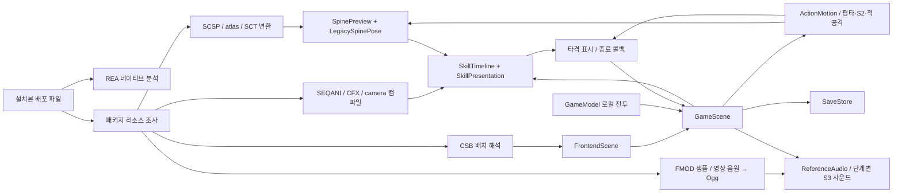
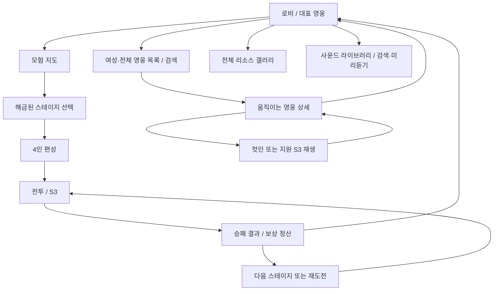

# 배포 바이너리·리소스 분석에서 Cocos2d-x 전투 연출까지

분석 대상: STOVE 설치본 `EpicSeven.exe` 1.0.999.0 / 구현 대상: `Cocos2dxPortfolio` / 작업일: 2026-10-15.

## 프로젝트 설명

에픽세븐의 배포 바이너리와 리소스 구조를 분석하고, 별도로 작성한 Cocos2d-x 4 프로젝트에 움직이는 영웅, S3 복합 연출, 로비와 모험 진입 흐름을 연결했다. REA의 네이티브 분석 결과, 원본 데이터에서 직접 읽은 사실, 호환 계층의 구현, 아직 검증하지 못한 동작을 분리해 기록한다. 원본 C++ 소스나 서버를 복원했다고 주장하지 않는다.

포트폴리오에서 강조할 부분은 바이너리 증거 관리, 여러 애니메이션 형식의 호환, 데이터 기반 타임라인, 전투와 연출의 상태 분리, 재현 가능한 검증이다. 원작 리소스의 제작자는 원작 권리자이며, 이 프로젝트의 기여는 분석·변환·렌더러·흐름·동기화 코드다.

## 증거와 구현의 범위

| 구분 | 확인한 내용 | 한계 |
|---|---|---|
| REA | EXE 식별, PE 구조, 네이티브 분석, 함수·참조 조사 | 의사코드는 원본 소스가 아니며 디컴파일의 오해 가능성이 있음 |
| 배포 리소스 | SCSP/atlas/SCT, SEQANI, CFX, camera SCSP, WebP, CocosStudio CSB | 설치본 안에서도 구형 시퀀스와 최신 모델 사이에 불일치가 있음 |
| 포팅 | Spine C + Cocos4 메시 렌더러, 2.1 포즈 호환, WebP 재생, 스킬 시계 | 원작 엔진의 모든 확장·셰이더를 지원하지는 않음 |
| 화면 흐름 | 로비→지도→스테이지→편성→전투→결과, 영웅 목록/상세 | 오프라인으로 재구성한 흐름. 서버 분기·이벤트·상점·장비·인증은 미구현 |
| 전투 | 4인 편성, 수동 턴·CR 순서, 스킬/대상 선택, 원본 HUD·배경, 선택적 자동 전투 | 계수·상태이상·AI는 원작 서버 복원이 아닌 로컬 규칙 |
| 사운드 | FMOD 28,984개 샘플 + 설치 영상 음원 19개 = 29,003개 Ogg, 음악·음성·효과음 연결 | 원본 Studio 이벤트 그래프와 정확한 믹스/발화 타이밍은 미복원 |
| 실행 관찰 | 프로젝트 자체 렌더러 화면과 진단 로그 | 원본 게임 화면 캡처는 도구 FrameArrived 시간 초과로 이번 검증에 포함하지 못함 |

원본 EXE의 SHA-256은 `ee2d31741484e536fc4a900134b43b82a2be54e1748a9171d1790613f29692dd`이다. 원본 파일을 수정하지 않고 별도 분석 사본과 해시를 대조했다. 상세 주소와 REA Evidence ID는 [원본 바이너리 분석](analysis/ORIGINAL_BINARY_ANALYSIS.md)에 기록한다.

## 현재 재현 범위와 남은 차이

| S3 | 길이 | 연결된 원본 요소 | 남은 차이 |
|---|---:|---|---|
| 아카테스 `c1017.s3` | 6.420초 | 3단계 동작, 이동·카메라, CFX, 3개 파티클 그룹, WebP, 2.980초 FIRE | 커스텀 파티클 colorBlends 등 원작 확장 차이 |
| 아라민타 `c1048.s3` | 5.706초 | 전/중/후경 이펙트, camera SCSP, 컷인, 원본 hatch 셰이더·3장 텍스처 | 타격 신호 미확보로 완료 시 표시, hatch 속도/화면 매핑 미검증 |
| 클라릿사 `c1028.s3` | 약 5.000초 | 다층 CFX, 캐릭터 이동, 카메라, 명시적 컷인 | CFX가 요구하는 `animation2`가 설치본 모델에 없음. 타격 표시는 완료 시 처리 |
| 도미니엘 `c1037.s3` | 4.600초 | 16개 cue, CFX 2개, camera SCSP와 얼음 효과 | CUTIN/FIRE 없음. 없는 신호를 만들어 넣지 않고 완료 시 결과 표시 |

264개 SEQANI 중 현재 실행용으로 컴파일·편성 연결한 것은 이 4종이다. 나머지 260개는 현 모델과의 매핑을 완료하지 않았으며, 이름만으로 무조건 재생하지 않는다. 키세의 범위 밖 ANI_POS와 세실리아의 사라진 skill3처럼 설치본 자체의 시퀀스·모델 불일치도 확인했다. 원작과 동일한 전체 S3/전체 메뉴 복원은 아직 완료된 상태가 아니다.

카메라 변환은 별도 컷인 노드뿐 아니라 실제 전장에도 동기화한다. BGSHOW는 전장 배경, LAYOUT의 상대편 오프셋은 적 그룹에 연결했다. 종료·스킵·씬 종료 때 원래 위치·회전·크기·가시성을 복구한다. 다만 원작 enum, easing, 속도의 의미를 원본 런타임 관찰과 대조하지 못한 부분은 변환 계층의 가정이다.

기존 갤러리의 488개 애니메이션 세트와 427개 WebP 컷인은 유지한다. 로비 영웅 목록은 기존 초상화 383종에 S3 초상화 2종을 보충해 385종을 제공한다. 모든 세트를 픽셀 단위로 검증했다는 뜻은 아니다. 예를 들어 c0002는 분리된 사각형 attachment가 보여 기본 로비 영웅은 아라민타로 정했다.

## 시스템 구조



| 소스 | 책임과 주요 진입점 |
|---|---|
| `Classes/FrontendScene.*` | `showLobby`, `showWorlds`, `showReady`, `showHeroes`, `showHero`, `enterStage`; 영웅/스킬 카탈로그와 편성 선택 |
| `Classes/GameScene.*` | 전투 이벤트 큐, 평타 `ActionMotion`의 준비·접근·타격·복귀, S3 시간표 연결, 타격 표시와 결과 순서 |
| `Classes/core/GameModel.*` | 속도 기반 다음 행동자 계산, 수동 입력 대기, 대상·쿨타임 검증, 피해·회복·승패·보상. 렌더러 의존 없음 |
| `Classes/core/SkillTimeline.*` | 원본에서 컴파일한 cue의 시간순 전달, 동일 시각 안정 정렬, 중지와 완료 판정 |
| `Classes/SkillPresentation.*` | 캐릭터 동작, 카메라, CFX의 Spine·파티클, 암전, WebP 컷인을 합성 |
| `Classes/SpinePreview.*` | Spine C pose를 Cocos4 TrianglesCommand로 렌더링; atlas, weighted mesh, clipping, blend |
| `Classes/LegacySpinePose.*` | `e7v21x` 모델의 스칼라 회전·스케일 상속 및 `_e7_flips` world-axis 반전 호환 |
| `Classes/WebpAnimation.*`, `AnimatedCutscene.*` | libwebp 애니메이션 디코딩, 프레임 타임스탬프·알파·폐기 처리 |
| `Classes/SaveStore.*` | v2 4인 프로필, v1 백업·1회 보상 이전, 교체 저장 |
| `Classes/BattleHud.*`, `BattleStageBackground.*` | 원본 CSB 배치·이미지 기반 HUD와 원본 atlas 배경 조립 |
| `Classes/ReferenceAudio.*`, `AudioLibraryScene.*` | Ogg 지연 재생, 배경음·효과음 수명 관리, 전체 샘플 검색·재생 |
| `tools/import-epicseven-skills.py` | 원본 스킬 문법과 참조 모델을 해석하고 실행용 타임라인·의존 자료·제한 보고서 작성 |
| `tools/parse-lobby-resource.py` | FlatBuffers 기반 CSB 계층·배치 추출과 로비 UI 리소스 반입 |

## 전투와 S3를 동기화한 방법

전투 모델은 먼저 한 행동의 결과를 결정한다. GameScene은 그 결과를 큐에 넣고, 같은 시전자의 연속된 광역 피해/회복 이벤트를 하나의 S3 그룹으로 묶는다. 연출 중에는 다음 전투 행동을 실행하지 않는다. 화면의 HP는 별도로 보관해 원본 FIRE cue 이전에 갑자기 줄어드는 문제를 막는다.

FIRE가 오면 해당 그룹의 표시만 한 번 반영한다. 원본에 여러 FIRE가 있어도 로컬 전투 결과를 다시 계산하거나 중복 적용하지 않는다. 건너뛰기나 정상 완료 때 아직 표시하지 않은 결과를 반영하고, 다음 프레임에 연출 노드를 정리한 뒤 대기 이벤트를 처리한다. 승리 이벤트도 연출 뒤에 처리하므로 스킬 도중 결과창이 뜨거나 보상이 중복 정산되지 않는다. 장면을 나갈 때는 콜백을 해제해 이미 사라진 전투 씬에 접근하지 않는다.

아카테스의 프로젝트 S3는 아군 회복, 아라민타·클라릿사·도미니엘은 광역 공격으로 연결했다. 회복 비율과 공격 수치는 프로젝트 규칙이며 원작의 계수나 상태이상을 복원한 것은 아니다. 원본 스킬 시각 연출과 로컬 전투 규칙은 별도 책임으로 유지한다.

## 방치형에서 수동 턴제로 전환

평타와 S2도 `ActionMotion`으로 직렬화한다. 원본 공격 클립 전체가 끝나고 배우가 복귀할 때까지 다음 행동을 막으며, 수동과 자동 전투가 같은 경로를 사용한다. 모델에서 결정한 HP와 화면 HP를 분리해 타격 순간에만 숫자·피격 모션·효과음이 반영된다. 클라릿사는 접근/복귀 점프, 원거리 배우는 시전과 투사체, 적은 공격 대상 예고와 강한 피격 반응을 사용한다. 메뉴 정지·2배속·앱 재개도 이 행동 시계에 연결했다.

아카테스·클라릿사의 일부 hit/fire 시점과 클라릿사의 점프 길이는 원본 데이터에서 확인했다. 나머지 55% 타격 시점, 적의 근접 분류, 투사체·경고·화면 흔들림은 가독성을 위해 작성한 연출이다. [기본 공격 분석](analysis/BASIC_ATTACK_ANALYSIS.md)에 원본 값과 재구성 값을 나눠 기록했다.

전투 시작 시 속도로 다음 행동자를 결정한다. 아군 차례에서 입력이 없으면 HP·CR·쿨타임은 진행하지 않는다. 우측 하단 S1/S2/S3를 선택하고 유효한 대상을 터치하면 한 행동을 소비한다. 전체 대상 스킬은 한 번 눌러 실행한다. 자동은 사용자가 켜는 편의 기능이며, 승패 후 다음 전투는 버튼으로 시작한다.

좌측 행동 순서·우측 하단 스킬 중심 좌표는 원본 CSB 필드에 근거한다. 배경은 forest/battle/nworld1 atlas 조각을 실제 디코딩해 합성했고, 아군·적 모두 원본 Spine 모델을 사용한다. 배치·카메라 시점·로컬 수치는 재구현이다. 자세한 규칙과 회귀 테스트는 [전투 모델 분석](analysis/BATTLE_LOGIC_ANALYSIS.md)에 남긴다.

v1의 3인 레벨·진행도·골드는 유지하고 네 번째 레벨을 1로 추가한다. 기존에 이미 쌓인 pendingGold만 1회 이전하며 새 오프라인 수입은 계산하지 않는다. 백업 실패나 저장 파일 읽기 오류가 있으면 기본값으로 덮어쓰지 않는다.

## 레거시 애니메이션 호환에서 해결한 문제

원본은 Live2D Cubism의 `moc3`가 아니라 Spine 계열 SCSP를 사용한다. 같은 자료 안에도 2.1 계열과 3.8 계열 모델이 있다. JSON 버전 문자열만 바꿔서는 포즈가 맞지 않는다.

3.8의 생략된 scale 키는 identity 1을 의미하지만 번들 파서의 기본값은 0이었다. 어댑터에서 생략값만 1로 채우고 명시적 0은 보존했다. 이 차이는 머리·무기 메시가 한 점으로 붕괴하는 문제의 원인이었다.

2.1 모델은 부모의 전체 행렬 합성 대신 스칼라 world rotation/scale을 상속한다. `LegacySpinePose`는 이 의미와 noScale/noRotation 변형을 재현하고, `_e7_flips`를 시간별 계단 값으로 적용한다. 반전은 자식의 noScale 여부와 별개로 world-axis XOR로 전파한다. 검증한 초기 S3 모델에는 IK/transform/path constraint가 없으며, 그런 제약이 있는 레거시 모델은 정확하지 않은 결과를 조용히 내보내지 않고 명시적으로 거부한다.

## 로비 및 화면 전환



선술집 배경과 버튼·지도 이미지에는 설치본에서 확인한 자료를 사용했다. CSB의 노드 이름·크기·앵커·위치·계층은 분석 근거로 보존했다. CSB는 레이아웃이며 버튼의 의미나 서버 조건까지 증명하지 않는다. 화면 분기와 4인 편성은 별도로 작성했다. 방치 보상과 자동 반복 전투는 제거했다. 상세 자료는 [로비/흐름 분석](analysis/LOBBY_FLOW_ANALYSIS.md)을 참고한다.

## 실행과 재현

```powershell
python tools/parse-lobby-resource.py --help
python tools/import-epicseven-skills.py --help
powershell -ExecutionPolicy Bypass -File tools/build-windows.ps1
.\Run-Reference-Game.cmd
```

원본에서 얻은 자료는 `.deps/epicseven-assets`와 `Resources/reference` 아래 로컬에 둔다. 원본 자원, 실행 파일, 분석 도구는 Git 배포 대상이 아니다. 소스와 Markdown 분석 문서, 테스트, 변환 스크립트를 프로젝트 설명 자료로 관리한다.

## 검증 결과

Windows Release 빌드 및 CTest 7개(game_rules, skill_timeline, save_roundtrip, animated_cutscene, legacy_pose, spine_c1001, spine_ras)가 통과했다. Python 스킬 컴파일러 회귀 테스트 6개와 scale 기본값 회귀 테스트도 통과했다. 신규 S3에서 사용한 모델·초상화·이펙트 21개 JSON/atlas 세트는 실제 번들 Spine 런타임의 피부·동작·메시 좌표 샘플링을 통과했다.

로비·지도·편성·영웅 목록·상세와 전투의 실제 렌더러 캡처를 검증한다. 이전 3인 버전의 캡처와 최종 4인 수동 턴 버전을 구분하며, 이번 버전의 완료 수치와 기기 설치 결과는 [최종 검증 기록](FINAL_VALIDATION.md) 및 [Android 검증](analysis/ANDROID_DEPLOYMENT.md)을 기준으로 한다.

스킬 스킵·일시정지·단일 FIRE 처리와 HP 표시 지연을 검증한다. smoke 실행은 별도 저장 폴더를 사용하므로 사용자 진행도를 바꾸지 않는다. 원본 전장 연결 후 위치·크기·가시성 복구도 진단에 기록한다.

자동 테스트가 통과해도 원작 화면과 픽셀 단위로 같다는 의미는 아니다. 비교 영상이 없는 기능은 데이터 기반 재구현으로 표기한다.

## 면접에서 설명할 수 있는 기술적 선택

- 연출 때문에 전투 규칙이 달라지지 않도록 계산과 표시를 분리했다. 스킵·중복 FIRE·승리 이벤트 순서가 주요 경계 조건이다.
- 자산 형식의 버전 차이를 런타임과 변환기의 책임으로 나눴다. 정적 파일 존재 검사만으로는 깨진 포즈를 발견하지 못해 실제 뼈대·메시 샘플링과 화면 캡처를 함께 사용했다.
- CFX의 의존 경로와 미지원 항목을 남겨 재현 범위를 설명할 수 있게 했다. 누락된 연출을 임의 타이밍으로 채우고 원작이라고 부르지 않았다.
- REA 의사코드, 패키지 데이터, 직접 쓴 C++를 구별했다. 바이너리의 타입 문자열은 구조의 단서이며 실제 사용자 흐름을 모두 증명하지 않는다.

## 상세 문서

- [원본 EXE / REA 분석](analysis/ORIGINAL_BINARY_ANALYSIS.md)
- [S3 스킬 연출 파이프라인](analysis/SKILL_PIPELINE_ANALYSIS.md)
- [로비 CSB와 화면 흐름](analysis/LOBBY_FLOW_ANALYSIS.md)
- [전투 HUD·배경 분석](analysis/BATTLE_UI_ANALYSIS.md)
- [전투 모델과 검증](analysis/BATTLE_LOGIC_ANALYSIS.md)
- [평타·적 공격 모션과 타격 동기화](analysis/BASIC_ATTACK_ANALYSIS.md)
- [사운드 파이프라인](analysis/AUDIO_PIPELINE_ANALYSIS.md)
- [Android 빌드·기기 설치](analysis/ANDROID_DEPLOYMENT.md)
- [리소스 출처 및 라이선스 구분](../THIRD_PARTY.md)
