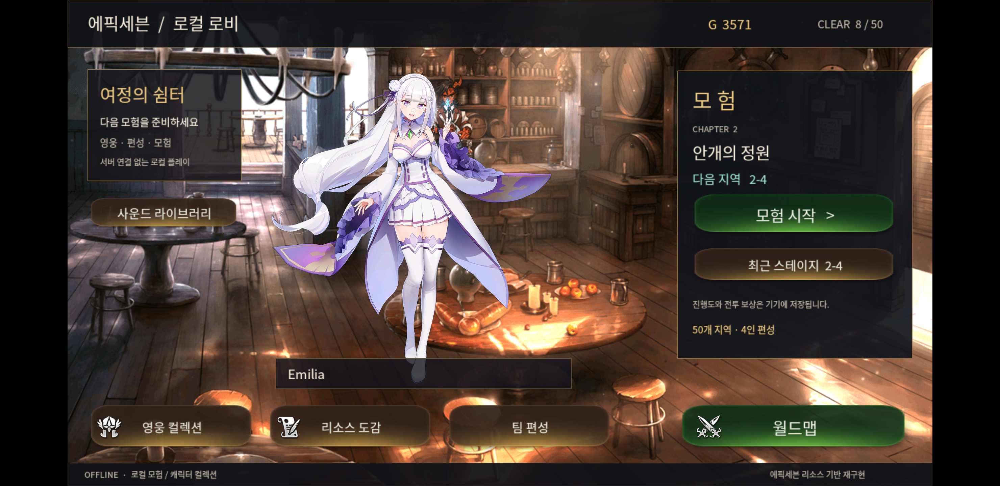
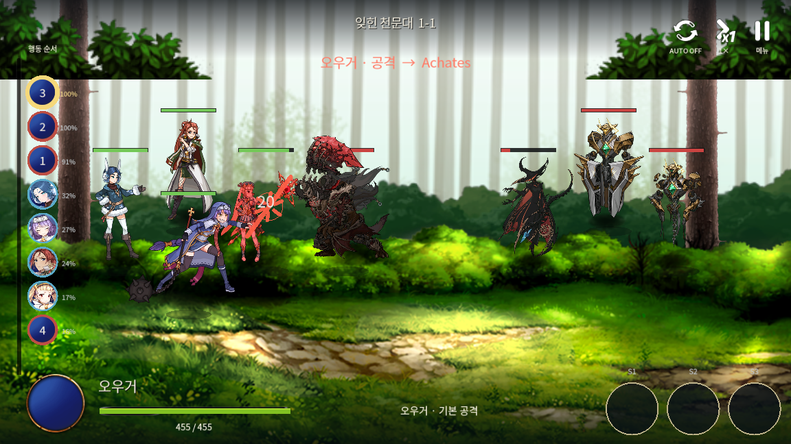

# Cocos2d-x 기반 턴제 전투·스킬 연출 재구현

**배포 데이터 분석부터 애니메이션 호환, 전투 상태 동기화, Android 실기기 실행까지 연결한 게임 클라이언트 프로젝트**

에픽세븐 설치본의 바이너리와 리소스 구조를 참고해, Cocos2d-x 4에서 동작하는 오프라인 4인 턴제 전투를 구현했습니다. 전투 계산과 화면 표시를 분리하고, 일반 공격과 S3 연출이 수동·자동 전투에서 같은 규칙으로 끝나도록 구성했습니다.

| 항목 | 내용 |
|---|---|
| 분야 | C++ 게임 클라이언트 · 애니메이션/연출 · 데이터 호환 |
| 실행 환경 | Windows / Android arm64, Galaxy S8+ Android 9 실기기 확인 |
| 주요 기술 | C++ · Cocos2d-x 4 · Spine C · libwebp · Python · CMake · Gradle |
| 분석·개발 도구 | REA · Ghidra · Codex · ADB |
| 검증 기준일 | 2026-10-15 — 개발 기간을 의미하지 않음 |

[25초 실기기 전투 영상](portfolio/assets/android-auto-battle.mp4) · [기술 사례 상세](portfolio/TECHNICAL_CASE_STUDY.md) · [5분 시연·면접 자료](portfolio/DEMO_AND_INTERVIEW.md) · [코드·검증 근거](portfolio/SOURCE_AND_EVIDENCE.md)

## 핵심 구현

- **전투와 표시의 분리:** `GameModel`이 결정한 결과를 이벤트 큐로 전달하고, 화면 HP·피격·음향은 타격 시점에 한 번 반영합니다. 연출 종료와 복귀 후 다음 행동 또는 결과 화면으로 진행합니다.
- **일반 공격의 완결성:** 준비→접근/시전→타격→복귀 단계를 `ActionMotion`으로 관리합니다. 적의 대상 예고, 접근, 피격 반응과 화면 흔들림도 연결했습니다.
- **데이터 기반 S3:** SEQANI/CFX/카메라 데이터를 실행용 시간표로 변환해 캐릭터·이펙트·컷인·전장을 함께 제어합니다. 현재 4명에게 연결했습니다.
- **애니메이션 호환:** SCSP 기반 Spine 자료를 Cocos 렌더러에 연결하고, 버전별 scale 기본값·상속·반전 차이를 호환 계층에서 처리했습니다.
- **기존 진행도 유지:** 방치형에서 수동 턴제로 바꾸면서 v1 저장 백업, 4인 프로필 이전, 기존 적립금의 1회 정산을 구현했습니다.

## 대표 화면

*Android 최종 설치본의 로비. 지도→스테이지→편성→전투→결과 흐름을 연결했습니다.*

*Windows 실제 렌더러: 적이 아군에게 접근해 공격하는 순간. 원본 공격·피격 클립에 프로젝트의 이동·타격 효과를 결합했습니다.*

## 검증으로 확인한 결과

| 검증 대상 | 결과 | 해석 범위 |
|---|---:|---|
| C++ 회귀 검사 | CTest 7/7 | 전투·시간표·저장·렌더링 관련 검사 |
| 변환기 회귀 검사 | 스킬 6/6, scale 1/1 | 원본 cue 해석과 호환 규칙 |
| S3 의존 모델 | 21/21 | 번들 Spine 런타임의 포즈·메시 샘플 검사 |
| WebP 컷인 | 427/427 | 프로젝트 디코더의 프레임·시간·크기 검사 |
| 일반 공격 | 51개 진단 시점 | 정상/2배속/정지에서 HP 동기화·적 접근 확인 |
| Android 패키지 | 35,599개 자산 대조 | 경로·크기·CRC 검증, 설치본과 전달본 SHA-256 일치 |

Windows 자동 전투에서는 S3 4회와 일반 행동 6회 후 승리하고 전장 위치가 복구됐습니다. Galaxy S8+에서도 아군·적 공격을 확인했으며, 업데이트 뒤 기존 진행도와 설정을 보존했습니다. 위 수치는 성능 벤치마크나 원작과의 픽셀 일치율이 아닙니다.

## 구현 범위와 출처

현재 복합 S3 지원은 아카테스·아라민타·클라릿사·도미니엘 4명입니다. 전투 계수·AI·상태 규칙은 로컬 구현이며, 원작 서버 로직과 전체 메뉴를 복원한 결과는 아닙니다. 원본 자료는 Live2D Cubism이 아닌 Spine 계열입니다.

캐릭터·배경·UI·효과·음원은 원작 및 해당 권리자의 자료입니다. 프로젝트에서 설명하는 구현 범위는 분석 기록, 변환·호환 코드, 렌더러 연결, 전투·연출 동기화와 검증입니다. 커뮤니티 변환 도구와 엔진을 사용한 부분도 [출처 문서](portfolio/CREDITS.md)에 구분했습니다.

이 문서 묶음에는 소개·분석·선별 화면·시연 영상·검증 요약을 담았습니다. APK와 추출 리소스 원본은 별도의 로컬 실행 결과물에서 관리합니다.
