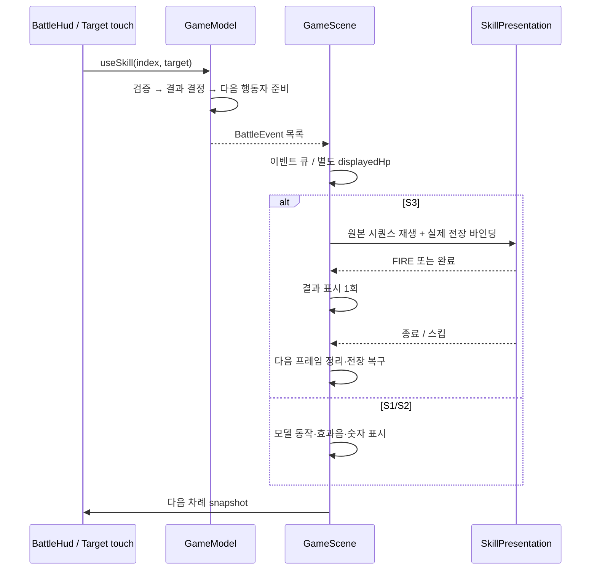

# 수동 턴 전투 모델과 원본 근거의 구분

2026-10-15 / `Classes/core/GameModel.*`, `GameScene.*`, `BattleHud.*`, `SaveStore.*`.

이 문서는 직접 작성한 C++의 동작을 설명한다. 원본 EXE에서 확인한 네이티브 연출·이벤트·UI 로더와, 아직 해독하지 못한 스킬 DB/서버 규칙을 구별한다. 정확한 에픽세븐 피해량·CR 공식이나 전체 상태이상을 복원한 결과가 아니다.

## 원본에서 확인한 것

`inbattle_hud.csb`의 3개 스킬 슬롯, `inbattle_order.csb`의 행동 순서와 퍼센트 표시, cooldown·target 노드, 4인 편성 자리, 실제 스킬 아이콘을 분석했다. [HUD 보고서](BATTLE_UI_ANALYSIS.md)에 파일 해시와 좌표가 있다. REA의 CompositeEffect→DelayTime/CallFunc/Sequence→Node.runAction 호출 사슬과 Lua custom event/CSLoader는 [EXE 보고서](ORIGINAL_BINARY_ANALYSIS.md)에 주소와 Evidence ID를 남겼다.

이 근거는 연출과 화면 구성의 근거다. 스킬 계수·패시브·기절·속성·명중·저항·소울번·협공·서버 AI의 정확한 규칙은 여기서 확인되지 않았다. 원본과 같다고 표기하지 않는다.

## 현재 로컬 규칙

| 항목 | 구현 |
|---|---|
| 파티 | 아군 4명, 적 4명. 초기 영웅 아카테스·아라민타·클라릿사·도미니엘 |
| CR | 게이지 0…1000. 살아 있는 각 유닛의 `(1000-gauge)/speed` 중 최소 시간을 선택하고 모두 그 시간만큼 전진 |
| 동률 | 유닛 인덱스 순서. 원작 초기 난수는 사용하지 않음 |
| 수동 차례 | 입력이 없으면 시뮬레이션 완전 정지. 시간 경과로 공격하거나 보상 발생하지 않음 |
| S1 | 적 1명 선택, 재사용 대기 없음 |
| S2 | 아카테스는 선택 아군 회복, 나머지는 로컬 단일 공격. 원작 패시브를 포함한 개별 S2와는 다름 |
| S3 | 아카테스 전체 회복, 다른 3명 전체 공격. 본인 다음 차례부터 감소하는 4턴 쿨타임 |
| 쿨타임 | S2 3, S3 4. 다른 유닛 행동이나 대기 시간에는 감소하지 않음 |
| 자동 | 기본 OFF. 켜면 준비된 S3→S2→S1 순으로 한 행동씩 실행. 원작 AI 추출 결과가 아님 |
| 승패 | 한 진영 전멸 시 종료. 최대 600행동 안전 한도. 결과창에서 다음 전투/재도전/로비 선택 |
| 보상 | 승리 1회 정산, 골드·스테이지 해금 저장. 오프라인 수입·자동 재도전 없음 |

수치는 프로토타입의 균형 값이다. 수동 입력의 타깃 진영, 사망 여부, 활성 행동자, 스킬 범위와 쿨타임을 모델에서 다시 검사한다. 잘못된 명령은 턴이나 HP를 소비하지 않는다. UI의 enable 상태만 신뢰하지 않는다.

## 한 행동의 처리

S3가 진행 중일 때 모델의 추가 행동을 호출하지 않는다. 내부 HP는 결정된 결과이고 화면 HP는 FIRE까지 지연한다. FIRE가 없는 소스는 완료 시 표시하며 임의의 원본 타격 시각을 만들지 않는다. 연출 스킵도 결과 표시 1회 및 전장 복구를 보장한다. 종료 콜백 안에서 자기 노드를 바로 파괴하지 않고 다음 프레임에 제거한다.

## 저장 마이그레이션

파일명은 기존 `aster-profile-v1.json`을 유지해 기존 설치의 진행도를 찾는다. 내용의 version은 2이며 levels가 4개다. v1의 처음 3개 레벨·골드·해금·승리 수를 보존하고 네 번째 레벨을 1로 추가한다. v1에 이미 적립된 pendingGold만 골드에 합산해 새 포맷으로 저장한다. 현재 시각으로 오프라인 수입을 계산하는 코드는 제거했다.

이전 프로필은 `.v1.bak`으로 원자적으로 보존한다. 파일 없음, 읽기 실패, 손상된 JSON, 미래 버전, 백업 실패를 구분한다. 오류가 있으면 새 기본값을 저장해 진행도를 지우지 않는다. 기존 유효 백업은 다시 쓰지 않는다.

## 의미 있는 회귀 검사

`tests/CoreTests.cpp`는 무입력 500회에도 진행 없음, 잘못된 스킬·진영·범위 명령 거부, 본인 차례의 쿨타임 감소, 8인 CR 순서, 동일 seed 재현, HP 범위, 승패·보상 1회, 최대 스테이지 경계를 검사한다. 보호막 기능은 별도 테스트 정의로 검사하고 기본 도미니엘 S3에 잘못 적용하지 않는다.

`tests/SaveTests.cpp`는 4인 v2 왕복 저장, v1 보존·1회 이전, 미래 버전·손상 입력·열기 실패, 잘못된 백업 보존을 검사한다. 렌더러 smoke는 별도 저장 경로를 쓰며 실제 음원 재생 시간, 현재 행동자, S3 표시 횟수, 전장 복구 상태를 기록한다.
