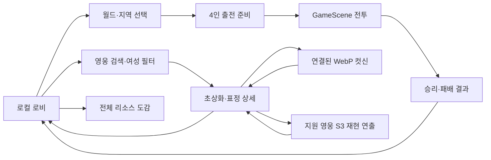

# 에픽세븐 로비·화면 흐름 분석과 로컬 재구현

작성일: 2026-10-15. 분석 대상은 사용자가 설치한 클라이언트에서 추출한 로컬 리소스다. 실행 파일과 원본 리소스는 수정하지 않았다.

이 작업은 원본 화면의 **자원 구조를 확인하고 오프라인으로 동작하는 화면 흐름을 재구현**한 것이다. 원본 서버의 계정, 상점, 소환, 재화 검증, 미션 API를 복원했다고 주장하지 않는다. 원본 창의 실시간 화면 캡처는 확보되지 않았으므로 현재 배포판과 픽셀 단위로 일치한다고 판단할 근거도 없다. 실행 파일의 REA/Ghidra 분석은 별도 보고서의 증거와 구분한다.

## 조사 방법

`tools/parse-lobby-resource.py`는 Cocos2d-x에 포함된 `CSParseBinary.fbs`와 실제 `CSLoader`의 테이블 접근 구조를 이용한다. 바이너리 문자열을 검색하는 대신 FlatBuffers 루트 오프셋, vtable, 간접 포인터, 노드 자식 벡터, 옵션 테이블을 경계 검사하며 읽는다. Node 클래스는 WidgetOptions를 직접 사용하고, Sprite/Button/SingleNode 등은 클래스별 옵션의 첫 필드가 WidgetOptions다. ProjectNode의 파일명 필드는 일반 ResourceData 테이블과 달라 임의 해석하지 않는다.

읽는 필드: 노드 계층 경로, 클래스, 이름, 위치, 크기, 스케일, 앵커, 가시성, 알파, 터치 활성화, 버튼·스프라이트·텍스트의 리소스 참조와 텍스트. 좌표는 **부모 기준 로컬 좌표**다. 계층 변환과 런타임 Lua 로직을 적용한 화면 좌표로 오인하면 안 된다. CSB에 남은 영문 문구와 영웅 이름도 편집기의 샘플 값일 수 있다.

```powershell
python tools/parse-lobby-resource.py
python tools/parse-lobby-resource.py --import-ui
```

첫 명령은 `.deps/epicseven-assets/lobby-analysis/layouts.json`에 소스 SHA-256과 노드 전체를 기록한다. 두 번째 명령은 PNG를 실제 디코딩한 뒤 `Resources/reference/epicseven/frontend/`에 독립 파일로 저장한다. 원본 입력은 읽기 전용이다. `sources.json`은 원본 경로, PNG 해시, atlas region/회전/좌표 등 변환 근거를 보존한다. Python과 Pillow가 필요하다.

## 확인된 자원 증거

10개 CSB에서 총 2,031개 노드를 파싱했다. 모두 CSB version 필드가 `2.1.0.0`이었다. 이는 CocosStudio 파일 포맷 값이며 Spine 버전이나 게임 릴리스 번호가 아니다.

| 파일 | 노드 수 | 실제 필드 관찰 | 구현에 반영한 점 |
|---|---:|---|---|
| `wnd/lobby.csb` | 228 | 1280×720 루트, `btn_team`, `btn_char1`…`btn_char4`, 배너와 영웅 이름 자리 | 배경과 영웅을 중심으로 한 로비, 팀 편성 진입 |
| `wnd/lobby_ui.csb` | 242 | `/base/BUTTONS/RIGHT/btn_battle`, 크기120×120, anchor(1,0), touch=true; `btn_hero`와 원본 HUD 버튼 이미지 | 하단 영웅·전투 메뉴를 별도 화면으로 연결 |
| `wnd/lobby_ui_renew.csb` | 166 | 성역·비밀상점·이벤트 바로가기, 프로필 버튼 | 여러 세대 UI가 함께 존재함을 확인. 서버 기능은 임의 구현하지 않음 |
| `wnd/battle_stage_list.csb` | 25 | 512×100 목록 항목 루트 | 지역 선택을 별도 단계로 구성 |
| `wnd/battle_ready.csb` | 647 | `btn_select_team`, `btn_go`; `_btn_green.png`; 시작 버튼335×72 | 지역 선택 직후 전투로 진입하지 않고 편성·보상·시작 화면 제공 |
| `wnd/battle_ready_renew.csb` | 562 | 팀 선택, 시작, 취소, 지원가·난이도 관련 노드 | 뒤로가기와 출전 확인을 명시적으로 구성 |
| `wnd/hero_detail_base.csb` | 14 | `port`=(640,0), 하위 port_1/2/3와 초상화 자리 | 애니메이션 초상화를 상세 화면의 중심으로 배치 |
| `wnd/hero_detail_info.csb` | 68 | 친밀도·선물·배경 변경 버튼 | 상세 정보 영역과 외형 조작 영역의 분리 |
| `wnd/unit_list.csb` | 49 | 검색 on/off, sort_1…5, 목록 크기 토글 | 이름·ID 검색, 여성 필터, 페이지 목록 |
| `story_layouts/story_tm_ma_1.csb` | 30 | 1580×720 루트; camera/background/arm/body/blur의 계층 | 스토리 컷은 별도 노드 합성임을 확인. 이를 WebP 한 장 또는 로비 구조로 혼동하지 않음 |

대표 원본 해시:

| 자원 | SHA-256 |
|---|---|
| lobby_ui.csb | `00fa440990cebf9da60d6c65ba53d8823c599b516d038321638933d818ada100` |
| battle_ready.csb | `f1e28e75e656675684fd0d0542ae883d1cf27a35683986c3e7137789c82a9104` |
| hero_detail_base.csb | `18abdad87481255b26ce6850ad8c3a8ef84328c6d5f67c4d6431b46dda8e6111` |
| story_tm_ma_1.csb | `bc0a6c925e85976f0c97fe26d9b7ae9a161045bf2ba16f8f1074c1f9c7e685be` |

### 배경과 애니메이션 자원

- `img/lobby_pub_mockup.png`를 실제 PNG로 디코딩하고 시각 확인했다. 1280×720 선술집 그림으로, 테이블·카운터·문·바텐더가 이미 합성되어 있다. 로비는 이 원본 이미지를 재사용한다. 바텐더를 별도 살아 있는 NPC로 복원한 것은 아니다.
- `worldmap/ritania.png`는 완성된 월드맵이 아니라 1877×2020 atlas 페이지다. `ritania.atlas`의 `rotate`, `xy`, `size`를 적용해 region을 분리했다. `rotate:true`는 packed 치수를 교환하고 Pillow `ROTATE_270`으로 복원해야 한다. 반대 방향을 사용하면 지도 글씨와 건물이 뒤집히는 것을 시각 검수에서 발견해 수정했다.
- 프로젝트 챕터1…10에는 atlas의 `ritania/landmap_3`…`landmap_12`를 순서대로 배치했다. **원작 지역 진행 순서나 연결 좌표를 복원한 매핑은 아니다.** 노드 위치와 지역명, 50개 스테이지 진행은 기존 ASTER 규칙을 사용한다.
- `bg/event_moonlight_lobby.scsp`를 기존 SCSP 구조 파서로 실제 해독했다. Spine3.8.99, root bone 1개, slot23개, `animation`1개가 나온다. floor/distant/tombstone/wall/ceiling 등의 슬롯과 attachment가 존재한다. 별도 이벤트 로비 합성이라는 근거이며 현재 선술집 배경으로 잘못 사용하지 않았다. 원본 SHA-256: `6bf5d7e5996cc471c38eed5378974fe7fa3859aa5ecc48141ab4776ff0a937ce`.
- `effect/lobby_night_mugs.scsp`는 구조상 Spine2.1.27이다. atlas page는 `lobby_night_mugs.sct`, 132×178, Linear/Linear, flash/mug1/mug2 region을 가진다. 로비 소품은 별도 애니메이션/texture 묶음으로 존재한다. 해당 소품을 현재 로비에 복원했다고 주장하지 않는다.

## 구현한 흐름



FrontendScene은 화면 이동을 다음 프레임으로 지연하고 중복 입력을 차단한다. 이전 노드의 터치 콜백 안에서 그 노드를 즉시 삭제하지 않는다. 각 페이지의 자식 노드를 정리하므로 이전 Spine·WebP update도 함께 해제된다. 영웅 전체를 동시에 만들지 않고 목록의 작은 얼굴 아이콘과 현재 선택된 하나의 애니메이션 초상화만 렌더링한다. 이름은 메타데이터를 사용하고 ID를 함께 표시한다.

로비 영웅 선택은 `reference-lobby-hero`에 저장한다. 파티 선택은 `reference-skill-slot-0/1/2/3`에 저장한다. 네 슬롯의 프레젠테이션 ID는 `reference/skills/catalog.json`의 `playable:true` 항목만 허용한다. 이미 편성된 영웅으로 변경하면 자리를 교환한다. 일반 초상화가 보인다는 이유만으로 해당 영웅의 S3 전체를 지원한다고 간주하지 않는다.

`playable`은 로컬 재생 가능이라는 의미다. 지원 S3에도 카메라 보간, 배경 바인딩, 일부 입자 색상, shader/CFX 누락 등의 한계가 있으며 스킬 catalog의 `limitations`에 기록한다. 원작 연출을 완전히 동일하게 복원했다는 의미가 아니다. 상세 화면은 짧은 WebP 컷신과 여러 단계로 재생하는 S3 재현을 구분한다.

출전 준비 화면은 4인 팀과 로컬 레벨·전투 보상을 표시한다. 방치 수입과 자동 반복 전투는 없다. 캐릭터 외형을 바꿔도 원작 능력치·장비·서버 전투 공식을 불러오는 것은 아니다. 저장 파일 오류 시 원본 파일을 보존하고 출전을 중단한다. GameScene 결과·다음 스테이지·로비 복귀와 전투 이벤트 큐는 별도 전투 구현이 담당한다.

## 검증과 남은 한계

자원 파싱: 10/10 성공. PNG 디코딩, atlas region 회전 복원, 선술집·지도 이미지를 시각 검수했다. 최초 CSB 옵션 해석에서 Node와 SingleNode를 동일시한 오류를 발견해 실제 로더 접근에 맞게 수정했다. 이는 포맷 버전의 문자열만 보는 접근으로는 발견하기 어려운 문제였다.

렌더링 검증용 `ASTER_FRONTEND_PAGE`는 `lobby`, `worlds`, `ready`, `heroes`, `hero`를 지원한다. 정상 실행에서는 설정하지 않는다. `FrontendScene::diagnostic()`은 현재 페이지, 초상화 수, 지원 스킬 수, 파티 ID, 스테이지를 반환한다. 빌드·런타임 화면 검증은 프로젝트의 최종 검증 기록과 함께 확인해야 한다.

로비·월드·준비·영웅목록·상세 화면 캡처를 확인했다. 텍스트, 메뉴, 지도 방향, 4인 편성 화면은 표시 영역에 들어온다. `c0002` 초상화에는 왼쪽 치마 아래 떨어진 보라색 사각 조각이 보여 전체 초상화가 시각적으로 동일 복원되었다고 결론내리지 않았다. 최초 로비 영웅은 준비 화면에서 형태를 확인했고 S3도 연결되는 `c1048`로 지정했다. 사용자가 저장한 로비 영웅 선택은 유지한다. 개별 초상화의 부착물·경계 품질 검증은 별도의 남은 작업이다.

이 문서의 CSB 노드와 원본 리소스 내용은 관찰이다. 버튼명이 암시하는 메뉴 역할은 자원 기반 추론이다. 그 메뉴를 어떤 서버 상태에서 노출하는지, 실제 Lua/네이티브 함수가 어떻게 전이하는지, 원작의 온라인 상태 동기화는 여기서 확인하지 않았다. 이 오프라인 화면의 전이는 직접 구현한 동작이다.

추출 inventory에서 `.lua`/`.luac` 확장자 파일은 0개였다. 이는 로직이나 Lua 사용이 없다는 증거가 아니다. 다른 번들·컨테이너·다운로드 경로 또는 확장자 없는 자원에 있을 수 있다. 네이티브 REA 분석에서 확인한 CSLoader/Lua 관련 문자열과 이 자원 inventory 결과는 서로 다른 층위의 증거다.

로비의 사운드 라이브러리는 전체 추출 샘플의 이름·뱅크·카테고리를 검색하고 개별 재생한다. 실제 전투와 로비에서는 필요한 음원만 지연 로드한다.
