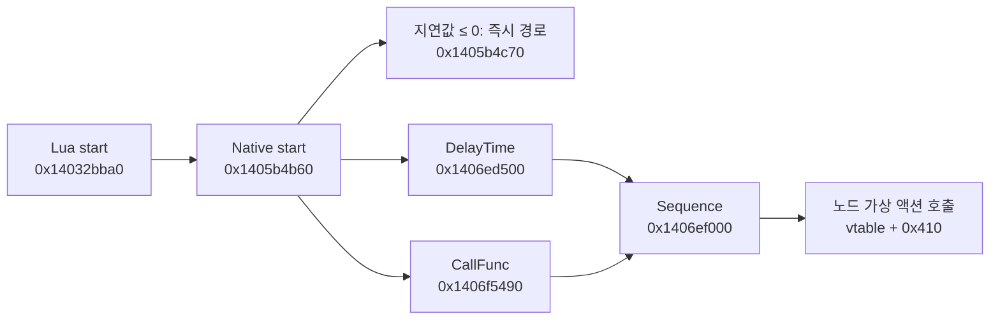

# EpicSeven 원본 실행 파일 분석

분석 기준일: 2026-10-15. 이 문서는 설치된 원본 실행 파일에서 확인한 사실과, 그 사실을 바탕으로 한 재구현 설계를 구분한다. 포트폴리오의 C++ 소스는 별도로 작성한 구현이며 원작 개발 소스를 복원한 결과물이 아니다.

## 대상과 재현 환경

| 항목 | 확인 값 |
|---|---|
| 원본 | `D:\Games\EpicSeven\EpicSeven.exe` |
| 크기 | 85,816,976 bytes |
| SHA-256 | `ee2d31741484e536fc4a900134b43b82a2be54e1748a9171d1790613f29692dd` |
| Windows 버전 리소스 | ProductName `EpicSeven`, CompanyName `Supercreative`, FileVersion `1.0.999.0` |
| 형식 | PE32+, AMD64 (`0x8664`), 네이티브 실행 파일 |
| 분석 사본 | `.deps/analysis-tools/targets/epicseven-ee2d3174/EpicSeven.exe` — 원본과 SHA-256 동일 |
| 도구 | REA `6.5.0`, Node `24.19.0`, Ghidra `12.1.4`, Eclipse Temurin JDK `21.0.12.1+1` |

원본 게임을 실행하거나 수정하지 않고, 분석 사본에 대해 REA의 Ghidra provider를 사용한다. Ghidra 임시 프로젝트는 REA가 관리한다. `JAVA_HOME`, `GHIDRA_INSTALL_DIR`, provider 선택은 자식 프로세스에만 전달했으며 MCP 등록이나 시스템 환경변수는 바꾸지 않았다.

Ghidra는 [REA Windows 프로필](https://github.com/morluto/rea/blob/main/docs/windows-ghidra-p0.md)에 맞추어 [NSA 공식 12.1.4 릴리스](https://github.com/NationalSecurityAgency/ghidra/releases/tag/Ghidra_12.1.4_build)를 사용했다. ZIP SHA-256은 `ddac49f903da9d5bac833e5cc79395098b9c33cfd3279be5f31bd00387d2d4db`다. JDK는 [Adoptium 공식 배포](https://github.com/adoptium/temurin21-binaries/releases/tag/jdk-21.0.12.1%2B1)이며 ZIP SHA-256은 `f9d6e191ab098c0d416e7d588a24420a8621cd2f4720dab2459b8b7b2d2d8b4e`다. 두 ZIP 모두 공식 배포 메타데이터와 다운로드 후 해시를 대조했다.

## 정적 형식과 리소스 증거

REA `inspect_managed_artifact`의 CLI 디렉터리는 없고 classification은 `not-managed`다. 따라서 이 파일에서 .NET CIL 소스를 얻는 경로는 해당하지 않는다. C++ 원본 소스의 존재 여부를 판정한 결과는 아니다.

- Evidence: `ev_91981d6547f2f12f7bea32b643166ec2277ca49b15065c7fe3187ec1be04b9bf`
- 원문: `work/original-binary-analysis/rea-managed-classification.json`

REA `inspect_pe_resources`는 27개 디렉터리 엔트리를 조사하여 11개 리소스를 열거했다. 아이콘 7개, `GLFW_ICON` 그룹, 버전, 매니페스트와 사용자 정의 리소스가 있다. 사용자 정의 type 242 / name 241은 49,637,739 bytes이며 내용의 의미는 이 도구로 해석하지 않았다. 리소스 목록이 곧 원작 로비 UI 목록이라는 주장은 성립하지 않는다.

- Evidence: `ev_7714e4deaf73273e50afd792bb21ba4422500a81e2112bd4087c13242400687c`
- 원문: `work/epicseven-pe-evidence.json`

별도 Python 표준 라이브러리 검사에서 이미지 기준 주소는 `0x140000000`, 진입점 VA는 `0x14107b4a0`, 섹션은 `.text`, `.rdata`, `.data`, `.pdata`, `.rsrc`, `.reloc`으로 확인했다. 이 보조 검사 결과는 REA 디컴파일 증거와 구분하며 `static-pe-strings.json`에 바이트 오프셋·RVA·VA를 함께 보관한다. VA는 정적 preferred image base 기준으로, 실제 프로세스의 ASLR 주소가 아니다.

## 실행 파일에 남은 구조 단서

다음은 보조 바이트 검사로 확인한 실제 문자열 위치다. 문자열 존재는 해당 이름의 코드 경로가 이 파일에 포함되었다는 단서이며, 실제 플레이 중 호출 여부까지 입증하지 않는다.

| 문자열 또는 타입 | VA | 의미와 한계 |
|---|---|---|
| `cocos2d-x-4.0` | `0x141ae4438` | 엔진 버전 문자열; 모든 엔진 코드가 순정 4.0과 같다는 의미는 아님 |
| `yuna2d.CompositiveEffect2D` | `0x141ac44d8` | 복합 이펙트의 Lua 노출 타입 |
| `yuna2d.ParticleEffect2D` | `0x141ac3df8` | 파티클 이펙트의 Lua 노출 타입 |
| `.scsp` | `0x1419fa8c0` | 패키지에서 확인한 캐릭터/효과 애니메이션 확장자와 일치 |
| `?.lua` | `0x1419fb1dc` | Lua 모듈 검색 패턴 |
| `.luac` | `0x142087560` | 컴파일된 Lua 확장자 문자열 |
| `.?AVCSLoader@cocos2d@@` | `0x1420ac940` | Cocos UI 로더의 MSVC RTTI 타입명 |
| `.?AVWebPDecoder@?A0xb04148e6@cocos2d@@` | `0x1420d1988` | WebP 디코더의 MSVC RTTI 타입명 |

복합 효과에는 `start`, `stop`, `getPrimitiveNode`, `getActionTimes`, `getDuration`, `getStartDelay`, `getSkeletonAnimations`의 Lua 바인딩 진단 문자열도 있다. 이는 복합 연출을 단일 동영상에 한정하지 않는 구조와 부합한다. 각 함수의 호출 관계는 별도의 REA 함수/참조 증거로 확인해야 한다.

현재 ASCII 문자열 검사에서 `lobby`, `seqani`, `cutscene`은 발견되지 않았다. 문자열 부재만으로 로비 기능이 없거나 암호화되었다고 결론 내리지 않는다. Lua/데이터 계층에 개별 화면과 전투 시나리오가 분리되어 있을 가능성은 추론이다. 원작 PDB의 빌드 경로 문자열은 있으나 실제 PDB나 원본 소스는 확보하지 않았다.

같은 보조 PE 검사에서는 50개 import DLL을 열거했다. `BaseSDK.dll`, `GamingServicesSDK.dll`, `IAPSDK.dll`, `ViewSDK.dll`, `fmodstudio.dll`, `fmod.dll`, FFmpeg 계열 DLL, `OPENGL32.dll`, `WebView2Loader.dll`이 포함된다. 이는 클라이언트에 플랫폼 서비스, 오디오, 영상, 렌더링, 웹뷰의 외부 경계가 있다는 정적 연결 증거다. 로그인·상점·보상 등의 서버 처리 규칙이나 실제 호출 순서는 import 목록으로 확정할 수 없다. DLL 본체를 디컴파일한 결과도 아니다.

전투 요구에 맞춰 `battle`, `combat`, `skill`과 Lua Action/Event/Sequence/Scheduler 바인딩을 추가로 조사한 원문은 `battle-string-seeds.json`에 있다. 전투 관련 단어의 일치에는 게임패드 제품명과 압축 사전 문자열이 포함되므로 이를 전투 함수로 오인하지 않았다. 고수준 스킬 규칙, 행동 게이지 공식, 4대4 타깃 선택과 피해량 계산을 원본 EXE에서 복원했다는 증거는 아직 없다. 포트폴리오의 해당 규칙은 별도의 재구현으로 분류한다.

## REA 네이티브 함수 분석 결과

**원본 EXE의 Lua → 네이티브 연출/이벤트/UI 연결을 실제 함수 의사코드와 직접 참조로 확인했다.** 성공한 프로필은 Ghidra 기본 분석에서 `x86 Constant Reference Analyzer` 하나를 제외한 프로필이다. 원본 바이트는 바꾸지 않았다. REA 6.5의 공식 `REA_GHIDRA_DISABLED_ANALYZERS` 환경변수를 사용했으며, 상수 전파로만 발견되는 간접 참조가 누락될 수 있다.

성공 프로필 digest는 `8dfbc363cadec4b7c4adddf5aa89a64417436f21c3ae1aa129036e09f994f851`이다. 자동분석은 768초, 최초 검색 응답까지 약 825초 걸렸다. `binary_overview`는 **80,716개 분석 함수와 51,871개 정의된 문자열 객체**를 보고했다. 이는 원작 소스 파일 수나 분석 정확도 수치가 아니다. 아래 결과는 모두 같은 원본 SHA와 프로필에 연결된다.

### 복합 효과와 액션 시퀀스

| 역할 | 실제 함수 VA | 확인한 동작 |
|---|---|---|
| Lua `CompositiveEffect2D:start` | `0x14032bba0` | 타입과 객체를 검사한 뒤 `0x1405b4b60` 호출 |
| 네이티브 복합 효과 start | `0x1405b4b60` | 저장된 float 값에 따라 즉시 실행 또는 지연 액션 구성; lambda RTTI에도 `CompositiveEffect2D::start`가 남아 있음 |
| DelayTime 생성 | `0x1406ed500` | `cocos2d::DelayTime::vftable` 설정과 값 저장 |
| CallFunc 생성 | `0x1406f5490` | `cocos2d::CallFunc::vftable` 설정과 callback 보관 |
| Sequence 생성 | `0x1406ef000` | 두 액션을 보관하고 두 duration 필드를 더함 |
| Lua `Node:runAction` | `0x140ccc160` | `cc.Node`/`cc.Action` 검사 후 vtable offset `0x410` 호출 |

복합 효과 start의 지연 경로도 같은 vtable offset `0x410`을 사용한다. 이를 Lua `Node:runAction`과 대조하면 지연 + callback Sequence를 노드 액션으로 실행하는 구조라고 해석할 수 있다. 런타임 수신 객체와 모든 간접 목적지는 관찰하지 않았다.

직접 문자열 참조도 확인했다. `0x14032bbd3`의 명령은 `0x141ac45a8`의 `lua_yuna2d_CompositiveEffect2D_start` 진단 문자열을 참조하며, REA `xrefs`가 같은 주소를 반환했다. 이름은 주소만 보고 임의로 붙인 것이 아니다.

이 결과는 스킬 연출을 `지연 → 효과 실행 → 완료 callback`으로 분리하는 재구현 설계의 근거다. **원작 스킬별 실행 시점, 행동 게이지 계산, 피해량·상태이상·타깃 규칙을 복원한 결과는 아니다.**

### UI 파일 로더와 이벤트 전달

Lua `CSLoader:createNode` 바인딩 `0x140dd4ad0`은 파일명 문자열을 받아 내부 `0x1411f1eb0` 또는 callback을 받는 `0x1411f2140`으로 연결된다. 내부 로더는 확장자를 비교하여 `csb`, `json`, `ExportJson` 경로로 분기한다. `0x141db9874`를 REA로 16 bytes 읽은 결과는 `637362006a736f6e000000004578706f`이며 앞부분은 실제 `csb\0json\0`이다. 실패 시 `wrong filename`, 성공 시 Lua에 `cc.Node`를 돌려주는 경로가 있다. 따라서 배포 CSB와 네이티브 UI 생성 코드의 연결은 확인했다. 개별 전투 버튼의 이벤트 처리에는 추가 Lua/데이터 증거가 필요하다.

Lua `EventDispatcher:dispatchCustomEvent` 바인딩 `0x140c9dd70`은 객체 검사와 이벤트 이름 문자열 변환 후 내부 `0x1403e1470`으로 전달한다. 이는 이름 기반 이벤트가 Lua에서 네이티브 엔진으로 전달되는 경계다. 어떤 이벤트가 전투 시작·공격·스킬 완료를 뜻하는지는 이 함수만으로 확정하지 않았다.

REA의 정의된 문자열 객체에서 `lobby|seqani|cutscene` 검색은 0건이었다. 이는 모든 바이트·인코딩·스크립트·런타임 상태에 대한 부재 증명이 아니다.

### 품질 제한과 핵심 증거

`CompositiveEffect2D:create` 의사코드에는 `Type propagation algorithm not settling` 경고가 있으며 fast-fail 뒤에 인접 함수 내용이 이어지는 현상이 있다. 그 의사코드 전체를 원작 생성 흐름으로 채택하지 않았고, body 범위·기계어·직접 호출을 우선했다. UI 함수에도 추정된 non-return 경계 경고가 있다. Windows P0의 `no_return_repair`는 비활성화되어 있다. 가상 호출 목적지 중 해석되지 않은 부분은 unknown으로 남겼다.

`__security_check_cookie replaced with injection`이라는 의사코드 경고는 Ghidra 내부 p-code 모델링을 뜻한다. 게임 프로세스에 코드를 주입한 것이 아니다. `FUN_...` 이름도 원작 C++ 심볼의 복원이 아니다.

원문은 `focused/*.evidence.json`, 의사코드는 대응하는 `.pseudocode.c.txt`다. `evidence-index.json`이 각 파일의 SHA-256·원본 대상·프로필·함수 범위를 연결한다.

| 파일 | Evidence ID |
|---|---|
| `03-effect-start` | `ev_1251704808ec1eaefd4a3d889ae650c418cafd1a1985c481e31fe1e8fff7b78c` |
| `05-event-dispatch` | `ev_2ccf5ae94ea0e27e3fd24662fb30fc814b196ba801a544607510cb001cc916c9` |
| `06-ui-create` | `ev_12cde2690e1c2aa4d3bbc6190f0c22484b6f33a126e4f2002f8c94205d6800ba` |
| `09-native-effect-start` | `ev_ed140e6599ca59101c090514326c95a728b310739345e4d3de90aba6a1f2e0c5` |
| `10-node-action` | `ev_93e7864781767bc5ead718c4e4848860e7f123971744575260e1ea7d5cd257af` |
| `11-native-ui-load` | `ev_c4cf3d52d526288c521e55e0b16288b74de872a1876de63bec51f480981e02d9` |
| `12-effect-start-xrefs` | `ev_50f103da8287d2d767b222e09dd2db76a5a332a9c0edefaa8b4dffc4e6c2954d` |
| `13-delay-action` | `ev_e7bda2743ea8938f1e25a706cd4f064a129f4f26c05c2c723166af559a329aaa` |
| `14-sequence-action` | `ev_c94ffaa6516b982cc631b35f4cdb94cd513c1540f7d72e297a40f2a1afd8bab4` |
| `15-callback-action` | `ev_9e208ed5de5d9b21851ef89b4a8f81316534b9f9ab726f17515fabecdbfcbfb0` |
| `16-ui-extension-bytes` | `ev_ff6c46df06c86b608b872156981fbb49f044118f05b5012e3182aee9fbf5bba4` |

## 원작 소스와 재구현 소스의 구분

| 결과물 | 현재 의미 |
|---|---|
| 원본 EXE와 그 사본 | 해시로 특정한 배포 바이너리 |
| Ghidra 함수와 의사코드 | 기계어에서 추론한 분석 표현; 원본 변수명·주석·C++ 소스의 복원이 아님 |
| 패키지에서 읽은 이미지·Spine·CFX·CSB | 배포 자원; 원작 전체 게임 규칙의 소스가 아님 |
| 프로젝트 `Classes/` 소스 | 관찰한 기능을 재현하기 위해 별도로 작성한 Cocos2d-x 구현 |

로비 화면의 메뉴 의미, 서버 상태에 따른 잠금·보상·결제 규칙, 모든 화면 전환과 S3의 전체 타이밍은 개별 네이티브 함수 몇 개만으로 확정할 수 없다. 관찰되지 않은 흐름을 원작에서 확인한 동작으로 표기하지 않는다. 특히 스킬 WebP 컷인 재생과 스킬 전체 연출은 범위가 다르며, CFX 복합 효과·SCSP 애니메이션·카메라·이동의 연결을 별도로 확인해야 한다.

## 증거 보관

원본 Evidence와 도구 호출 결과는 작업 디렉터리의 `work/original-binary-analysis/`에 저장했다. `tool-schemas.json`은 실제 접속한 REA 서버의 207개 도구 스키마이고, `provider-provenance.json`은 설치한 portable 도구의 URL·크기·SHA-256을 기록한다. `rea-session.mjs`는 같은 REA stdio 세션을 유지하며 호출 결과 전체를 저장하는 재현용 클라이언트다. `static-pe.py`는 보조 문자열/PE 조사 스크립트다.

증거 루트의 절대 경로는 `C:\Users\yeop_sun\Documents\Codex\2026-10-15\https-github-com-morluto-rea-git\work\original-binary-analysis`다. 최종 `focused/analysis-snapshot.json`은 REA가 저장한 7,900,858 bytes의 분석 스냅샷이며 Evidence 15개를 포함한다. 이 중 함수 dossier는 10개다. 스냅샷은 전체 원작 소스나 전체 Ghidra DB가 아니라 수집된 분석 결과다.

초기의 `rea-lobby-search-attempt.json`은 Ghidra 미구성 상태의 실패 기록이다. 첫 실제 Ghidra 시도는 기본 한도 330초에서 `provider_timeout`으로 종료되었다. 이후 `REA_GHIDRA_STARTUP_TIMEOUT_MS=1800000`을 자식 프로세스에만 적용했다. 기본 프로필은 약 17분 동안 상수 전파에서 지연되어 진단 로그를 보존한 뒤 우리 분석 프로세스만 종료하고 `close_binary`로 정리했다. 성공 결과는 위에 명시한 분석기 하나를 제외한 별도 프로필에서 얻었다. 실행 파일이나 그 보호 기능을 변경하지 않았다.

보조적으로 원본 `.pdata`의 unwind 범위와 RIP-relative 참조를 연결한 작은 바이트 슬라이스도 만들었다. REA Windows P0가 raw x86-64 입력을 지원하지 않아 해당 호출은 거절되었고 이를 우회하지 않았다. `function-slice-provenance.json`과 `slice-session/01-open.json`은 그 경로와 실패를 기록한다. `.pdata` 레코드는 분리된 코드 범위일 수 있으므로 그 길이를 전체 의미론적 함수 길이로 간주하지 않는다. 최종 성공 증거는 슬라이스가 아닌 전체 원본 EXE 사본에서 얻었다.

모든 REA 세션을 종료했고 남아 있는 우리 Ghidra Java 프로세스가 없음을 확인했다. 작업 후 원본 EXE SHA-256도 최초 값과 동일했다(`original-exe-after.json`).
