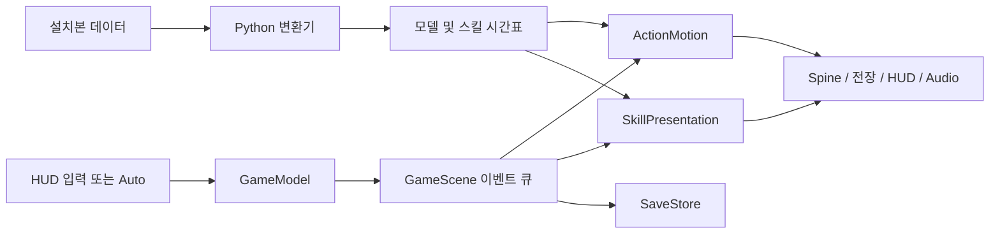
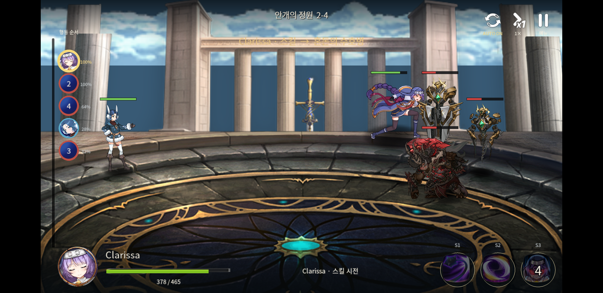
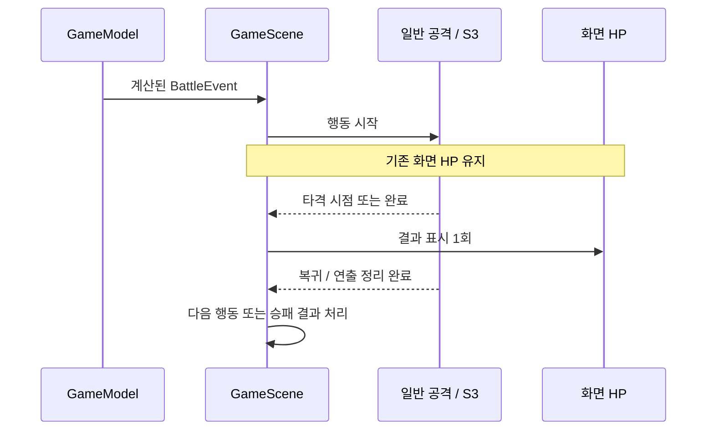
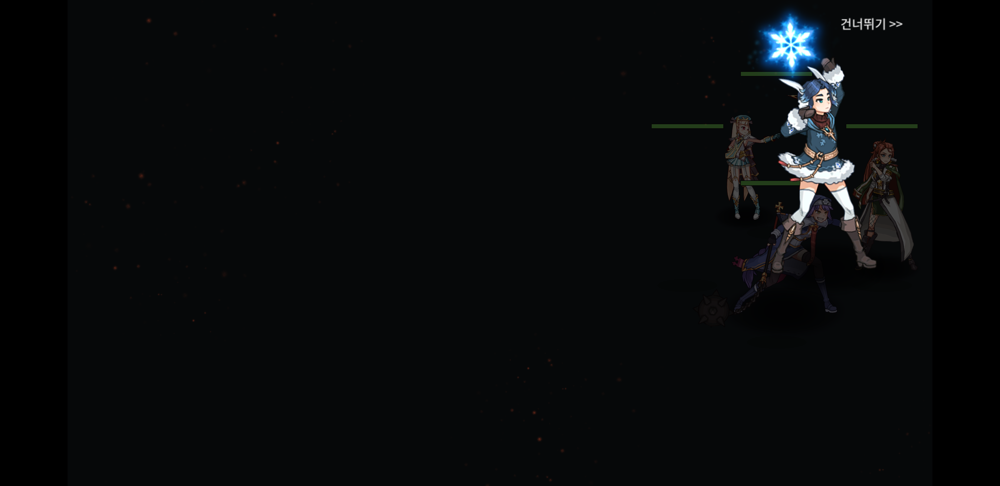

# 기술 사례: 전투 계산과 애니메이션을 일관되게 연결하기

[프로젝트 소개](README.md) · [코드·검증 근거](SOURCE_AND_EVIDENCE.md)

## 1. 요구사항과 구조

방치형 프로젝트를 수동 턴제로 바꾸면서, 입력 대기·일반 공격·S3·적 행동이 서로 겹치지 않게 구성해야 했습니다. 단순히 캐릭터의 공격 클립을 재생하는 것만으로는 접근 이동이나 타격 순간의 HP 표시, 복귀와 승리 처리를 해결할 수 없었습니다.

`GameModel`은 렌더러 의존 없이 턴·대상·쿨타임과 결과를 계산합니다. `GameScene`은 이벤트 큐와 화면 HP를 관리합니다. 일반 행동은 `ActionMotion`, 복합 S3는 `SkillPresentation`이 재생하며, `SkillTimeline`은 컴파일된 cue를 시간순으로 전달합니다.

## 2. 공격은 진행되는데 동작이 충분히 보이지 않는 문제

**증상:** Auto에서 다음 행동으로 너무 빨리 넘어가 평타의 준비·타격·복귀를 읽기 어려웠습니다. 적이 멀리 선 채 결과만 적용되면 공격 대상과 위협도 파악하기 어려웠습니다.

**분석:** 아군·적 8개 리그의 S1/S2 루트에는 전장 전체를 이동시키는 키가 없거나 x/y가 0이었습니다. 클라릿사의 원본 시퀀스는 점프와 MOVE를 공격 클립과 별도로 구성하고 있었습니다. 따라서 클립 재생과 배우의 전장 이동을 분리해야 했습니다. 모든 모델의 `attacked_damage`는 길이가 0이어서 가시적인 피격에는 `attacked`가 적절했습니다.

**구현:** `ActionMotion`에 준비·접근·공격·복귀 시계와 타격 적용 여부를 보관했습니다. 수동과 Auto는 같은 큐를 사용하고, 복귀가 끝나기 전에는 다음 행동을 진행하지 않습니다. 접근 중에는 캐릭터뿐 아니라 그림자·HP바도 함께 이동합니다. 피격 시에는 원본 `attacked` 클립, 색상 변화, 밀림, 화면 흔들림을 연결했습니다.

원본에서 확인한 아카테스 S1 hit 0.2666초, 클라릿사 S1 hit 0.5초 등은 공격 클립 기준으로 사용합니다. hit/fire가 없는 모델의 55% 타격 시점과 일부 적의 근접 분류, 이동 경로·투사체·타격 도형은 프로젝트에서 정한 표현입니다. 클라릿사 S2의 여러 hit 표식은 현재 하나의 게임플레이 결과로 묶어 첫 표식에 표시합니다.

**확인:** 일반/2배속/메뉴 정지의 51개 진단 시점에서 타격 전 화면 HP 유지, 타격 후 모델 HP 일치, 적 접근과 위치 복구를 검사했습니다. Android에서는 31개 행동의 타격·완료 로그와 실제 이동 영상을 확인했습니다.

*기기 모션 검증본: 클라릿사가 적 쪽으로 이동해 공격하는 장면.*

## 3. 전투 결과와 S3 타격 시점의 불일치

**문제:** 전투 결과를 계산하자마자 HUD를 갱신하면 스킬이 적중하기 전에 HP가 줄어듭니다. 연출 중 승리 이벤트를 즉시 처리하면 화면 복구 전에 결과창이 나타날 수 있습니다.

**설계:** 계산된 HP와 `displayedHp`를 분리했습니다. 같은 시전자의 광역 이벤트를 묶고, 타격 cue 또는 완료 시점에 표시 결과를 한 번 반영합니다. FIRE가 없는 원본은 완료 시 표시합니다. 종료·스킵은 미표시 결과를 마무리하고 전장의 위치·크기·가시성을 복구한 뒤 다음 이벤트로 넘어갑니다.

S3 생성 실패와 연출 OFF도 일반 행동 경로로 보내며, 완료 시 남은 S3 효과음 단계를 취소합니다. 2배속이나 지연 프레임에서는 새로 생성된 피격 반응에 해당 프레임 전체 dt를 다시 적용하지 않아 반응이 즉시 끝나는 문제를 방지했습니다.

**확인:** Windows Auto는 복합 S3 4회와 일반 행동 6회 뒤 승리했고 모든 배우가 원위치로 돌아왔습니다. S3 OFF에서도 일반 행동 10회·타격 10회 후 승리했으며 지연 음향은 0개였습니다. 스킵과 메뉴 정지·재개도 별도 시나리오로 검사했습니다.

*Galaxy S8+에서 확인한 도미니엘 S3. 카메라·일부 파티클·원본 음향 이벤트의 정확한 의미는 미검증 항목을 별도로 남겼습니다.*

## 4. Spine 버전 차이로 인한 포즈 오류

**문제:** SCSP 자료를 JSON으로 변환한 뒤 버전 문자열을 맞추는 것만으로는 포즈가 일치하지 않았습니다. scale 기본값과 부모 변환 상속 방식이 달랐습니다.

**해결:** 생략된 scale은 1로 채우되 명시적 0은 보존했습니다. `LegacySpinePose`는 2.1 계열의 스칼라 회전·스케일 상속과 world-axis 반전을 처리합니다. 지원하지 않는 레거시 constraint는 명시적으로 거부해 변환 실패를 추적할 수 있게 했습니다.

추가로 커스텀 Spine 렌더러는 배치의 원래 색을 보관하고 매 draw에서 노드 색·불투명도를 곱하도록 했습니다. 정지된 포즈에도 피격 플래시와 사망 페이드가 보이고, 이전 프레임의 tint가 중복 누적되지 않습니다. premultiplied alpha의 RGB도 함께 처리합니다.

**확인:** scale 기본값 회귀 검사와 레거시 포즈 검사, S3 의존 모델 21개 런타임 검사를 통과했습니다. 이 수치를 갤러리 전체 488세트의 시각적 완전 일치로 확대 해석하지 않습니다.

## 5. Android에서 기존 저장을 보존한 업데이트

**문제:** 3인 방치형 v1 프로필을 4인 턴제 v2로 바꾸면서 기존 골드·진행도·적립금을 보존해야 했습니다. 실제 Android 기기에서는 하드 링크 방식의 백업 발행이 실패했습니다.

**해결:** 백업 성공 전 새 기본값으로 덮어쓰지 않도록 했습니다. Android 백업은 `renameat2(RENAME_NOREPLACE)` 시스템 호출로 발행해 기존 백업을 덮어쓰지 않으며, Android 9에서 사용할 수 없는 API 30 libc wrapper 의존을 피했습니다. 기존 pendingGold는 1회만 합산하고 새 시간 보상은 제거했습니다.

**확인:** 원본 v1 백업을 보존하면서 골드 2,750+적립금 546=3,296을 이전했습니다. 이후 실제 전투 보상 275를 받아 3,571이 되었고, 최종 업데이트·재개 후에도 스테이지 9·최고 클리어 8·승리 15회가 유지됐습니다. 테스트 목적으로 프로필 수치를 편집하지 않았습니다.

## 6. 검증이 설계에 영향을 준 사례

메뉴를 열 때 아직 비동기 로딩 중인 음원은 즉시 pause할 수 없었습니다. 로딩이 끝난 뒤 정지 중인데도 재생되는 상태를 발견해, 정지 상태에서는 뒤늦게 PLAYING이 된 음원도 매 tick 멈추도록 했습니다. 수정 후 Windows 정지 전후 음원 4개의 상태와 재생 위치가 일치했습니다.

검증은 순수 로직, 변환 데이터, 실제 렌더러, 실기기를 나눴습니다. 문서에는 성공한 경로와 미검증 경로를 함께 남깁니다. 예를 들어 최종 Android에서는 사운드 라이브러리 표시와 Home 후 재개를 확인했지만, 개별 샘플 재생은 확인하지 못했습니다. 전투 OpenSL/AudioTrack의 활성 증거와 구분합니다.

## 7. 현재 한계와 다음 개선 순서

| 현재 범위 | 후속 개선 |
|---|---|
| 복합 S3 4개 연결, 나머지 260개 SEQANI 매핑 미완료 | 모델·이펙트 의존 검증을 통과하는 영웅부터 지원 확대 |
| 일부 타격 시점·적 근접 분류는 로컬 추정 | 원본 이벤트와 런타임 관찰 근거가 확보된 값부터 교체 |
| 로컬 피해·AI·스킬 규칙 | 적 행동 패턴과 스테이지별 수치 검증을 별도 설계 |
| 라이브러리 개별 음원 재생 미확인 | 실기기 입력·디코더 상태·재생 완료를 연결해 검사 |
| 전체 참조 자산을 포함한 APK 약 2.39 GiB | 사용 의존성 기준 패키징과 필요 자산 로딩으로 경량화 |
| 시작 시 GL 0x0501 경고 관찰 | ProgramGL 초기화 경로를 분리 조사 |

위 개선 항목은 완료 기능으로 기재하지 않습니다. 원작 런타임과의 픽셀 비교·서버 전투 로직·원본 FMOD 이벤트 그래프도 이번 검증 범위 밖입니다.
